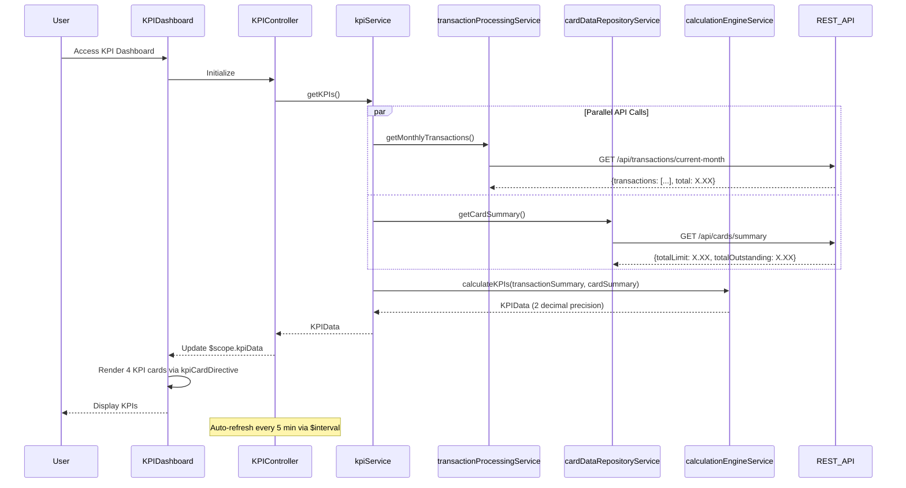

# Low-Level Design: Financial KPIs and Spending Insights
**Epic ID:** QE-7952

## a. Architecture Mapping

- **User Dashboard** → AngularJS Module (`kpiModule`) + Controller (`KPIController`) + View Template (`kpi-dashboard.html`)
- **KPI Service** → AngularJS Service (`kpiService`) for orchestrating KPI data retrieval
- **Transaction Processing Service Integration** → AngularJS Service (`transactionProcessingService`) for transaction data
- **Credit Card Data Repository Integration** → AngularJS Service (`cardDataRepositoryService`) for card limits and balances
- **Analytics Calculation Engine Integration** → AngularJS Service (`calculationEngineService`) for KPI computation
- **KPI Visualization Component** → AngularJS Directive (`kpiCardDirective`) for individual KPI display

**Recommended Folder Structure:**
```
app/
├── modules/kpi/
│   ├── controllers/kpiController.js
│   ├── services/kpiService.js
│   ├── services/calculationEngineService.js
│   ├── views/kpi-dashboard.html
│   ├── directives/kpiCardDirective.js
├── shared/
│   ├── services/transactionProcessingService.js
│   ├── services/cardDataRepositoryService.js
└── assets/css/kpi.css
```

## b. Component Specifications

| Component Name | Artifact Type | Responsibility | Key Dependencies |
|----------------|---------------|----------------|------------------|
| kpiModule | AngularJS Module | Root module for KPI feature, configures routes and auto-refresh | ngRoute, $interval |
| KPIController | Controller | Manages KPI dashboard state, handles auto-refresh, coordinates KPI data retrieval | kpiService, $scope, $interval |
| kpiService | Service | Orchestrates KPI data retrieval from multiple sources, coordinates calculation | transactionProcessingService, cardDataRepositoryService, calculationEngineService, $q |
| transactionProcessingService | Service | Fetches transaction data for KPI calculations via REST API | $http |
| cardDataRepositoryService | Service | Retrieves card limits and balances via REST API | $http |
| calculationEngineService | Service | Computes KPIs with 2 decimal precision (monthly spend, available credit, etc.) | None (client-side calculation) |
| kpiCardDirective | Directive | Reusable component for displaying individual KPI with icon, value, and label | None |
| kpi-dashboard.html | View Template | Displays 4 KPI cards in responsive grid layout | Bootstrap, kpiCardDirective |

## c. Data Model

```javascript
// KPI Data Model
class KPIData {
  monthlySpend: Number,        // Accurate to 2 decimal places
  totalCreditLimit: Number,    // Accurate to 2 decimal places
  availableCredit: Number,     // Accurate to 2 decimal places
  outstandingAmount: Number,   // Accurate to 2 decimal places
  lastUpdated: Date
}

// Transaction Summary Model
class TransactionSummary {
  currentMonthTotal: Number,
  transactionCount: Number
}

// Card Data Summary Model
class CardDataSummary {
  totalLimit: Number,
  totalOutstanding: Number,
  cardCount: Number
}
```

## d. Data Flow

User accesses KPI dashboard → KPIController initializes and calls kpiService.getKPIs() → kpiService makes parallel REST API calls using $q.all() to transactionProcessingService.getMonthlyTransactions() and cardDataRepositoryService.getCardSummary() → Services return TransactionSummary and CardDataSummary → calculationEngineService.calculateKPIs(transactionSummary, cardSummary) computes 4 KPIs with 2 decimal precision: monthlySpend (sum of current month transactions), totalCreditLimit (sum of all card limits), outstandingAmount (sum of all balances), availableCredit (totalCreditLimit - outstandingAmount) → kpiService returns KPIData object → Controller updates $scope.kpiData → kpiCardDirective renders 4 KPI cards in Bootstrap grid → $interval refreshes data every 5 minutes (300000ms) for near real-time updates.

## e. Primary Sequence Diagram



## f. Implementation Notes

- Use Number.toFixed(2) in calculationEngineService for 2 decimal place precision on all KPI calculations
- Implement $q.all() in kpiService to parallelize transactionProcessingService and cardDataRepositoryService API calls for performance
- Use $interval service with 300000ms (5 minutes) delay for auto-refresh; cancel on $scope.$destroy to prevent memory leaks
- Create reusable kpiCardDirective with isolated scope accepting kpi object {label, value, icon, trend} for consistent KPI display
- Apply Bootstrap grid (col-md-3, col-sm-6, col-xs-12) for responsive 4-column KPI card layout

## g. Error Handling

Interceptor-based error handling with $http response interceptors; display Bootstrap alert on API failures with retry option.

## h. Security Notes

Requires token-based auth via existing SSO; all API calls include JWT token in Authorization header managed by auth interceptor.