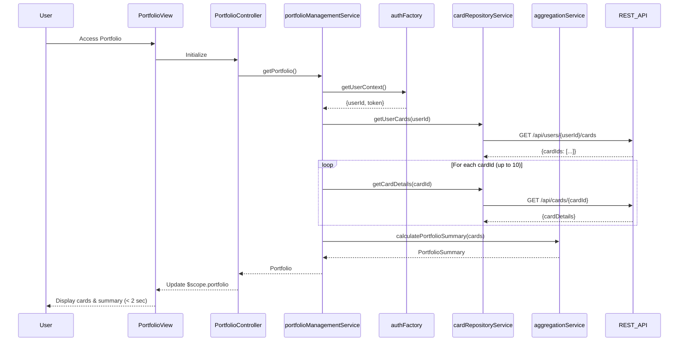

# Low-Level Design: Credit Card Portfolio Management
**Epic ID:** QE-7953

## a. Architecture Mapping

- **User Interface** → AngularJS Module (`portfolioModule`) + Controller (`PortfolioController`) + View Template (`portfolio.html`)
- **Portfolio Management Service** → AngularJS Service (`portfolioManagementService`) for orchestrating portfolio operations
- **User Authentication Service Integration** → AngularJS Factory (`authFactory`) for secure user access
- **Credit Card Data Repository Integration** → AngularJS Service (`cardRepositoryService`) for retrieving card data
- **Aggregation Engine** → AngularJS Service (`aggregationService`) for calculating consolidated metrics

**Recommended Folder Structure:**
```
app/
├── modules/portfolio/
│   ├── controllers/portfolioController.js
│   ├── services/portfolioManagementService.js
│   ├── services/aggregationService.js
│   ├── views/portfolio.html
│   ├── directives/portfolioSummary.directive.js
├── shared/
│   ├── factories/authFactory.js
│   ├── services/cardRepositoryService.js
└── assets/css/portfolio.css
```

## b. Component Specifications

| Component Name | Artifact Type | Responsibility | Key Dependencies |
|----------------|---------------|----------------|------------------|
| portfolioModule | AngularJS Module | Root module for portfolio feature, configures routes | ngRoute |
| PortfolioController | Controller | Manages portfolio view state, handles user interactions, coordinates data retrieval | portfolioManagementService, $scope |
| portfolioManagementService | Service | Orchestrates portfolio data flow, fetches user's card list, coordinates aggregation | authFactory, cardRepositoryService, aggregationService, $q |
| authFactory | Factory | Manages authentication tokens, validates user session, provides user context | $http, $window |
| cardRepositoryService | Service | Retrieves individual card data from repository via REST API | $http |
| aggregationService | Service | Calculates total credit limits, available credit, outstanding amounts across portfolio | None (client-side calculation) |
| portfolioSummary.directive | Directive | Displays consolidated portfolio metrics in summary card | None |
| portfolio.html | View Template | Displays multiple cards and portfolio summary in responsive layout | Bootstrap, portfolioSummary directive |

## c. Data Model

```javascript
// Credit Card Model
class CreditCard {
  cardId: String,
  cardNumber: String,
  cardType: String,
  creditLimit: Number,
  availableCredit: Number,
  outstandingAmount: Number,
  lastUpdated: Date
}

// Portfolio Summary Model
class PortfolioSummary {
  totalCards: Number,
  totalCreditLimit: Number,
  totalAvailableCredit: Number,
  totalOutstandingAmount: Number,
  utilizationRate: Number  // (totalOutstanding / totalLimit) * 100
}

// Portfolio Model
class Portfolio {
  cards: Array<CreditCard>,
  summary: PortfolioSummary
}
```

## d. Data Flow

User authenticates via authFactory → PortfolioController initializes and calls portfolioManagementService.getPortfolio() → portfolioManagementService retrieves user context from authFactory → Service calls cardRepositoryService.getUserCards(userId) to fetch user's credit card list → For each card, cardRepositoryService.getCardDetails(cardId) retrieves individual card data from repository via REST API → aggregationService.calculatePortfolioSummary(cards) computes consolidated metrics: totalCreditLimit (sum of all limits), totalAvailableCredit (sum of available credit), totalOutstandingAmount (sum of outstanding), utilizationRate ((totalOutstanding / totalLimit) * 100) → portfolioManagementService returns Portfolio object → Controller updates $scope.portfolio → View renders card list and portfolio summary in responsive Bootstrap grid within 2 seconds.

## e. Primary Sequence Diagram



## f. Implementation Notes

- Use $q.all() in portfolioManagementService to parallelize multiple cardRepositoryService.getCardDetails() API calls for performance optimization
- Implement client-side aggregation in aggregationService using ES6 Array.reduce() for summing credit limits, available credit, and outstanding amounts
- Apply ng-repeat with track by cardId for efficient rendering of card list supporting up to 10 cards
- Use Bootstrap responsive grid (col-lg-3, col-md-4, col-sm-6, col-xs-12) for card display across desktop, tablet, and mobile
- Create portfolioSummary.directive with isolated scope for reusable summary card component displaying consolidated metrics

## g. Error Handling

HTTP interceptor-based error handling with $http response interceptors; display Bootstrap alert modals on API failures with retry option.

## h. Security Notes

Requires token-based authentication via existing SSO; authFactory manages JWT tokens with automatic injection in API request headers.