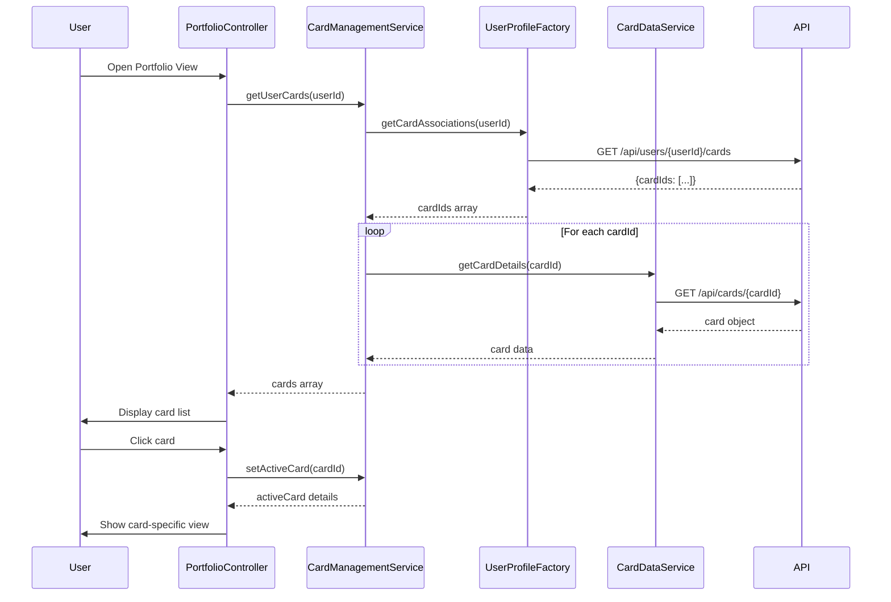

# Low-Level Design: Credit Card Portfolio Management
**Epic ID:** QE-7966  
**Application Stack:** AngularJS 1.x, JavaScript ES6, HTML5, CSS3, Bootstrap, REST APIs, MVC Architecture

---

## a. Architecture Mapping

| HLD Component | AngularJS Artifact | Responsibility |
|---------------|-------------------|----------------|
| User Interface - Card Portfolio View | Module: `creditCard.portfolio`, Controller: `PortfolioController`, Directive: `cardListView` | Render card list, handle card selection UI |
| Card Management Service | Service: `CardManagementService` | Orchestrate card data retrieval and state management |
| User Profile Service | Factory: `UserProfileFactory` | Fetch user-card associations via REST API |
| Credit Card Data Repository | Service: `CardDataService` | CRUD operations for card data via REST endpoints |
| Card Issuer Data Feeds | Service: `CardIssuerService` | Sync card details from external feeds |

**Recommended Folder Structure:**
```
app/
├── modules/
│   └── creditCard/
│       ├── portfolio/
│       │   ├── portfolio.module.js
│       │   ├── portfolio.controller.js
│       │   ├── portfolio.html
│       │   └── directives/
│       │       └── card-list-view.directive.js
│       └── services/
│           ├── card-management.service.js
│           ├── card-data.service.js
│           └── card-issuer.service.js
├── shared/
│   └── factories/
│       └── user-profile.factory.js
└── assets/css/portfolio.css
```

---

## b. Component Specifications

| Component Name | Artifact Type | Responsibility | Key Dependencies |
|----------------|---------------|----------------|------------------|
| `creditCard.portfolio` | Module | Root module for portfolio feature | `ngRoute`, `ui.bootstrap` |
| `PortfolioController` | Controller | Manage card list state, handle card selection events | `CardManagementService`, `$scope` |
| `cardListView` | Directive | Render individual card tiles with details | `CardDataService` |
| `CardManagementService` | Service | Aggregate card data, manage active card state, coordinate services | `CardDataService`, `UserProfileFactory`, `$q` |
| `CardDataService` | Service | REST API calls for card CRUD operations | `$http`, `API_ENDPOINTS` |
| `UserProfileFactory` | Factory | Retrieve user-card associations | `$http`, `$cacheFactory` |
| `CardIssuerService` | Service | Sync card details from issuer feeds | `$http`, `$interval` |

---

## c. Data Model

**CreditCard Object:**
```javascript
{
  cardId: String,              // Unique card identifier
  cardNumber: String,          // Masked card number (e.g., "****1234")
  cardType: String,            // "Visa", "Mastercard", "Amex"
  cardHolderName: String,      // Name on card
  creditLimit: Number,         // Total credit limit
  availableCredit: Number,     // Available credit balance
  outstandingAmount: Number,   // Current outstanding balance
  expiryDate: String,          // "MM/YY" format
  isActive: Boolean,           // Card active status
  issuerName: String           // Bank/issuer name
}
```

**UserCardAssociation Object:**
```javascript
{
  userId: String,
  cardIds: Array<String>       // List of associated card IDs
}
```

---

## d. Data Flow

User opens the portfolio view → `PortfolioController` initializes and calls `CardManagementService.getUserCards()` → Service fetches user-card associations via `UserProfileFactory` REST call → For each cardId, `CardDataService` retrieves card details from `/api/cards/{cardId}` endpoint → Aggregated card data is bound to `$scope.cards` → `cardListView` directive renders each card tile with credit limit, available balance, and outstanding amount → User clicks a card → Controller updates `$scope.activeCard` and triggers card-specific spend analysis view with sub-500ms response via cached data.

---

## e. Primary Sequence Diagram



---

## f. Implementation Notes

- Use AngularJS Dependency Injection for all services, factories, and controllers to ensure testability and modularity.
- Implement client-side caching via `$cacheFactory` in `UserProfileFactory` to optimize repeated card association lookups.
- Use `$q.all()` in `CardManagementService` to parallelize multiple card detail API calls and meet sub-500ms switching requirement.
- Apply ES6 arrow functions and `const`/`let` for cleaner service implementations; transpile via Babel if needed.
- Secure card data transmission using HTTPS; mask sensitive card numbers in UI using AngularJS filters (e.g., `| cardMask`).

---

## g. Error Handling

Use HTTP interceptor to catch API errors globally; display user-friendly notifications via Bootstrap modals or toast messages on card load failures.

---

## h. Security Notes

Requires token-based authentication via existing SSO; encrypt sensitive card details at rest and in transit; apply input validation on card data fields.