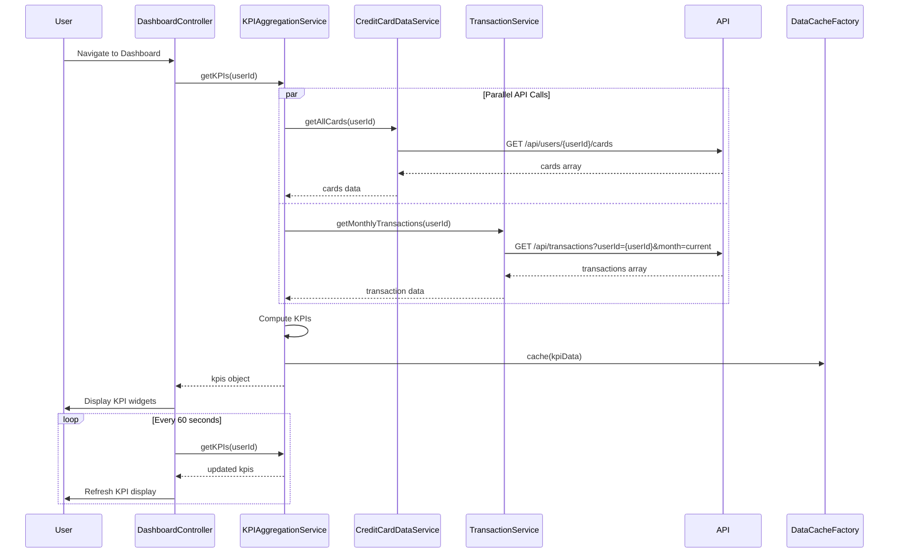

# Low-Level Design: Dashboard and KPI Management
**Epic ID:** QE-7967  
**Application Stack:** AngularJS 1.x, JavaScript ES6, HTML5, CSS3, Bootstrap, REST APIs, MVC Architecture

---

## a. Architecture Mapping

| HLD Component | AngularJS Artifact | Responsibility |
|---------------|-------------------|----------------|
| User Interface - Dashboard | Module: `dashboard`, Controller: `DashboardController`, View: `dashboard.html` | Render KPI widgets and handle user interactions |
| KPI Aggregation Service | Service: `KPIAggregationService` | Aggregate and compute KPI metrics from multiple data sources |
| Credit Card Data Service | Service: `CreditCardDataService` | Fetch credit card details via REST API |
| Transaction Processing Service | Service: `TransactionService` | Retrieve and process transaction data for spend calculations |
| User Authentication Service | Service: `AuthService` | Validate user session and manage authentication state |
| Data Store | Factory: `DataCacheFactory` | Client-side caching layer for KPI data |

**Recommended Folder Structure:**
```
app/
├── modules/
│   └── dashboard/
│       ├── dashboard.module.js
│       ├── dashboard.controller.js
│       ├── dashboard.html
│       └── services/
│           ├── kpi-aggregation.service.js
│           ├── credit-card-data.service.js
│           └── transaction.service.js
├── shared/
│   ├── services/
│   │   └── auth.service.js
│   └── factories/
│       └── data-cache.factory.js
└── assets/css/dashboard.css
```

---

## b. Component Specifications

| Component Name | Artifact Type | Responsibility | Key Dependencies |
|----------------|---------------|----------------|------------------|
| `dashboard` | Module | Root module for dashboard feature | `ngRoute`, `ui.bootstrap` |
| `DashboardController` | Controller | Manage dashboard state, bind KPI data to view, handle refresh actions | `KPIAggregationService`, `$scope`, `$interval` |
| `KPIAggregationService` | Service | Compute monthly spend, total credit limit, available credit, outstanding amount | `CreditCardDataService`, `TransactionService`, `$q` |
| `CreditCardDataService` | Service | REST API calls to fetch credit card data | `$http`, `API_ENDPOINTS` |
| `TransactionService` | Service | REST API calls to fetch transaction data for spend calculations | `$http`, `DataCacheFactory` |
| `AuthService` | Service | Manage user authentication and session validation | `$http`, `$window` |
| `DataCacheFactory` | Factory | Cache KPI data to meet 2-second load time requirement | `$cacheFactory` |

---

## c. Data Model

**DashboardKPI Object:**
```javascript
{
  monthlySpend: Number,         // Total spend for current month
  totalCreditLimit: Number,     // Sum of credit limits across all cards
  availableCredit: Number,      // Sum of available credit across all cards
  outstandingAmount: Number,    // Total outstanding balance across all cards
  lastUpdated: Date             // Timestamp of last data refresh
}
```

**CreditCardSummary Object:**
```javascript
{
  cardId: String,
  creditLimit: Number,
  availableCredit: Number,
  outstandingAmount: Number
}
```

**TransactionSummary Object:**
```javascript
{
  userId: String,
  currentMonthSpend: Number,
  transactionCount: Number
}
```

---

## d. Data Flow

User navigates to dashboard → `AuthService` validates session → `DashboardController` initializes and calls `KPIAggregationService.getKPIs()` → Service makes parallel REST calls via `CreditCardDataService.getAllCards()` and `TransactionService.getMonthlyTransactions()` using `$q.all()` → Card data aggregates total credit limit, available credit, and outstanding amounts → Transaction data computes monthly spend → Aggregated KPIs are cached via `DataCacheFactory` and returned to controller → Controller binds data to `$scope.kpis` → View renders KPI widgets using Bootstrap grid → `$interval` triggers refresh every 60 seconds to update KPIs in real-time.

---

## e. Primary Sequence Diagram



---

## f. Implementation Notes

- Use AngularJS `$q.all()` to parallelize credit card and transaction API calls, reducing total load time to meet 2-second NFR.
- Implement `$cacheFactory` in `DataCacheFactory` with TTL of 60 seconds to serve cached KPIs on subsequent loads.
- Apply Bootstrap responsive grid (col-xs, col-sm, col-md, col-lg) for KPI widgets to ensure mobile and desktop compatibility.
- Use `$interval` service for periodic KPI refresh; ensure proper cleanup on `$scope.$on('$destroy')` to prevent memory leaks.
- Apply ES6 template literals and arrow functions in services for cleaner async handling; use Babel transpilation if targeting older browsers.

---

## g. Error Handling

HTTP interceptor captures API failures; display user-friendly error messages via Bootstrap alerts; retry failed requests up to 2 times with exponential backoff.

---

## h. Security Notes

Requires token-based auth via existing SSO; validate session on dashboard load; secure API endpoints with HTTPS and CORS policies.