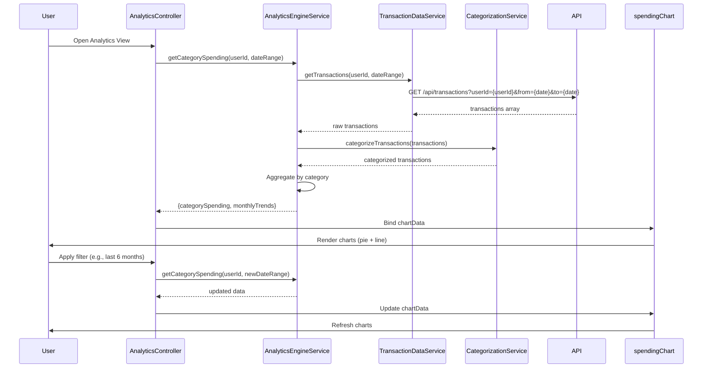

# Low-Level Design: Spending Analytics and Insights
**Epic ID:** QE-7968  
**Application Stack:** AngularJS 1.x, JavaScript ES6, HTML5, CSS3, Bootstrap, REST APIs, MVC Architecture

---

## a. Architecture Mapping

| HLD Component | AngularJS Artifact | Responsibility |
|---------------|-------------------|----------------|
| User Interface - Analytics Dashboard | Module: `analytics`, Controller: `AnalyticsController`, View: `analytics.html` | Render charts and handle user interactions for filtering |
| Analytics Engine | Service: `AnalyticsEngineService` | Compute category-wise spending and monthly trends |
| Transaction Data Service | Service: `TransactionDataService` | Fetch raw transaction data via REST API |
| Categorization Engine | Service: `CategorizationService` | Classify transactions into predefined categories |
| Data Visualization Library | Directive: `spendingChart` (wrapping Chart.js or D3.js) | Render interactive charts and graphs |
| Transaction Data Store | Factory: `TransactionCacheFactory` | Cache transaction data for performance |

**Recommended Folder Structure:**
```
app/
├── modules/
│   └── analytics/
│       ├── analytics.module.js
│       ├── analytics.controller.js
│       ├── analytics.html
│       ├── directives/
│       │   └── spending-chart.directive.js
│       └── services/
│           ├── analytics-engine.service.js
│           ├── transaction-data.service.js
│           └── categorization.service.js
├── shared/
│   └── factories/
│       └── transaction-cache.factory.js
└── assets/
    ├── css/analytics.css
    └── libs/chart.min.js
```

---

## b. Component Specifications

| Component Name | Artifact Type | Responsibility | Key Dependencies |
|----------------|---------------|----------------|------------------|
| `analytics` | Module | Root module for analytics feature | `ngRoute`, `ui.bootstrap`, `chart.js` |
| `AnalyticsController` | Controller | Manage analytics state, bind chart data to view, handle filter actions | `AnalyticsEngineService`, `$scope`, `$filter` |
| `spendingChart` | Directive | Render category-wise and trend charts using Chart.js | `Chart.js`, `$timeout` |
| `AnalyticsEngineService` | Service | Aggregate spending by category, compute monthly trends | `TransactionDataService`, `CategorizationService`, `$q` |
| `TransactionDataService` | Service | REST API calls to fetch transaction data (up to 12 months) | `$http`, `API_ENDPOINTS` |
| `CategorizationService` | Service | Map transactions to categories using rule-based logic | None |
| `TransactionCacheFactory` | Factory | Cache transaction data to optimize repeated queries | `$cacheFactory` |

---

## c. Data Model

**Transaction Object:**
```javascript
{
  transactionId: String,
  userId: String,
  cardId: String,
  amount: Number,
  merchantName: String,
  category: String,            // "Food & Dining", "Fuel", "Shopping", etc.
  transactionDate: Date,
  description: String
}
```

**CategorySpending Object:**
```javascript
{
  category: String,            // One of 9 predefined categories
  totalSpend: Number,
  transactionCount: Number,
  percentage: Number           // % of total monthly spend
}
```

**MonthlyTrend Object:**
```javascript
{
  month: String,               // "YYYY-MM" format
  totalSpend: Number,
  categoryBreakdown: Array<CategorySpending>
}
```

---

## d. Data Flow

User navigates to analytics view → `AnalyticsController` initializes and calls `AnalyticsEngineService.getCategorySpending(userId)` → Service fetches transactions via `TransactionDataService.getTransactions(userId, dateRange)` REST call → Raw transactions are passed to `CategorizationService.categorizeTransactions()` which applies rule-based mapping (merchant keywords, MCC codes) → Categorized data is aggregated by category to compute total spend and percentages → `AnalyticsEngineService` returns `CategorySpending[]` and `MonthlyTrend[]` → Controller binds data to `$scope.chartData` → `spendingChart` directive renders pie chart for category breakdown and line chart for monthly trends using Chart.js → User applies filter (e.g., date range) → Controller re-invokes service with updated parameters and refreshes charts.

---

## e. Primary Sequence Diagram



---

## f. Implementation Notes

- Use Chart.js library wrapped in AngularJS directive (`spendingChart`) for responsive, interactive visualizations; ensure chart updates via `$watch` on data changes.
- Implement `CategorizationService` with rule-based mapping using merchant name keywords and MCC (Merchant Category Code) lookup tables.
- Apply `$cacheFactory` in `TransactionCacheFactory` to cache transaction data for 12 months with TTL of 5 minutes to meet 1.5-second chart rendering NFR.
- Use AngularJS `$filter` service for client-side date range filtering to avoid redundant API calls when user changes filters.
- Leverage ES6 `Array.reduce()` and `Map` for efficient category aggregation in `AnalyticsEngineService`.

---

## g. Error Handling

HTTP interceptor handles API errors; display user-friendly messages via Bootstrap alerts; fallback to cached data if API call fails.

---

## h. Security Notes

Requires token-based auth via existing SSO; validate user ownership of transactions server-side; apply HTTPS for all API calls.