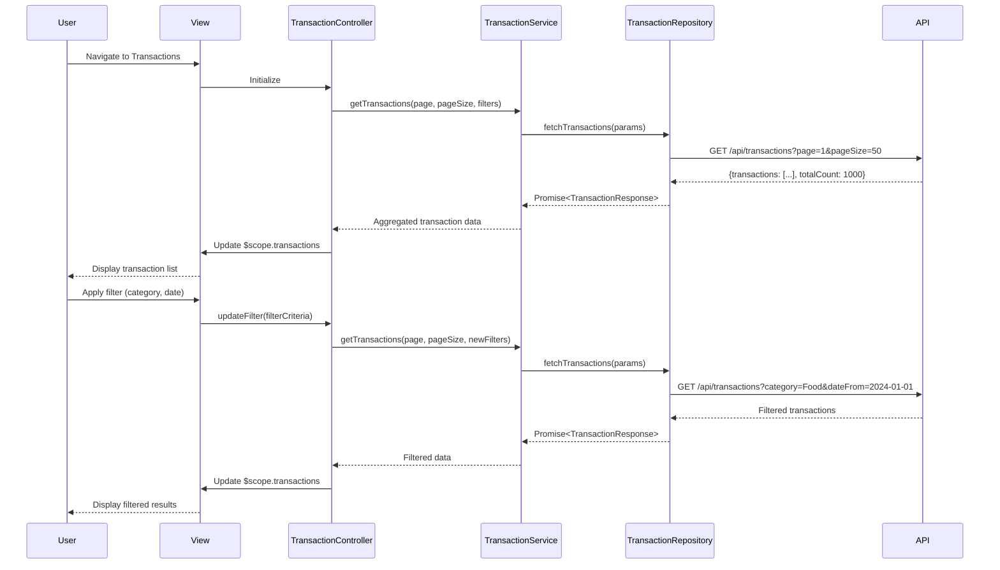

# Low-Level Design: Transaction Management and Viewing
**Epic ID:** QE-7987  
**Application Stack:** AngularJS 1.x, JavaScript ES6, HTML5, CSS3, Bootstrap, REST APIs, MVC Architecture

---

## a. Architecture Mapping

**Component to Artifact Mapping:**
- User Interface → View Template (`transaction-list.html`, `transaction-detail.html`) + Directives (`transactionCard`, `transactionFilter`)
- Transaction Controller → AngularJS Controller (`TransactionController`)
- Transaction Service → AngularJS Service (`TransactionService`)
- Transaction Repository → AngularJS Factory (`TransactionRepository`)
- Filter and Search Engine → AngularJS Filter (`transactionFilter`) + Service (`SearchService`)

**Recommended Folder Structure:**
```
app/
├── modules/
│   └── transactions/
│       ├── controllers/
│       │   └── transaction.controller.js
│       ├── services/
│       │   ├── transaction.service.js
│       │   └── search.service.js
│       ├── factories/
│       │   └── transaction.repository.js
│       ├── directives/
│       │   ├── transaction-card.directive.js
│       │   └── transaction-filter.directive.js
│       ├── filters/
│       │   └── transaction.filter.js
│       ├── views/
│       │   ├── transaction-list.html
│       │   └── transaction-detail.html
│       └── transactions.module.js
```

---

## b. Component Specifications

| Component Name | Artifact Type | Responsibility | Key Dependencies |
|---|---|---|---|
| `transactions.module` | Module | Registers all transaction-related components and configures routing | `ngRoute`, `ui.bootstrap` |
| `TransactionController` | Controller | Manages transaction list/detail view state, handles user interactions, coordinates filtering/sorting | `TransactionService`, `SearchService`, `$scope`, `$routeParams` |
| `TransactionService` | Service | Orchestrates transaction data retrieval, pagination, aggregation across cards | `TransactionRepository`, `$q` |
| `TransactionRepository` | Factory | Executes REST API calls to fetch transaction data with pagination | `$http`, `API_CONFIG` |
| `SearchService` | Service | Implements client-side search and filter logic for transactions | None |
| `transactionFilter` | Filter | Formats transaction data for display (date, currency, status) | `$filter` |
| `transactionCard` | Directive | Renders individual transaction item with details and actions | None |
| `transactionFilterDirective` | Directive | Provides UI controls for filtering and sorting transactions | `SearchService` |

---

## c. Data Model

**Transaction Model (`Transaction`):**
```javascript
{
  id: String,                    // Unique transaction identifier
  cardId: String,                // Associated credit card ID
  cardLast4: String,             // Last 4 digits of card for display
  date: Date,                    // Transaction date
  merchant: String,              // Merchant name
  amount: Number,                // Transaction amount (positive for charges)
  category: String,              // Spending category (Food & Dining, Fuel, etc.)
  status: String,                // Transaction status (Posted, Pending, Declined)
  description: String            // Additional transaction details
}
```

**Pagination Model (`PaginationParams`):**
```javascript
{
  page: Number,                  // Current page number (1-indexed)
  pageSize: Number,              // Items per page (default: 50)
  totalCount: Number,            // Total transaction count
  hasMore: Boolean               // Indicates if more pages exist
}
```

**Filter Model (`TransactionFilter`):**
```javascript
{
  cardIds: Array<String>,        // Selected card IDs
  categories: Array<String>,     // Selected categories
  dateFrom: Date,                // Start date filter
  dateTo: Date,                  // End date filter
  searchText: String,            // Merchant search text
  sortBy: String,                // Sort field (date, amount, merchant)
  sortOrder: String              // Sort direction (asc, desc)
}
```

---

## d. Data Flow

User navigates to transaction list view → `TransactionController` initializes and calls `TransactionService.getTransactions()` with pagination params → `TransactionService` delegates to `TransactionRepository` which executes GET `/api/transactions?page=1&pageSize=50` → API returns paginated transaction array with metadata → `TransactionRepository` wraps response in promise and returns to service → `TransactionService` aggregates data if multiple cards selected and returns to controller → Controller updates `$scope.transactions` → View renders transaction list using `transactionCard` directive and applies `transactionFilter` for formatting → User applies filters via `transactionFilterDirective` → `SearchService` processes filter criteria client-side and controller updates displayed results → User clicks transaction → Controller navigates to detail view passing transaction ID → Detail view fetches and displays full transaction information.

---

## e. Primary Sequence Diagram



---

## f. Implementation Notes

- Use AngularJS dependency injection to inject `TransactionService` and `SearchService` into `TransactionController` for testability and modularity.
- Implement pagination using `$http` interceptor to handle API response metadata (totalCount, hasMore) and update controller state accordingly.
- Leverage ES6 classes for service definitions with constructor injection pattern; use arrow functions for promise chaining to maintain lexical `this` context.
- Apply Bootstrap responsive grid (`col-xs-*`, `col-md-*`) for transaction card layout to ensure mobile/tablet/desktop compatibility.
- Use `$filter` service for date and currency formatting; create custom `transactionFilter` for status badge styling and category icons.

---

## g. Error Handling

HTTP interceptor captures API errors (4xx/5xx), logs to console, and displays user-friendly notification using Bootstrap alert component; controller-level try/catch wraps service calls with fallback to cached data if available.

---

## h. Security Notes

Standard input validation and secure API calls assumed; transaction data transmitted over HTTPS with existing session-based authentication.

---

**End of LLD Document**