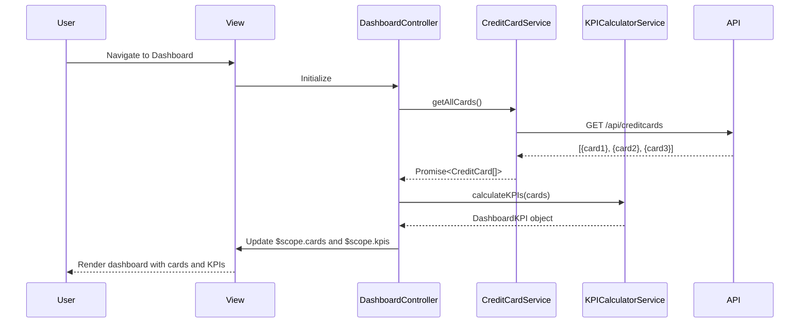

# Low-Level Design: Credit Card Management and Dashboard KPIs
**Epic ID:** QE-7988  
**Application Stack:** AngularJS 1.x, JavaScript ES6, HTML5, CSS3, Bootstrap, REST APIs, MVC Architecture

---

## a. Architecture Mapping

**Component to Artifact Mapping:**
- User Interface → View Template (`dashboard.html`) + Directives (`creditCardWidget`, `kpiCard`)
- Dashboard Controller → AngularJS Controller (`DashboardController`)
- Credit Card Service → AngularJS Service (`CreditCardService`)
- Data Source API → REST API endpoints consumed via `$http`
- KPI Calculator → AngularJS Service (`KPICalculatorService`)

**Recommended Folder Structure:**
```
app/
├── modules/
│   └── dashboard/
│       ├── controllers/
│       │   └── dashboard.controller.js
│       ├── services/
│       │   ├── credit-card.service.js
│       │   └── kpi-calculator.service.js
│       ├── directives/
│       │   ├── credit-card-widget.directive.js
│       │   └── kpi-card.directive.js
│       ├── views/
│       │   └── dashboard.html
│       └── dashboard.module.js
```

---

## b. Component Specifications

| Component Name | Artifact Type | Responsibility | Key Dependencies |
|---|---|---|---|
| `dashboard.module` | Module | Registers dashboard components and configures routing | `ngRoute`, `ui.bootstrap` |
| `DashboardController` | Controller | Manages dashboard state, loads credit card data, coordinates KPI display | `CreditCardService`, `KPICalculatorService`, `$scope` |
| `CreditCardService` | Service | Fetches credit card data from API, caches results, handles multi-card aggregation | `$http`, `$q`, `API_CONFIG` |
| `KPICalculatorService` | Service | Computes KPI metrics (monthly spend, available credit, outstanding amount) from card data | None |
| `creditCardWidget` | Directive | Renders individual credit card summary with key details and visual indicators | None |
| `kpiCard` | Directive | Displays single KPI metric with value, label, and trend indicator | None |

---

## c. Data Model

**CreditCard Model (`CreditCard`):**
```javascript
{
  id: String,                    // Unique card identifier
  cardNumber: String,            // Masked card number (e.g., "**** **** **** 1234")
  cardType: String,              // Card type (Visa, Mastercard, Amex)
  cardHolderName: String,        // Cardholder name
  creditLimit: Number,           // Total credit limit
  availableCredit: Number,       // Available credit amount
  outstandingAmount: Number,     // Current outstanding balance
  monthlySpend: Number,          // Current month's total spend
  dueDate: Date,                 // Next payment due date
  minPaymentDue: Number,         // Minimum payment amount
  status: String                 // Card status (Active, Blocked, Expired)
}
```

**DashboardKPI Model (`DashboardKPI`):**
```javascript
{
  totalMonthlySpend: Number,     // Sum of monthly spend across all cards
  totalCreditLimit: Number,      // Sum of credit limits across all cards
  totalAvailableCredit: Number,  // Sum of available credit across all cards
  totalOutstanding: Number,      // Sum of outstanding amounts across all cards
  creditUtilization: Number      // Percentage of credit used (outstanding/limit * 100)
}
```

---

## d. Data Flow

User navigates to dashboard → `DashboardController` initializes and calls `CreditCardService.getAllCards()` → Service executes GET `/api/creditcards` via `$http` → API returns array of credit card objects with balances and limits → Service caches response and returns promise to controller → Controller passes card array to `KPICalculatorService.calculateKPIs()` → Calculator aggregates monthly spend, credit limits, available credit, and outstanding amounts across all cards → Calculator returns `DashboardKPI` object → Controller updates `$scope.cards` and `$scope.kpis` → View renders credit card widgets using `creditCardWidget` directive and KPI cards using `kpiCard` directive → Bootstrap responsive grid ensures proper layout on mobile/tablet/desktop → User sees consolidated dashboard with all cards and KPIs within 2 seconds.

---

## e. Primary Sequence Diagram



---

## f. Implementation Notes

- Use AngularJS dependency injection to inject `CreditCardService` and `KPICalculatorService` into `DashboardController` for clean separation of concerns.
- Implement `CreditCardService` with ES6 class syntax and promise-based API calls using `$http`; cache results in service instance variable with TTL for 5 minutes.
- Apply Bootstrap grid system (`container-fluid`, `row`, `col-md-4`, `col-sm-6`, `col-xs-12`) for responsive card layout across devices.
- Use `ng-repeat` with `track by card.id` for efficient rendering of credit card widgets; leverage one-time binding (`::`) for static card properties.
- Implement WCAG 2.1 accessibility with proper ARIA labels on KPI cards, semantic HTML5 elements, and keyboard navigation support in directives.

---

## g. Error Handling

HTTP interceptor-based error handling with try/catch in controller; API failures display user-friendly error message via Bootstrap alert and log to console.

---

## h. Security Notes

Requires token-based auth via existing SSO; card numbers transmitted masked from API; HTTPS enforced for all API calls.

---

**End of LLD Document**