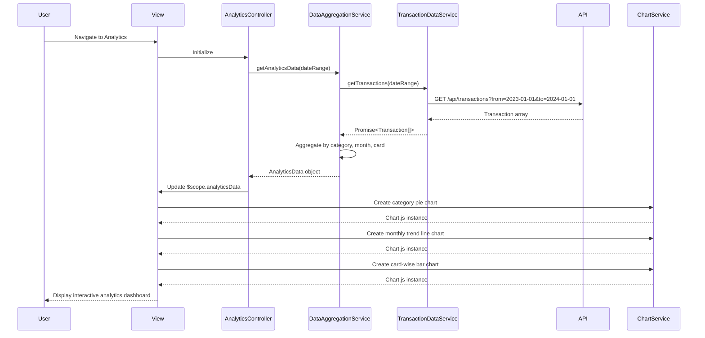

# Low-Level Design: Spending Analytics and Insights
**Epic ID:** QE-7989  
**Application Stack:** AngularJS 1.x, JavaScript ES6, HTML5, CSS3, Bootstrap, REST APIs, MVC Architecture

---

## a. Architecture Mapping

**Component to Artifact Mapping:**
- User Interface → View Template (`analytics.html`) + Directives (`categoryChart`, `trendChart`, `cardSpendWidget`)
- Analytics Controller → AngularJS Controller (`AnalyticsController`)
- Data Aggregation Service → AngularJS Service (`DataAggregationService`)
- Transaction Data Service → AngularJS Service (`TransactionDataService`)
- Visualization Engine → AngularJS Service (`ChartService`) wrapping Chart.js library

**Recommended Folder Structure:**
```
app/
├── modules/
│   └── analytics/
│       ├── controllers/
│       │   └── analytics.controller.js
│       ├── services/
│       │   ├── data-aggregation.service.js
│       │   ├── transaction-data.service.js
│       │   └── chart.service.js
│       ├── directives/
│       │   ├── category-chart.directive.js
│       │   ├── trend-chart.directive.js
│       │   └── card-spend-widget.directive.js
│       ├── views/
│       │   └── analytics.html
│       └── analytics.module.js
```

---

## b. Component Specifications

| Component Name | Artifact Type | Responsibility | Key Dependencies |
|---|---|---|---|
| `analytics.module` | Module | Registers analytics components, configures routing, imports Chart.js | `ngRoute`, `chart.js`, `ui.bootstrap` |
| `AnalyticsController` | Controller | Manages analytics view state, coordinates data loading, handles user interactions for time period selection | `DataAggregationService`, `ChartService`, `$scope`, `$filter` |
| `DataAggregationService` | Service | Aggregates transaction data by category, month, and card; implements category mapping logic | `TransactionDataService`, `$q` |
| `TransactionDataService` | Service | Fetches raw transaction data from API with date range filters | `$http`, `API_CONFIG` |
| `ChartService` | Service | Wraps Chart.js library, provides factory methods for creating pie/bar/line charts with accessibility features | `Chart.js` |
| `categoryChart` | Directive | Renders interactive pie/donut chart for category-wise spending breakdown | `ChartService` |
| `trendChart` | Directive | Renders line chart showing monthly spend trends over time | `ChartService` |
| `cardSpendWidget` | Directive | Displays card-wise spending summary with horizontal bar chart | `ChartService` |

---

## c. Data Model

**CategorySpend Model (`CategorySpend`):**
```javascript
{
  category: String,              // Category name (Food & Dining, Fuel, etc.)
  amount: Number,                // Total spend in category
  percentage: Number,            // Percentage of total spend
  transactionCount: Number,      // Number of transactions in category
  color: String                  // Chart color code for category
}
```

**MonthlyTrend Model (`MonthlyTrend`):**
```javascript
{
  month: String,                 // Month label (e.g., "Jan 2024")
  totalSpend: Number,            // Total spend for the month
  categoryBreakdown: Array<CategorySpend>  // Category-wise spend for the month
}
```

**CardSpend Model (`CardSpend`):**
```javascript
{
  cardId: String,                // Card identifier
  cardLast4: String,             // Last 4 digits for display
  totalSpend: Number,            // Total spend on card
  percentage: Number,            // Percentage of total spend across all cards
  categoryBreakdown: Array<CategorySpend>  // Category-wise spend for card
}
```

**AnalyticsData Model (`AnalyticsData`):**
```javascript
{
  categorySpends: Array<CategorySpend>,      // Overall category spending
  monthlyTrends: Array<MonthlyTrend>,        // Monthly trend data (12 months)
  cardSpends: Array<CardSpend>,              // Card-wise spending
  dateRange: { from: Date, to: Date },       // Analysis period
  totalSpend: Number                         // Total spend in period
}
```

---

## d. Data Flow

User navigates to analytics view → `AnalyticsController` initializes and calls `DataAggregationService.getAnalyticsData(dateRange)` with default 12-month range → `DataAggregationService` calls `TransactionDataService.getTransactions(dateRange)` → Service executes GET `/api/transactions?from=2023-01-01&to=2024-01-01` → API returns transaction array → `DataAggregationService` processes transactions, groups by category using predefined mapping (Food & Dining, Fuel, Shopping, Travel, Entertainment, Utilities, Healthcare, Education, Miscellaneous), calculates monthly aggregates, and computes card-wise breakdowns → Service returns `AnalyticsData` object to controller → Controller updates `$scope.analyticsData` → View renders three chart directives: `categoryChart` for pie chart, `trendChart` for line chart, and `cardSpendWidget` for bar chart → Each directive calls `ChartService` to create Chart.js instance with data and accessibility config → Charts render within 2 seconds with interactive tooltips and responsive sizing → User hovers over chart elements to see detailed breakdowns.

---

## e. Primary Sequence Diagram



---

## f. Implementation Notes

- Use AngularJS dependency injection to inject `DataAggregationService` and `ChartService` into `AnalyticsController` and chart directives.
- Implement `DataAggregationService` with ES6 Map/Reduce patterns for efficient transaction grouping and aggregation; cache aggregated results for 10 minutes.
- Integrate Chart.js via `ChartService` wrapper that provides consistent configuration (responsive: true, maintainAspectRatio: false, accessibility plugin enabled).
- Apply Bootstrap responsive grid for chart layout (`col-md-6`, `col-sm-12`) and use CSS media queries to adjust chart height on mobile devices.
- Implement category color mapping as constant in `DataAggregationService` to ensure consistent colors across all charts; use WCAG AA compliant color palette.

---

## g. Error Handling

HTTP interceptor captures API errors and displays user notification; controller-level try/catch with fallback to empty state message if no transaction data available.

---

## h. Security Notes

Standard input validation and secure API calls assumed; transaction data access controlled by existing authentication layer.

---

**End of LLD Document**