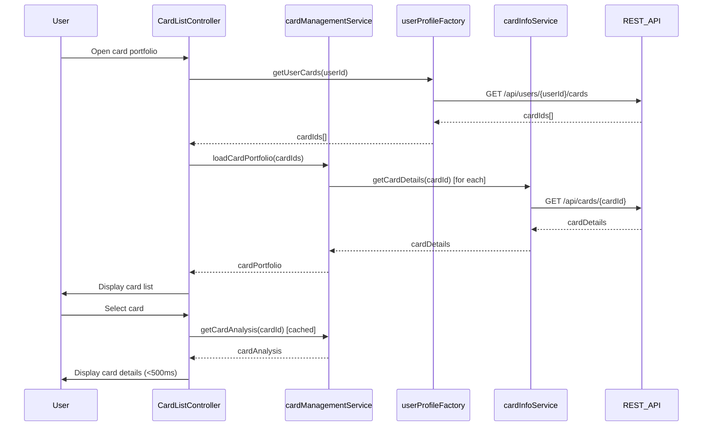

# Low-Level Design: QE-8026 - Multiple Credit Card Management

## a. Architecture Mapping

- **User Interface** → AngularJS Module (`creditCardModule`) + Controller (`CardListController`, `CardDetailController`)
- **Card Management Service** → AngularJS Service (`cardManagementService`)
- **User Profile Service** → AngularJS Factory (`userProfileFactory`)
- **Card Information Service** → AngularJS Service (`cardInfoService`)
- **Data Aggregation Engine** → AngularJS Service (`cardAggregationService`)
- **Credit Card Data Repository** → REST API endpoints

**Folder Structure:**
```
/app
  /modules
    /card-management
      /controllers
      /services
      /views
      /directives
  /shared
    /factories
    /interceptors
```

## b. Component Specifications

| Name | Artifact Type | Responsibility | Key Dependencies |
|------|---------------|----------------|------------------|
| creditCardModule | Module | Root module for card management features | ngRoute, ngResource |
| CardListController | Controller | Manages card portfolio display and switching | cardManagementService, $scope |
| CardDetailController | Controller | Displays individual card details and trends | cardManagementService, cardInfoService, $routeParams |
| cardManagementService | Service | Orchestrates card data retrieval and caching | $http, cardInfoService, cardAggregationService |
| cardInfoService | Service | Fetches card-specific details from REST API | $http, $q |
| cardAggregationService | Service | Computes portfolio metrics and per-card analytics | $http, $q |
| userProfileFactory | Factory | Manages user-to-card associations | $resource |
| cardSwitcher | Directive | Provides UI for fast card switching | cardManagementService |

## c. Data Model

```javascript
// Card object
{
  cardId: String,
  userId: String,
  cardNumber: String, // masked
  issuer: String,
  cardType: String,
  creditLimit: Number,
  availableCredit: Number,
  outstandingBalance: Number,
  billingCycleDate: Date
}

// CardSpendAnalysis object
{
  cardId: String,
  monthlySpend: Number,
  trendData: Array, // [{month: String, amount: Number}]
  lastUpdated: Date
}

// CardPortfolio object
{
  userId: String,
  cards: Array, // [Card]
  totalCreditLimit: Number,
  totalAvailableCredit: Number,
  totalOutstanding: Number
}
```

## d. Data Flow

User opens the card management interface → CardListController loads → userProfileFactory retrieves user's card IDs → cardManagementService fetches card details via cardInfoService (REST API call) → Cards displayed in UI with cached data → User selects a card → cardSwitcher directive triggers CardDetailController → cardAggregationService retrieves card-wise spend analysis and monthly trends (REST API call, cached response under 500ms) → UI updates with card details, spend analysis, and trend charts → User can switch between cards with sub-500ms response using cached data.

## e. Primary Sequence Diagram



## f. Implementation Notes

- Use AngularJS 1.x with ES6 classes for controllers and services; leverage `$inject` annotation for DI.
- Implement client-side caching in `cardManagementService` using `$cacheFactory` to meet 500ms card switching requirement.
- Use `$http` interceptors for authentication token injection and response caching headers.
- Employ `ng-repeat` with `track by cardId` for optimized card list rendering.
- Integrate Bootstrap grid system for responsive layout across devices.

## g. Error Handling

HTTP interceptor captures API errors; user-friendly notifications displayed via toast service; retry logic for transient failures.

## h. Security Notes

Requires token-based auth via existing SSO; card numbers masked in UI and API responses.