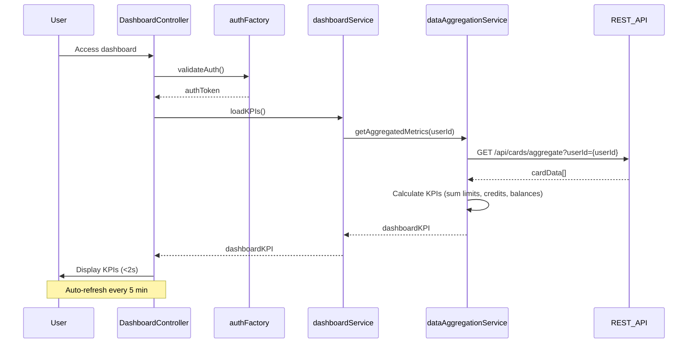

# Low-Level Design: QE-8027 - Dashboard KPIs and Financial Overview

## a. Architecture Mapping

- **User Interface** → AngularJS Module (`dashboardModule`) + Controller (`DashboardController`)
- **Dashboard Service** → AngularJS Service (`dashboardService`)
- **Data Aggregation Service** → AngularJS Service (`dataAggregationService`)
- **User Authentication Service** → AngularJS Factory (`authFactory`)
- **Credit Card Data Source** → REST API endpoints

**Folder Structure:**
```
/app
  /modules
    /dashboard
      /controllers
      /services
      /views
      /directives
  /shared
    /factories
    /interceptors
```

## b. Component Specifications

| Name | Artifact Type | Responsibility | Key Dependencies |
|------|---------------|----------------|------------------|
| dashboardModule | Module | Root module for dashboard features | ngRoute, ngResource |
| DashboardController | Controller | Manages KPI display and real-time refresh | dashboardService, $scope, $interval |
| dashboardService | Service | Orchestrates dashboard data retrieval | $http, dataAggregationService, authFactory |
| dataAggregationService | Service | Calculates consolidated KPIs across cards | $http, $q |
| authFactory | Factory | Validates user identity and manages auth tokens | $resource, $window |
| kpiCard | Directive | Displays individual KPI metric with styling | None |
| autoRefresh | Directive | Handles real-time data refresh | dashboardService, $interval |

## c. Data Model

```javascript
// DashboardKPI object
{
  userId: String,
  monthlySpend: Number,
  totalCreditLimit: Number,
  availableCredit: Number,
  outstandingAmount: Number,
  lastRefreshed: Date
}

// CardData object (from API)
{
  cardId: String,
  creditLimit: Number,
  availableCredit: Number,
  outstandingBalance: Number,
  currentMonthSpend: Number
}
```

## d. Data Flow

User accesses dashboard → authFactory validates authentication token → DashboardController initializes → dashboardService requests KPIs from dataAggregationService → dataAggregationService calls REST API (GET /api/cards/aggregate) to fetch individual card data → Service calculates aggregated metrics (sum of limits, available credit, outstanding, monthly spend) → Aggregated KPIs returned to DashboardController → UI renders KPI cards with Bootstrap styling → autoRefresh directive triggers periodic refresh (every 5 minutes) → Updated KPIs displayed in real-time.

## e. Primary Sequence Diagram



## f. Implementation Notes

- Use AngularJS 1.x with ES6 modules; inject dependencies via `$inject` array notation.
- Implement `$interval` in autoRefresh directive for periodic data refresh (5-minute interval).
- Use Bootstrap 3 card components and responsive grid for cross-device layout.
- Leverage `$http` with promise chaining for sequential API calls; implement timeout of 1.5s to meet 2s load requirement.
- Store auth token in `$window.sessionStorage` for secure session management.

## g. Error Handling

Interceptor-based error handling with user notification via modal; fallback to cached data on API failure.

## h. Security Notes

Requires token-based auth via existing SSO; all API calls include Authorization header with JWT token.