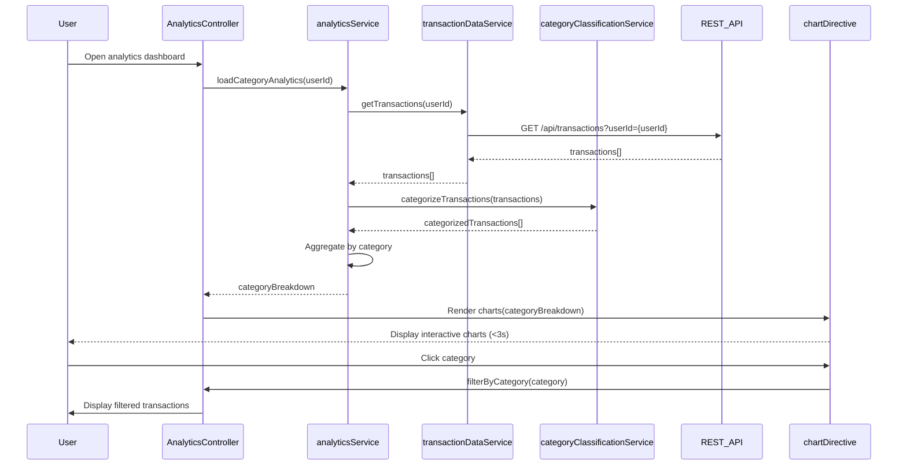

# Low-Level Design: QE-8028 - Category-wise Spending Analytics

## a. Architecture Mapping

- **User Interface** → AngularJS Module (`analyticsModule`) + Controller (`AnalyticsController`)
- **Analytics Service** → AngularJS Service (`analyticsService`)
- **Category Classification Engine** → AngularJS Service (`categoryClassificationService`)
- **Transaction Data Service** → AngularJS Service (`transactionDataService`)
- **Visualization Library** → AngularJS Directive (`chartDirective`) wrapping Chart.js
- **Transaction History Database** → REST API endpoints

**Folder Structure:**
```
/app
  /modules
    /analytics
      /controllers
      /services
      /views
      /directives
  /shared
    /charts
    /filters
```

## b. Component Specifications

| Name | Artifact Type | Responsibility | Key Dependencies |
|------|---------------|----------------|------------------|
| analyticsModule | Module | Root module for analytics features | ngRoute, chart.js |
| AnalyticsController | Controller | Manages category analytics display and interactions | analyticsService, $scope |
| analyticsService | Service | Orchestrates transaction categorization and aggregation | transactionDataService, categoryClassificationService |
| categoryClassificationService | Service | Assigns transactions to predefined categories | None (rule-based) |
| transactionDataService | Service | Fetches raw transaction data from REST API | $http, $q |
| chartDirective | Directive | Renders interactive pie/bar charts using Chart.js | Chart.js library |
| categoryFilter | Filter | Filters transactions by selected category | None |

## c. Data Model

```javascript
// Transaction object
{
  transactionId: String,
  cardId: String,
  merchantName: String,
  amount: Number,
  transactionDate: Date,
  category: String, // Assigned by classification engine
  transactionType: String
}

// CategorySpending object
{
  category: String, // One of 9: Food & Dining, Fuel, Shopping, Travel, Entertainment, Utilities, Healthcare, Education, Miscellaneous
  totalSpend: Number,
  transactionCount: Number,
  percentage: Number
}

// AnalyticsData object
{
  userId: String,
  categoryBreakdown: Array, // [CategorySpending]
  totalSpend: Number,
  lastUpdated: Date
}
```

## d. Data Flow

User opens analytics dashboard → AnalyticsController initializes → analyticsService requests transaction data from transactionDataService → transactionDataService calls REST API (GET /api/transactions?userId={userId}) → Raw transactions returned → categoryClassificationService processes each transaction and assigns to one of 9 categories based on merchant name and transaction type → analyticsService aggregates spending by category, calculates totals and percentages → AnalyticsController receives categoryBreakdown → chartDirective renders interactive pie chart and bar graph → User interacts with chart (click category) → categoryFilter applied → Filtered transactions displayed in detail view.

## e. Primary Sequence Diagram



## f. Implementation Notes

- Use AngularJS 1.x with Chart.js library wrapped in custom directive for responsive, touch-enabled charts.
- Implement categoryClassificationService with rule-based mapping (merchant keywords → category); maintain rules in JSON config.
- Use `$http` with caching enabled for transaction data to optimize repeat loads.
- Leverage AngularJS filters for client-side category filtering and sorting.
- Employ Bootstrap responsive utilities for mobile-optimized chart display.

## g. Error Handling

Try/catch in classification service with fallback to "Miscellaneous" category; HTTP interceptor for API errors with user toast notification.

## h. Security Notes

Standard input validation and secure API calls assumed; auth token required for transaction API access.