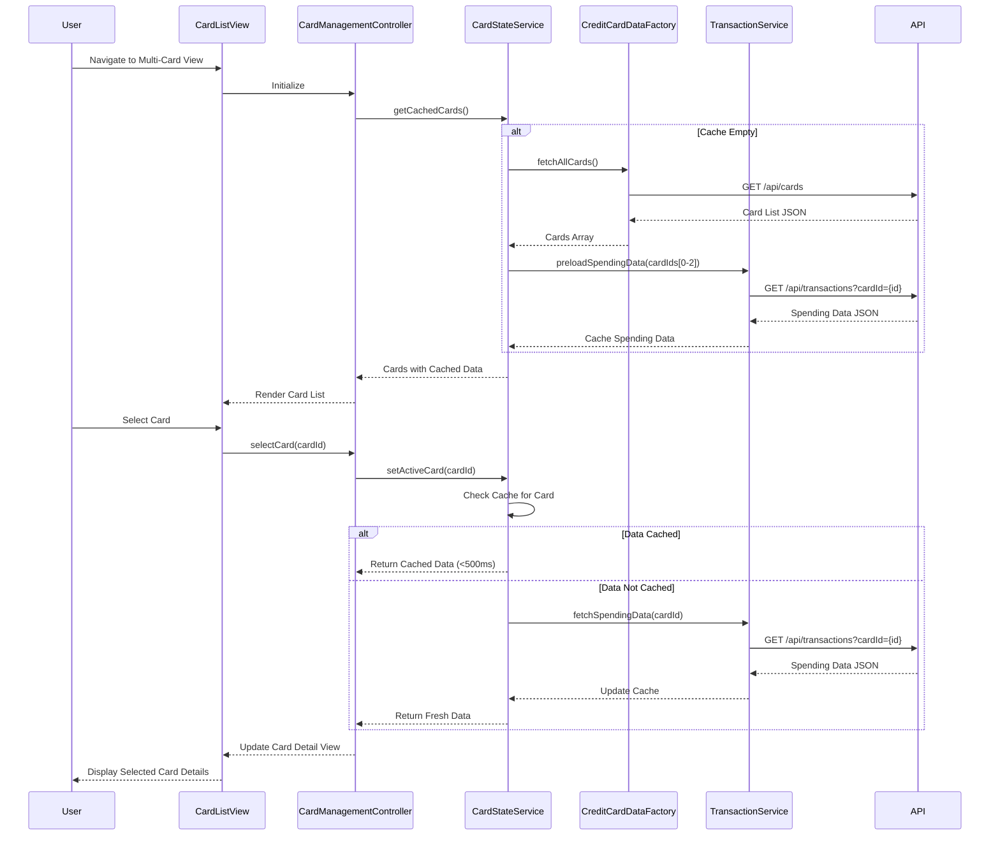

# Low-Level Design: QE-8029 - Multi-Card Management and Visualization

## a. Architecture Mapping

**Component to Artifact Mapping:**
- User Interface → AngularJS Module: `creditCard.multiCardModule` with templates for card list and detail views
- Card Management Controller → AngularJS Controller: `CardManagementController` handles card selection, navigation, and UI state
- Card State Manager → AngularJS Service: `CardStateService` manages active card state and caching for sub-500ms switching
- Credit Card Data Service → AngularJS Factory: `CreditCardDataFactory` fetches card metadata via REST API
- Transaction Service → AngularJS Service: `TransactionService` retrieves card-specific spending data via REST API

**Recommended Folder Structure:**
```
app/
├── modules/
│   └── credit-card/
│       ├── multi-card/
│       │   ├── controllers/
│       │   │   └── card-management.controller.js
│       │   ├── services/
│       │   │   ├── card-state.service.js
│       │   │   ├── credit-card-data.factory.js
│       │   │   └── transaction.service.js
│       │   ├── views/
│       │   │   ├── card-list.html
│       │   │   └── card-detail.html
│       │   └── multi-card.module.js
│       └── styles/
│           └── card-management.css
```

## b. Component Specifications

| Component Name | Artifact Type | Responsibility | Key Dependencies |
|----------------|---------------|----------------|------------------|
| creditCard.multiCardModule | Module | Registers all multi-card management components and routing | angular, ngRoute, bootstrap |
| CardManagementController | Controller | Handles card selection, comparison UI logic, and view orchestration | CardStateService, CreditCardDataFactory, TransactionService |
| CardStateService | Service | Maintains active card state, implements caching for fast switching, manages card preloading | $q, $cacheFactory |
| CreditCardDataFactory | Factory | Fetches card information and metadata from REST API endpoint /api/cards | $http, $q |
| TransactionService | Service | Retrieves card-specific spending data from REST API endpoint /api/transactions | $http, CardStateService |
| cardListDirective | Directive | Renders responsive card list with selection handling | CardManagementController |
| cardDetailDirective | Directive | Displays individual card details with status, limits, and usage | CardManagementController |

## c. Data Model

**CreditCard Model:**
```javascript
{
  cardId: String,           // Unique card identifier
  cardNumber: String,       // Masked card number (e.g., "**** **** **** 1234")
  cardType: String,         // "Visa", "Mastercard", "Amex"
  cardHolderName: String,   // Cardholder full name
  creditLimit: Number,      // Total credit limit
  availableCredit: Number,  // Available credit balance
  outstandingAmount: Number,// Current outstanding balance
  status: String,           // "Active", "Blocked", "Expired"
  expiryDate: String,       // MM/YY format
  issuer: String            // Bank/issuer name
}
```

**CardSpending Model:**
```javascript
{
  cardId: String,           // Reference to CreditCard
  monthlySpend: Number,     // Current month total spend
  lastTransactionDate: Date,// Last transaction timestamp
  transactionCount: Number, // Number of transactions this month
  topCategory: String       // Highest spending category
}
```

## d. Data Flow

User navigates to the multi-card view, triggering CardManagementController initialization which calls CardStateService to check cached card data. If cache is empty, CreditCardDataFactory fetches all cards via GET /api/cards and CardStateService preloads the first 3 cards' spending data through TransactionService (GET /api/transactions?cardId={id}). When user selects a different card, CardManagementController updates CardStateService with the new active card ID; if spending data is cached, the view updates immediately (<500ms); otherwise TransactionService fetches data asynchronously and updates the UI via two-way binding. Card comparison view aggregates data from CardStateService cache and renders side-by-side comparison using Bootstrap grid layout.

## e. Primary Sequence Diagram



## f. Implementation Notes

- Use AngularJS $cacheFactory with LRU eviction to store card and spending data; cache up to 10 cards to meet NFR for 10+ card support
- Implement CardStateService as singleton with $q promises for async operations; preload top 3 cards on initialization to optimize first interaction
- Apply ES6 class syntax for controllers/services where possible; use arrow functions for callbacks to maintain lexical 'this' context
- Leverage Bootstrap grid (col-md-4 for card tiles) and card component for responsive layout; use ng-repeat with track by cardId for performance
- Inject dependencies via explicit array notation for minification safety: `['$scope', 'CardStateService', function($scope, CardStateService) {...}]`

## g. Error Handling

HTTP interceptor captures API errors (4xx/5xx) and displays user-friendly notifications via Bootstrap alerts; CardStateService implements try/catch for cache operations with fallback to API re-fetch.

## h. Security Notes

Requires token-based authentication via existing SSO; card numbers are masked server-side before transmission; all API calls use HTTPS with authorization headers.