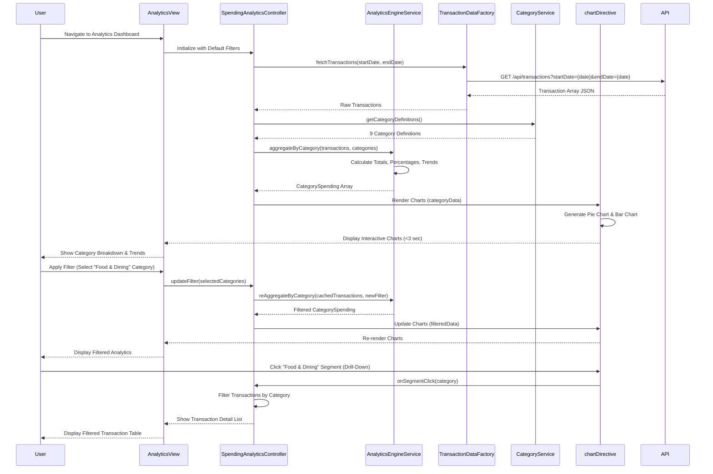

# Low-Level Design: QE-8030 - Spending Analytics and Category Insights

## a. Architecture Mapping

**Component to Artifact Mapping:**
- User Interface → AngularJS Module: `creditCard.analyticsModule` with chart templates and filter controls
- Analytics Controller → AngularJS Controller: `SpendingAnalyticsController` manages chart data, filtering, and drill-down interactions
- Analytics Engine → AngularJS Service: `AnalyticsEngineService` performs client-side data aggregation and trend calculations
- Transaction Service → AngularJS Factory: `TransactionDataFactory` fetches transaction data via REST API
- Category Classification Service → AngularJS Service: `CategoryService` maps transactions to 9 predefined categories
- Visualization Module → AngularJS Directive: `chartDirective` wraps Chart.js for rendering interactive charts

**Recommended Folder Structure:**
```
app/
├── modules/
│   └── credit-card/
│       ├── analytics/
│       │   ├── controllers/
│       │   │   └── spending-analytics.controller.js
│       │   ├── services/
│       │   │   ├── analytics-engine.service.js
│       │   │   ├── transaction-data.factory.js
│       │   │   └── category.service.js
│       │   ├── directives/
│       │   │   └── chart.directive.js
│       │   ├── views/
│       │   │   ├── analytics-dashboard.html
│       │   │   └── category-breakdown.html
│       │   └── analytics.module.js
│       └── styles/
│           └── analytics.css
```

## b. Component Specifications

| Component Name | Artifact Type | Responsibility | Key Dependencies |
|----------------|---------------|----------------|------------------|
| creditCard.analyticsModule | Module | Registers analytics components, routing, and Chart.js integration | angular, ngRoute, chart.js, bootstrap |
| SpendingAnalyticsController | Controller | Orchestrates analytics view, handles filter interactions, manages chart data binding | AnalyticsEngineService, TransactionDataFactory, CategoryService |
| AnalyticsEngineService | Service | Aggregates transaction data by category/month, calculates trends, implements caching for 3-sec render NFR | $q, $filter |
| TransactionDataFactory | Factory | Fetches transaction data from REST API endpoint /api/transactions with date range parameters | $http, $q |
| CategoryService | Service | Provides category definitions, maps transaction types to 9 categories (Food & Dining, Fuel, Shopping, Travel, Entertainment, Utilities, Healthcare, Education, Miscellaneous) | None |
| chartDirective | Directive | Renders responsive Chart.js visualizations (pie, bar, line charts) with interactive tooltips and drill-down | chart.js library |
| filterPanelDirective | Directive | Provides date range, category, and card selection filters with apply/reset actions | SpendingAnalyticsController |

## c. Data Model

**Transaction Model:**
```javascript
{
  transactionId: String,        // Unique transaction identifier
  cardId: String,               // Reference to credit card
  amount: Number,               // Transaction amount
  transactionDate: Date,        // Transaction timestamp
  merchantName: String,         // Merchant/vendor name
  category: String,             // One of 9 predefined categories
  description: String,          // Transaction description
  transactionType: String       // "Debit", "Credit", "Refund"
}
```

**CategorySpending Model:**
```javascript
{
  category: String,             // Category name
  totalAmount: Number,          // Total spend in category
  transactionCount: Number,     // Number of transactions
  percentage: Number,           // Percentage of total spend
  monthlyTrend: Array           // Array of {month: String, amount: Number}
}
```

**AnalyticsFilter Model:**
```javascript
{
  startDate: Date,              // Filter start date
  endDate: Date,                // Filter end date
  selectedCategories: Array,    // Array of category strings
  selectedCards: Array          // Array of cardId strings
}
```

## d. Data Flow

User accesses the analytics dashboard, triggering SpendingAnalyticsController to initialize with default filter (current month, all categories, all cards). Controller calls TransactionDataFactory to fetch transactions via GET /api/transactions?startDate={date}&endDate={date}, which returns transaction array. AnalyticsEngineService receives raw transactions and aggregates them by category using CategoryService mapping, calculating totals and percentages. Aggregated CategorySpending data is passed to chartDirective, which renders a responsive pie chart for category breakdown and bar chart for monthly trends within 3 seconds. When user applies filters (date range or category selection), SpendingAnalyticsController updates AnalyticsFilter model and triggers AnalyticsEngineService re-aggregation without additional API call (client-side filtering). For drill-down, user clicks a chart segment, controller updates view to show filtered transaction list for that category, maintaining responsive layout via Bootstrap grid.

## e. Primary Sequence Diagram



## f. Implementation Notes

- Use Chart.js 2.x integrated via chartDirective with isolated scope; bind chart data via two-way binding for reactive updates on filter changes
- Implement AnalyticsEngineService with ES6 Map for efficient category aggregation; cache raw transactions to avoid redundant API calls during client-side filtering
- CategoryService returns static category array with display names and color codes for consistent chart theming across visualizations
- Apply AngularJS $filter for date formatting and currency display in transaction detail view; use orderBy filter for sorting transaction lists
- Leverage Bootstrap responsive utilities (hidden-xs, col-md-6) for chart layout; ensure charts resize via Chart.js responsive:true option for mobile/tablet support

## g. Error Handling

HTTP interceptor handles API failures with user-friendly error messages via Bootstrap modal; AnalyticsEngineService wraps aggregation logic in try/catch to handle malformed data gracefully with fallback to empty state.

## h. Security Notes

Requires token-based auth via existing SSO; transaction data is filtered server-side by authenticated user; sensitive merchant details are sanitized before display to prevent XSS.