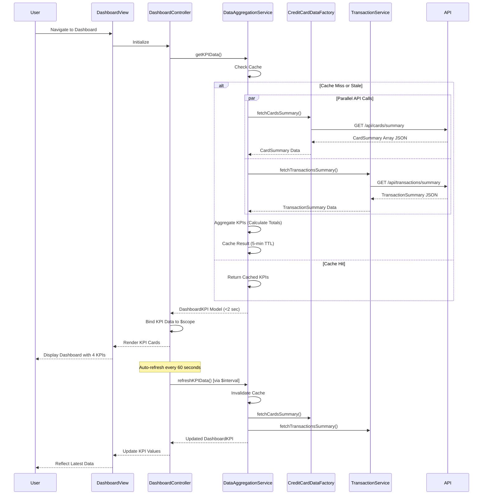

# Low-Level Design: QE-8031 - Credit Card Dashboard and KPI Management

## a. Architecture Mapping

**Component to Artifact Mapping:**
- User Interface Layer → AngularJS Module: `creditCard.dashboardModule` with responsive dashboard template
- Dashboard Controller → AngularJS Controller: `DashboardController` manages KPI data binding and refresh logic
- Data Aggregation Module → AngularJS Service: `DataAggregationService` consolidates data from multiple services and caches results
- Credit Card Data Service → AngularJS Factory: `CreditCardDataFactory` fetches card balances and limits via REST API
- Transaction Service → AngularJS Service: `TransactionService` retrieves monthly spend and outstanding amounts via REST API

**Recommended Folder Structure:**
```
app/
├── modules/
│   └── credit-card/
│       ├── dashboard/
│       │   ├── controllers/
│       │   │   └── dashboard.controller.js
│       │   ├── services/
│       │   │   ├── data-aggregation.service.js
│       │   │   ├── credit-card-data.factory.js
│       │   │   └── transaction.service.js
│       │   ├── views/
│       │   │   └── dashboard.html
│       │   └── dashboard.module.js
│       └── styles/
│           └── dashboard.css
```

## b. Component Specifications

| Component Name | Artifact Type | Responsibility | Key Dependencies |
|----------------|---------------|----------------|------------------|
| creditCard.dashboardModule | Module | Registers dashboard components, routing, and configures auto-refresh interval | angular, ngRoute, bootstrap |
| DashboardController | Controller | Initializes dashboard, binds KPI data to view, handles manual refresh action | DataAggregationService, $interval |
| DataAggregationService | Service | Fetches and aggregates KPI data from multiple sources, implements caching for 2-sec load NFR | CreditCardDataFactory, TransactionService, $q, $cacheFactory |
| CreditCardDataFactory | Factory | Retrieves card balances and credit limits from REST API endpoint /api/cards/summary | $http, $q |
| TransactionService | Service | Fetches monthly spend and outstanding amounts from REST API endpoint /api/transactions/summary | $http, $q |
| kpiCardDirective | Directive | Renders individual KPI card with icon, label, value, and trend indicator | None |
| dashboardRefreshDirective | Directive | Provides manual refresh button with loading state and last-updated timestamp | DashboardController |

## c. Data Model

**DashboardKPI Model:**
```javascript
{
  monthlySpend: Number,         // Total spend for current month
  totalCreditLimit: Number,     // Sum of credit limits across all cards
  availableCredit: Number,      // Total available credit
  outstandingAmount: Number,    // Total outstanding balance across all cards
  lastUpdated: Date             // Timestamp of last data refresh
}
```

**CardSummary Model:**
```javascript
{
  cardId: String,               // Unique card identifier
  creditLimit: Number,          // Card credit limit
  availableCredit: Number,      // Available credit balance
  currentBalance: Number        // Current outstanding balance
}
```

**TransactionSummary Model:**
```javascript
{
  currentMonthSpend: Number,    // Total spend for current month
  totalOutstanding: Number,     // Sum of outstanding amounts
  lastTransactionDate: Date     // Most recent transaction timestamp
}
```

## d. Data Flow

User navigates to the dashboard, triggering DashboardController initialization which calls DataAggregationService.getKPIData(). DataAggregationService checks cache; if stale or empty, it makes parallel API calls via $q.all() to CreditCardDataFactory (GET /api/cards/summary) and TransactionService (GET /api/transactions/summary). CreditCardDataFactory returns array of CardSummary objects, which DataAggregationService aggregates to calculate totalCreditLimit and availableCredit. TransactionService returns TransactionSummary with currentMonthSpend and totalOutstanding. DataAggregationService combines both results into DashboardKPI model, caches it with 5-minute TTL, and returns to DashboardController within 2 seconds. Controller binds KPI data to view via $scope, and kpiCardDirective renders each KPI in responsive Bootstrap grid (col-md-3 for desktop, col-xs-12 for mobile). Auto-refresh via $interval triggers DataAggregationService.refreshKPIData() every 60 seconds, updating view via two-way binding.

## e. Primary Sequence Diagram



## f. Implementation Notes

- Use $q.all() in DataAggregationService to parallelize API calls to CreditCardDataFactory and TransactionService, reducing total load time to meet 2-sec NFR
- Implement $cacheFactory with timestamp-based TTL (5 minutes) to balance freshness and performance; cache key includes user identifier for multi-user support
- Apply ES6 reduce() for aggregating card summaries (totalCreditLimit = cards.reduce((sum, card) => sum + card.creditLimit, 0))
- Use Bootstrap grid with responsive breakpoints (col-md-3 col-sm-6 col-xs-12) for KPI cards; apply CSS3 flexbox for vertical centering and consistent card heights
- Inject $interval for auto-refresh with cleanup in controller $destroy event to prevent memory leaks; dependency injection via array notation for minification safety

## g. Error Handling

HTTP interceptor captures API errors and displays Bootstrap alert notifications; DataAggregationService implements $q.reject() for promise chain error propagation with fallback to last known cached values if available.

## h. Security Notes

Requires token-based auth via existing SSO; all API endpoints validate JWT tokens; sensitive financial data is transmitted over HTTPS only with authorization headers.