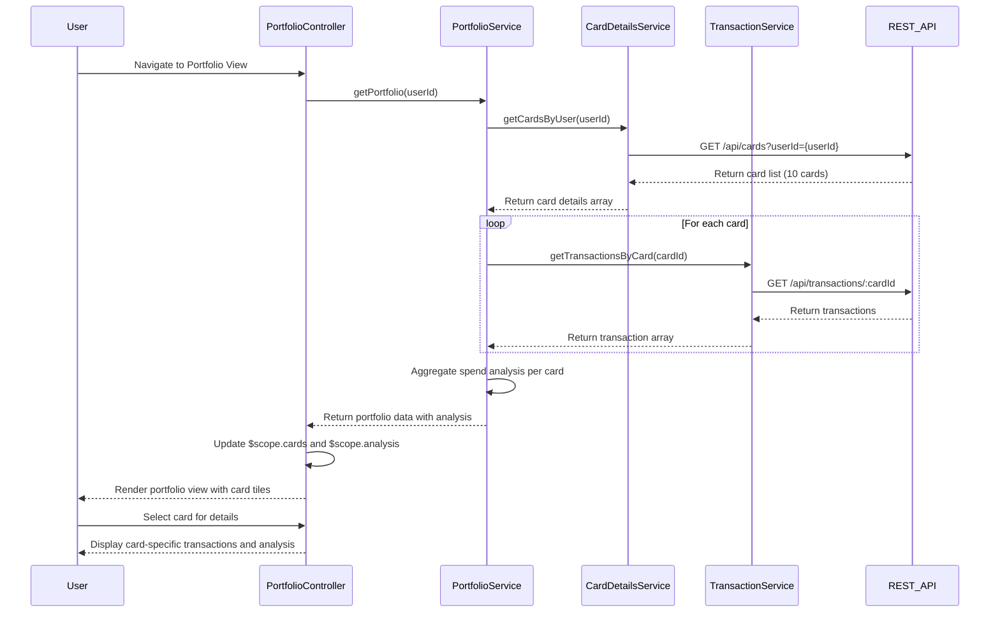

# Low-Level Design: QE-8188 - Credit Card Portfolio Management

## a. Architecture Mapping

- **AngularJS Module**: `creditCard.portfolio` - Main module for portfolio management features
- **Controller**: `PortfolioController` - Manages portfolio view state and user interactions
- **Service**: `PortfolioService` - Orchestrates card data retrieval and aggregation
- **Service**: `CardDetailsService` - Fetches individual card details via REST API
- **Service**: `TransactionService` - Retrieves card-specific transaction history
- **Directive**: `cardListDirective` - Renders individual card tiles with filtering/selection
- **Factory**: `UserProfileFactory` - Manages card-user mapping and user session data

**Folder Structure:**
```
/app
  /modules
    /portfolio
      portfolio.module.js
      portfolio.controller.js
      portfolio.service.js
      card-details.service.js
      transaction.service.js
      /directives
        card-list.directive.js
      /factories
        user-profile.factory.js
      /views
        portfolio.html
        card-detail.html
```

## b. Component Specifications

| Component Name | Artifact Type | Responsibility | Key Dependencies |
|----------------|---------------|----------------|------------------|
| portfolio.module | Module | Defines portfolio feature module and routing | ngRoute, creditCard.core |
| PortfolioController | Controller | Manages portfolio view state, card selection, filtering logic | PortfolioService, $scope, $filter |
| PortfolioService | Service | Orchestrates multi-card data retrieval and spend analysis aggregation | CardDetailsService, TransactionService, $q, $http |
| CardDetailsService | Service | Fetches card details from REST API (/api/cards) | $http, $q, UserProfileFactory |
| TransactionService | Service | Retrieves card-specific transactions from REST API (/api/transactions/:cardId) | $http, $q |
| cardListDirective | Directive | Renders card tiles with selection, filtering, and comparison UI | PortfolioService |
| UserProfileFactory | Factory | Manages user session, card-user mapping, and card ownership verification | $http, localStorageService |

## c. Data Model

**CreditCard Object:**
```javascript
{
  cardId: String,
  cardNumber: String (masked),
  cardType: String, // Visa, MasterCard, etc.
  cardHolderName: String,
  creditLimit: Number,
  availableCredit: Number,
  outstandingAmount: Number,
  expiryDate: String (YYYY-MM),
  isActive: Boolean
}
```

**Transaction Object:**
```javascript
{
  transactionId: String,
  cardId: String,
  amount: Number,
  category: String,
  merchantName: String,
  transactionDate: Date (ISO 8601),
  description: String
}
```

**CardSpendAnalysis Object:**
```javascript
{
  cardId: String,
  totalSpend: Number,
  monthlySpend: Number,
  utilizationPercent: Number,
  transactionCount: Number
}
```

## d. Data Flow

User navigates to portfolio view → PortfolioController initializes and calls PortfolioService.getPortfolio() → PortfolioService requests card-user mappings from UserProfileFactory, then fetches all card details via CardDetailsService ($http GET /api/cards) and card-specific transactions via TransactionService ($http GET /api/transactions/:cardId) → Services aggregate spend analysis data → PortfolioService returns combined portfolio data to controller → Controller updates $scope with card list and analysis → cardListDirective renders card tiles with filtering/selection UI → User selects card for drill-down → Controller fetches detailed transactions and updates view.

## e. Primary Sequence Diagram



## f. Implementation Notes

- Use AngularJS Dependency Injection for all services/factories; register with module.service() and module.factory() patterns
- Implement $q.all() for parallel card data fetching to meet 1-second retrieval NFR
- Use $http interceptors for authentication token injection and error handling across all API calls
- Apply ng-repeat with track by cardId for efficient card list rendering; use ng-show/ng-hide for filtering
- Implement client-side filtering using $filter service for card selection and comparison features

## g. Error Handling

HTTP interceptor captures API errors (4xx/5xx), displays user-friendly notifications via toastr/alert service, and logs errors to console; try/catch in controllers for synchronous operations.

## h. Security Notes

Requires token-based auth via existing SSO; card numbers masked at API level; sensitive card data transmitted over HTTPS only.