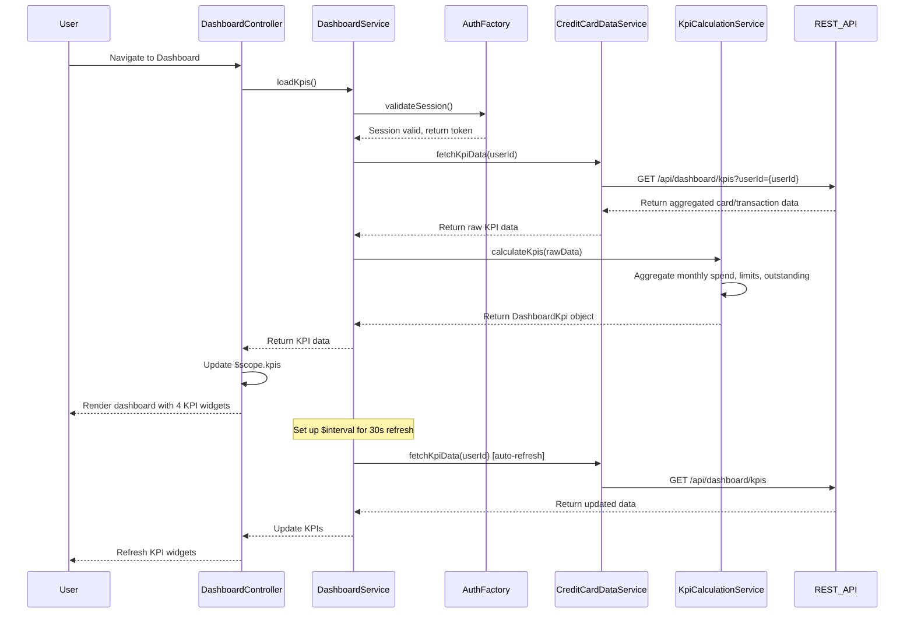

# Low-Level Design: QE-8189 - Dashboard and KPI Management

## a. Architecture Mapping

- **AngularJS Module**: `creditCard.dashboard` - Main module for dashboard and KPI features
- **Controller**: `DashboardController` - Manages dashboard state and KPI display logic
- **Service**: `DashboardService` - Orchestrates KPI data retrieval and real-time refresh
- **Service**: `KpiCalculationService` - Calculates aggregated KPIs from card and transaction data
- **Service**: `CreditCardDataService` - Fetches card balances and transaction data via REST API
- **Directive**: `kpiWidgetDirective` - Renders individual KPI widgets (spend, limit, available, outstanding)
- **Factory**: `AuthFactory` - Manages user authentication and session validation

**Folder Structure:**
```
/app
  /modules
    /dashboard
      dashboard.module.js
      dashboard.controller.js
      dashboard.service.js
      kpi-calculation.service.js
      credit-card-data.service.js
      /directives
        kpi-widget.directive.js
      /factories
        auth.factory.js
      /views
        dashboard.html
```

## b. Component Specifications

| Component Name | Artifact Type | Responsibility | Key Dependencies |
|----------------|---------------|----------------|------------------|
| dashboard.module | Module | Defines dashboard feature module and routing | ngRoute, creditCard.core |
| DashboardController | Controller | Manages dashboard view state, triggers KPI refresh, handles user interactions | DashboardService, $scope, $interval |
| DashboardService | Service | Orchestrates KPI data retrieval and real-time refresh logic | KpiCalculationService, CreditCardDataService, $q, $interval |
| KpiCalculationService | Service | Calculates monthly spend, total limit, available credit, outstanding amount from raw data | $filter |
| CreditCardDataService | Service | Fetches card balances and transactions from REST API (/api/dashboard/kpis) | $http, $q, AuthFactory |
| kpiWidgetDirective | Directive | Renders individual KPI widget with value, label, and responsive styling | None |
| AuthFactory | Factory | Manages authentication token, session validation, and user identity | $http, localStorageService |

## c. Data Model

**DashboardKpi Object:**
```javascript
{
  userId: String,
  monthlySpend: Number,
  totalCreditLimit: Number,
  availableCredit: Number,
  outstandingAmount: Number,
  lastUpdated: Date (ISO 8601)
}
```

**CardBalance Object:**
```javascript
{
  cardId: String,
  currentBalance: Number,
  creditLimit: Number,
  availableCredit: Number
}
```

## d. Data Flow

User authenticates and navigates to dashboard → DashboardController initializes and calls DashboardService.loadKpis() → DashboardService validates session via AuthFactory, then requests data from CreditCardDataService ($http GET /api/dashboard/kpis) → CreditCardDataService fetches aggregated card and transaction data from backend → KpiCalculationService calculates monthly spend, total limit, available credit, and outstanding amount → DashboardService returns KPI object to controller → Controller updates $scope.kpis → kpiWidgetDirective renders four KPI widgets in responsive grid → DashboardService sets up $interval for real-time refresh every 30 seconds → User views consolidated multi-card metrics with auto-refresh.

## e. Primary Sequence Diagram



## f. Implementation Notes

- Use AngularJS $interval service for real-time KPI refresh every 30 seconds; cancel interval on $scope.$destroy to prevent memory leaks
- Implement responsive grid using Bootstrap col-* classes for KPI widgets; ensure mobile-first design with stacked layout on small screens
- Use $http interceptors for token injection and session expiry handling; redirect to login on 401 responses
- Apply ng-cloak to prevent flash of unstyled content during initial load; use loading spinner during data fetch
- Cache KPI data in DashboardService for 30 seconds to reduce redundant API calls on view re-entry

## g. Error Handling

HTTP interceptor-based error handling with user notification via toast messages; session expiry redirects to login; network errors display retry option.

## h. Security Notes

Requires token-based auth via existing SSO; all API calls include Authorization header with JWT token; session timeout enforced at 15 minutes.