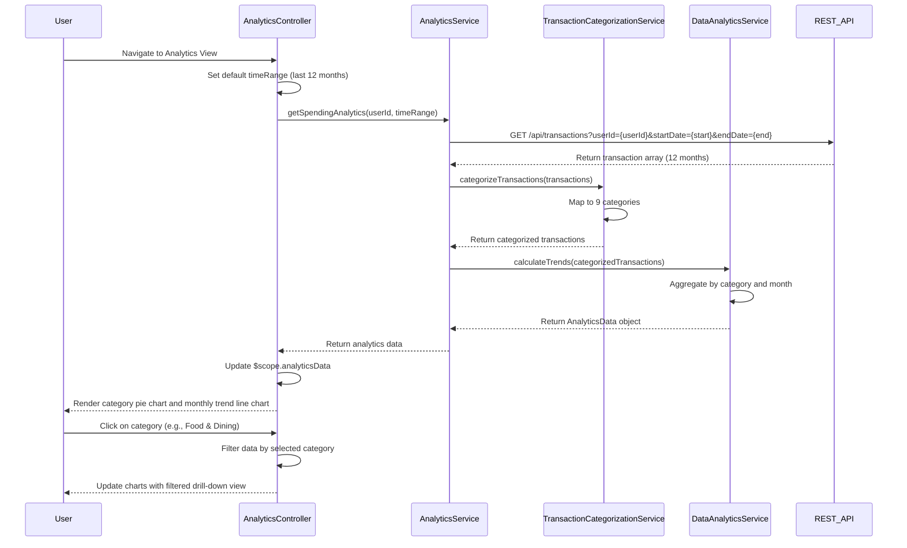

# Low-Level Design: QE-8190 - Spending Analytics and Insights

## a. Architecture Mapping

- **AngularJS Module**: `creditCard.analytics` - Main module for analytics and insights features
- **Controller**: `AnalyticsController` - Manages analytics view state, filters, and chart interactions
- **Service**: `AnalyticsService` - Orchestrates analytics data retrieval and aggregation
- **Service**: `TransactionCategorizationService` - Provides category mappings for transactions
- **Service**: `DataAnalyticsService` - Calculates spending trends and category-wise aggregations
- **Directive**: `spendingChartDirective` - Renders interactive charts using Chart.js or D3.js
- **Factory**: `VisualizationFactory` - Configures chart options and handles chart lifecycle

**Folder Structure:**
```
/app
  /modules
    /analytics
      analytics.module.js
      analytics.controller.js
      analytics.service.js
      transaction-categorization.service.js
      data-analytics.service.js
      /directives
        spending-chart.directive.js
      /factories
        visualization.factory.js
      /views
        analytics.html
```

## b. Component Specifications

| Component Name | Artifact Type | Responsibility | Key Dependencies |
|----------------|---------------|----------------|------------------|
| analytics.module | Module | Defines analytics feature module and routing | ngRoute, creditCard.core, chart.js |
| AnalyticsController | Controller | Manages analytics view state, time period filters, category selection, drill-down logic | AnalyticsService, $scope, $filter |
| AnalyticsService | Service | Orchestrates analytics data retrieval, aggregation, and trend calculation | TransactionCategorizationService, DataAnalyticsService, $http, $q |
| TransactionCategorizationService | Service | Maps transactions to 9 predefined categories via REST API (/api/categories/mapping) | $http, $q |
| DataAnalyticsService | Service | Calculates monthly trends, category-wise spending aggregations from transaction data | $filter, moment.js |
| spendingChartDirective | Directive | Renders interactive pie/bar/line charts with drill-down and filtering capabilities | VisualizationFactory, Chart.js |
| VisualizationFactory | Factory | Configures chart options, color schemes, and manages chart instance lifecycle | Chart.js |

## c. Data Model

**CategorySpending Object:**
```javascript
{
  category: String, // Food & Dining, Fuel, Shopping, Travel, Entertainment, Utilities, Healthcare, Education, Miscellaneous
  totalAmount: Number,
  transactionCount: Number,
  percentage: Number
}
```

**MonthlyTrend Object:**
```javascript
{
  month: String (YYYY-MM),
  totalSpend: Number,
  categoryBreakdown: Array<CategorySpending>
}
```

**AnalyticsData Object:**
```javascript
{
  userId: String,
  timeRange: { startDate: Date, endDate: Date },
  categorySpending: Array<CategorySpending>,
  monthlyTrends: Array<MonthlyTrend>,
  totalSpend: Number
}
```

## d. Data Flow

User navigates to analytics view and selects time period (default: last 12 months) → AnalyticsController calls AnalyticsService.getSpendingAnalytics(userId, timeRange) → AnalyticsService fetches transaction data ($http GET /api/transactions?userId&startDate&endDate) → TransactionCategorizationService maps transactions to 9 categories → DataAnalyticsService aggregates spending by category and calculates monthly trends → AnalyticsService returns AnalyticsData object → Controller updates $scope.analyticsData → spendingChartDirective renders category pie chart and monthly trend line chart using Chart.js → User interacts with charts (drill-down, filter by category) → Controller updates filters and re-renders charts.

## e. Primary Sequence Diagram



## f. Implementation Notes

- Use Chart.js library for interactive visualizations; configure via VisualizationFactory with responsive options and color palette for 9 categories
- Implement client-side caching in AnalyticsService for 5 minutes to reduce API calls on filter changes; use $cacheFactory
- Apply ng-repeat with track by category for efficient category list rendering; use $filter for time-based filtering
- Use moment.js for date manipulation and month aggregation in DataAnalyticsService
- Implement lazy loading for chart library to optimize initial page load; load Chart.js only when analytics module is activated

## g. Error Handling

HTTP interceptor captures API errors; user-friendly error messages displayed via toast notifications; fallback to cached data if available on network failure.

## h. Security Notes

Standard input validation and secure API calls assumed; authentication token required for all analytics API endpoints.