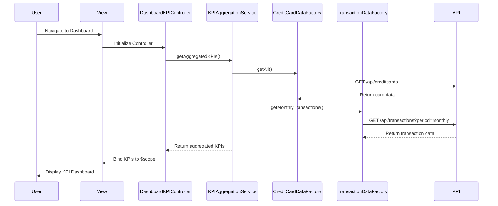

# Low-Level Design: QE-8253 - Dashboard KPIs and Credit Card Overview

## a. Architecture Mapping

- **Dashboard UI Component** → AngularJS Module: `dashboardModule` + Controller: `DashboardKPIController` + View: `dashboard-kpi.html`
- **KPI Aggregation Service** → AngularJS Service: `KPIAggregationService` (handles business logic for aggregating KPIs)
- **Credit Card Data Service** → AngularJS Factory: `CreditCardDataFactory` (REST API integration for card data)
- **Transaction Data Service** → AngularJS Factory: `TransactionDataFactory` (REST API integration for transaction data)
- **Data Binding & Display** → AngularJS Directives: `kpiCard` directive for reusable KPI display widgets

**Recommended Folder Structure:**
```
/app
  /modules
    /dashboard
      dashboard.module.js
      dashboard-kpi.controller.js
      dashboard-kpi.html
  /services
    kpi-aggregation.service.js
  /factories
    credit-card-data.factory.js
    transaction-data.factory.js
  /directives
    kpi-card.directive.js
  /styles
    dashboard.css
```

## b. Component Specifications

| Component Name | Artifact Type | Responsibility | Key Dependencies |
|----------------|---------------|----------------|------------------|
| dashboardModule | Module | Root module for dashboard feature, registers all dashboard components | angular, ngRoute, ngResource |
| DashboardKPIController | Controller | Orchestrates KPI data retrieval, aggregation, and binding to view | KPIAggregationService, $scope |
| KPIAggregationService | Service | Aggregates monthly spend, total credit limit, available credit, outstanding amount from raw data | CreditCardDataFactory, TransactionDataFactory |
| CreditCardDataFactory | Factory | Fetches credit card details (limit, balance, card ID) via REST API | $http, API_CONFIG |
| TransactionDataFactory | Factory | Fetches transaction data for monthly spend calculation via REST API | $http, API_CONFIG |
| kpiCard | Directive | Reusable UI component to display individual KPI metrics with icon, label, and value | None |

## c. Data Model

**CreditCard Object:**
```javascript
{
  cardId: String,
  cardNumber: String (masked),
  cardType: String,
  creditLimit: Number,
  currentBalance: Number,
  availableCredit: Number,
  outstandingAmount: Number
}
```

**Transaction Object:**
```javascript
{
  transactionId: String,
  cardId: String,
  amount: Number,
  date: Date,
  category: String,
  description: String
}
```

**KPI Aggregation Model:**
```javascript
{
  monthlySpend: Number,
  totalCreditLimit: Number,
  totalAvailableCredit: Number,
  totalOutstanding: Number
}
```

## d. Data Flow

User navigates to the dashboard view, triggering `DashboardKPIController` initialization. The controller invokes `KPIAggregationService`, which concurrently calls `CreditCardDataFactory.getAll()` and `TransactionDataFactory.getMonthlyTransactions()` to fetch card and transaction data via REST APIs. The service aggregates the data (summing credit limits, available credit, outstanding amounts, and calculating monthly spend), then returns the KPI model to the controller. The controller binds the aggregated KPIs to `$scope`, and the view renders the data using the `kpiCard` directive for each metric, displaying them in a responsive Bootstrap grid layout.

## e. Primary Sequence Diagram



## f. Implementation Notes

- Use AngularJS 1.x with ES6 module syntax; leverage `angular.module()` for dependency injection and component registration.
- Implement `$http` interceptors for global error handling and loading state management to meet 2-second load time NFR.
- Use Bootstrap grid system (col-md-3, col-sm-6, col-xs-12) for responsive KPI card layout across devices.
- Cache aggregated KPI data in service using a simple in-memory cache with TTL to reduce redundant API calls.
- Employ `$q.all()` for parallel API calls to CreditCardDataFactory and TransactionDataFactory to optimize load time.

## g. Error Handling

HTTP interceptor captures API errors, displays user-friendly notifications via a toast service, and logs errors to console; controller-level try/catch for service invocation failures.

## h. Security Notes

Requires token-based authentication via existing SSO; API endpoints validate user session and return only authorized user's credit card and transaction data.