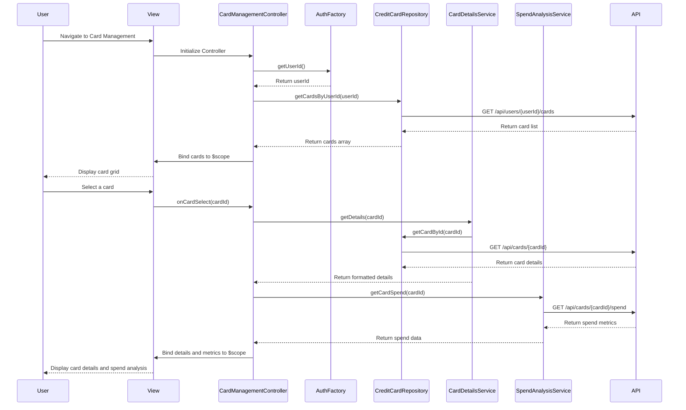

# Low-Level Design: QE-8254 - Credit Card Management and Viewing

## a. Architecture Mapping

- **User Interface** → AngularJS Module: `cardManagementModule` + Controller: `CardManagementController` + View: `card-management.html`
- **Card Management Module** → AngularJS Controller: `CardManagementController` (orchestrates card listing, selection, and detail display)
- **Card Details Service** → AngularJS Service: `CardDetailsService` (business logic for card detail retrieval and formatting)
- **Spend Analysis Engine** → AngularJS Service: `SpendAnalysisService` (calculates card-wise spending metrics)
- **Credit Card Data Repository** → AngularJS Factory: `CreditCardRepository` (REST API integration for card CRUD operations)
- **User Authentication Service** → AngularJS Factory: `AuthFactory` (manages user authentication state and tokens)

**Recommended Folder Structure:**
```
/app
  /modules
    /card-management
      card-management.module.js
      card-management.controller.js
      card-management.html
      card-detail.html
  /services
    card-details.service.js
    spend-analysis.service.js
  /factories
    credit-card-repository.factory.js
    auth.factory.js
  /directives
    card-tile.directive.js
  /styles
    card-management.css
```

## b. Component Specifications

| Component Name | Artifact Type | Responsibility | Key Dependencies |
|----------------|---------------|----------------|------------------|
| cardManagementModule | Module | Root module for card management feature, registers all card-related components | angular, ngRoute |
| CardManagementController | Controller | Manages card list display, card selection, navigation to card details, and spend analysis invocation | CardDetailsService, SpendAnalysisService, CreditCardRepository, $scope |
| CardDetailsService | Service | Retrieves and formats individual card details including metrics and metadata | CreditCardRepository |
| SpendAnalysisService | Service | Calculates and returns card-wise spending metrics aggregated from transaction data | CreditCardRepository |
| CreditCardRepository | Factory | Provides REST API interface for fetching card list, card details, and card-specific transactions | $http, API_CONFIG |
| AuthFactory | Factory | Provides user authentication state, token management, and user ID for API calls | $http, $window |
| cardTile | Directive | Reusable UI component to display individual card summary in grid/list format | None |

## c. Data Model

**CreditCard Object:**
```javascript
{
  cardId: String,
  userId: String,
  cardNumber: String (masked),
  cardType: String,
  bankName: String,
  creditLimit: Number,
  currentBalance: Number,
  availableCredit: Number,
  outstandingAmount: Number,
  expiryDate: String,
  cardStatus: String
}
```

**CardSpendMetrics Object:**
```javascript
{
  cardId: String,
  monthlySpend: Number,
  categoryBreakdown: Array<{category: String, amount: Number}>,
  lastTransactionDate: Date,
  transactionCount: Number
}
```

**CardListViewModel:**
```javascript
{
  cards: Array<CreditCard>,
  selectedCard: CreditCard,
  spendMetrics: Map<String, CardSpendMetrics>
}
```

## d. Data Flow

User navigates to the card management view, triggering `CardManagementController` initialization. The controller calls `AuthFactory.getUserId()` to retrieve the authenticated user ID, then invokes `CreditCardRepository.getCardsByUserId()` to fetch the user's card list via REST API. The retrieved cards are bound to `$scope.cards` and rendered using the `cardTile` directive in a responsive grid. When the user selects a card, the controller calls `CardDetailsService.getDetails(cardId)` and `SpendAnalysisService.getCardSpend(cardId)` to fetch detailed card information and spending metrics. The combined data is bound to `$scope.selectedCard` and `$scope.spendMetrics`, and the view updates to display the card detail panel with metrics, supporting up to 20 cards without performance degradation.

## e. Primary Sequence Diagram



## f. Implementation Notes

- Use AngularJS 1.x with controller-as syntax for cleaner scope management and ES6 arrow functions in service methods.
- Implement lazy loading for card details and spend metrics—fetch only when user selects a card to optimize initial load time.
- Use Bootstrap responsive grid (col-lg-3, col-md-4, col-sm-6, col-xs-12) for card tile layout to support mobile and desktop views.
- Leverage AngularJS `ng-repeat` with `track by cardId` for efficient DOM rendering when displaying up to 20 cards.
- Cache card list in `CreditCardRepository` using a simple object store to avoid redundant API calls during session.

## g. Error Handling

HTTP interceptor handles API failures with user-friendly error messages; controller-level try/catch for service method exceptions with fallback to empty state display.

## h. Security Notes

Requires token-based auth via existing SSO; all API endpoints validate user session and enforce user-card association to prevent unauthorized card access.