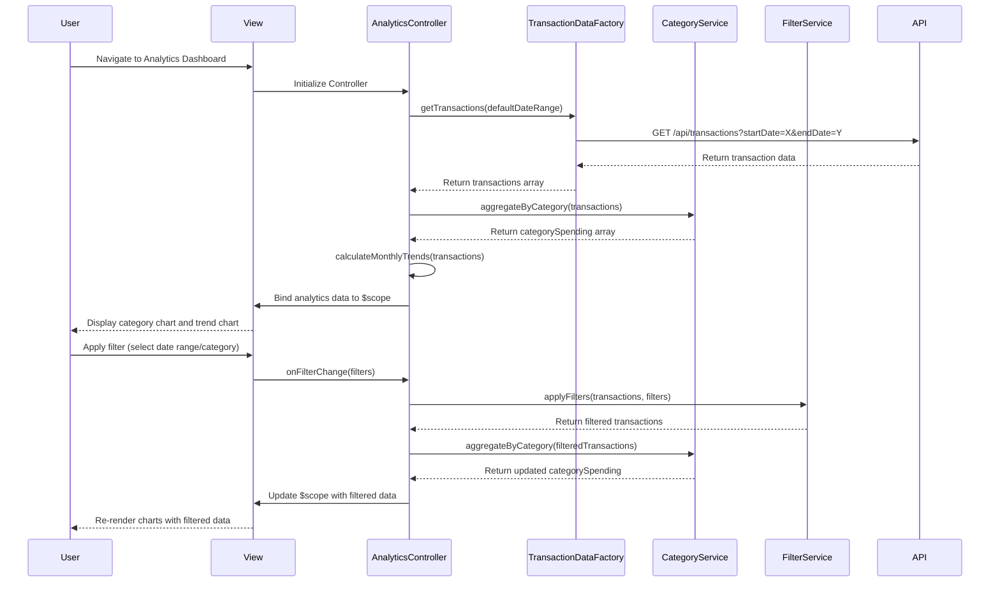

# Low-Level Design: QE-8255 - Transaction Analytics and Spending Insights

## a. Architecture Mapping

- **User Interface** → AngularJS Module: `analyticsModule` + Controller: `AnalyticsController` + View: `analytics-dashboard.html`
- **Analytics Dashboard** → AngularJS Controller: `AnalyticsController` (orchestrates data retrieval, filtering, and chart rendering)
- **Transaction Data Service** → AngularJS Factory: `TransactionDataFactory` (REST API integration for transaction data)
- **Category Classification Engine** → AngularJS Service: `CategoryService` (manages category definitions and transaction categorization logic)
- **Data Visualization Library** → Third-party library integration: Chart.js or D3.js via AngularJS directive wrappers
- **Filtering & Drill-down** → AngularJS Service: `FilterService` (handles interactive filtering logic for date ranges and categories)

**Recommended Folder Structure:**
```
/app
  /modules
    /analytics
      analytics.module.js
      analytics.controller.js
      analytics-dashboard.html
  /services
    category.service.js
    filter.service.js
  /factories
    transaction-data.factory.js
  /directives
    category-chart.directive.js
    trend-chart.directive.js
  /styles
    analytics.css
```

## b. Component Specifications

| Component Name | Artifact Type | Responsibility | Key Dependencies |
|----------------|---------------|----------------|------------------|
| analyticsModule | Module | Root module for analytics feature, registers all analytics components and chart directives | angular, ngRoute, chart.js |
| AnalyticsController | Controller | Manages transaction data retrieval, filter application, category aggregation, and chart data binding | TransactionDataFactory, CategoryService, FilterService, $scope |
| TransactionDataFactory | Factory | Fetches transaction data from REST API with support for date range and category filters | $http, API_CONFIG |
| CategoryService | Service | Provides category definitions (Food & Dining, Fuel, Shopping, Travel, Entertainment, Utilities, Healthcare, Education, Miscellaneous) and categorization logic | None |
| FilterService | Service | Manages filter state (date range, category selection) and applies filters to transaction dataset | None |
| categoryChart | Directive | Renders interactive pie/bar chart for category-wise spending using Chart.js | Chart.js |
| trendChart | Directive | Renders line chart for monthly spend trends over time using Chart.js | Chart.js |

## c. Data Model

**Transaction Object:**
```javascript
{
  transactionId: String,
  cardId: String,
  amount: Number,
  date: Date,
  category: String,
  description: String,
  merchantName: String
}
```

**CategorySpending Object:**
```javascript
{
  category: String,
  totalAmount: Number,
  transactionCount: Number,
  percentage: Number
}
```

**MonthlyTrend Object:**
```javascript
{
  month: String,
  year: Number,
  totalSpend: Number,
  categoryBreakdown: Array<{category: String, amount: Number}>
}
```

**AnalyticsViewModel:**
```javascript
{
  transactions: Array<Transaction>,
  categorySpending: Array<CategorySpending>,
  monthlyTrends: Array<MonthlyTrend>,
  filters: {startDate: Date, endDate: Date, selectedCategories: Array<String>}
}
```

## d. Data Flow

User navigates to the analytics dashboard, triggering `AnalyticsController` initialization. The controller invokes `TransactionDataFactory.getTransactions()` to fetch transaction data via REST API (default: last 12 months). The retrieved transactions are processed by `CategoryService` to aggregate spending by category, producing a `categorySpending` array. Simultaneously, the controller calculates `monthlyTrends` by grouping transactions by month. The aggregated data is bound to `$scope`, and the view renders interactive charts using `categoryChart` and `trendChart` directives. When the user applies filters (date range or category selection), `FilterService` updates the filter state, the controller re-aggregates the filtered dataset, and the charts re-render within 3 seconds, supporting drill-down into specific categories.

## e. Primary Sequence Diagram



## f. Implementation Notes

- Use AngularJS 1.x with Chart.js library wrapped in custom directives (`categoryChart`, `trendChart`) for declarative chart rendering.
- Implement client-side aggregation and filtering in `CategoryService` and `FilterService` to minimize API calls and meet 3-second render NFR.
- Use AngularJS `$watch` on filter model to trigger automatic chart updates when user changes date range or category selection.
- Leverage Bootstrap responsive utilities and Chart.js responsive configuration to ensure charts adapt to mobile and desktop screen sizes.
- Pre-load transaction data for default time period (last 12 months) on controller initialization; use pagination or lazy loading if dataset exceeds performance threshold.

## g. Error Handling

HTTP interceptor captures API errors and displays user notification; controller handles empty dataset gracefully by showing "No data available" message in chart area.

## h. Security Notes

Requires token-based auth via existing SSO; API validates user session and returns only user's authorized transaction data; standard input validation applied to filter parameters.