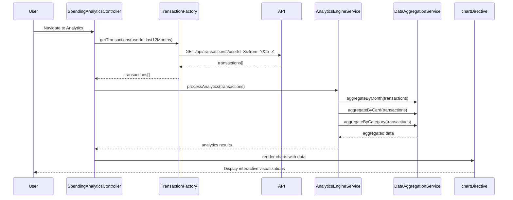

# Low-Level Design: QE-8260 - Spending Analytics and Insights

## a. Architecture Mapping

**Component to Artifact Mapping:**
- Analytics Dashboard UI → AngularJS Module (`spendingAnalyticsModule`) + Controller (`SpendingAnalyticsController`)
- Analytics Engine → AngularJS Service (`AnalyticsEngineService`) for data processing and aggregation
- Transaction Data Service → AngularJS Factory (`TransactionFactory`) for API calls
- Category Classification Service → Backend API (consumed via `CategoryFactory`)
- Data Aggregation Module → AngularJS Service (`DataAggregationService`) for grouping and summarizing data
- Visualization Library → Chart.js integrated via AngularJS Directive (`chartDirective`)

**Recommended Folder Structure:**
```
app/
├── modules/
│   └── spending-analytics/
│       ├── spending-analytics.module.js
│       ├── controllers/
│       │   └── spending-analytics.controller.js
│       ├── services/
│       │   ├── analytics-engine.service.js
│       │   └── data-aggregation.service.js
│       ├── factories/
│       │   ├── transaction.factory.js
│       │   └── category.factory.js
│       ├── directives/
│       │   └── chart.directive.js
│       └── views/
│           └── spending-analytics.html
```

## b. Component Specifications

| Component Name | Artifact Type | Responsibility | Key Dependencies |
|----------------|---------------|----------------|------------------|
| spendingAnalyticsModule | Module | Root module for spending analytics feature | ngRoute, chart.js |
| SpendingAnalyticsController | Controller | Manages analytics UI state, triggers data fetch and visualization | AnalyticsEngineService, DataAggregationService, TransactionFactory |
| AnalyticsEngineService | Service | Orchestrates data processing pipeline for analytics | DataAggregationService, CategoryFactory |
| DataAggregationService | Service | Aggregates transactions by month, card, and category | None |
| TransactionFactory | Factory | Fetches transaction data from REST API with date range filtering | $http, $q |
| CategoryFactory | Factory | Retrieves category metadata and validates categorization | $http |
| chartDirective | Directive | Wraps Chart.js for rendering interactive charts in the view | Chart.js |

## c. Data Model

**Transaction Model:**
```javascript
{
  id: String,
  cardId: String,
  merchantName: String,
  amount: Number,
  date: Date,
  category: String // One of 9 predefined categories
}
```

**MonthlySpendTrend Model:**
```javascript
{
  month: String, // YYYY-MM format
  totalSpend: Number,
  transactionCount: Number
}
```

**CardWiseSpend Model:**
```javascript
{
  cardId: String,
  cardName: String,
  totalSpend: Number,
  percentage: Number
}
```

**CategoryWiseSpend Model:**
```javascript
{
  category: String,
  totalSpend: Number,
  transactionCount: Number,
  percentage: Number
}
```

## d. Data Flow

User navigates to Spending Analytics view → SpendingAnalyticsController calls TransactionFactory.getTransactions(userId, dateRange) → API returns transaction data → AnalyticsEngineService processes data through DataAggregationService to generate monthly trends, card-wise spend, and category-wise spend → Aggregated data passed to chartDirective → Chart.js renders interactive visualizations (line chart for trends, pie chart for card-wise, bar chart for category-wise) → User interacts with charts (hover, filter) triggering real-time updates via controller.

## e. Primary Sequence Diagram



## f. Implementation Notes

- Use AngularJS Dependency Injection to inject all services and factories into SpendingAnalyticsController.
- Leverage Chart.js (v2.9+) wrapped in a custom AngularJS directive for reusable chart rendering; directive should watch data changes for automatic re-rendering.
- Implement client-side caching in TransactionFactory using $cacheFactory to cache transaction data for the selected date range.
- Use ES6 Array methods (map, reduce, filter) in DataAggregationService for efficient data transformation.
- Apply lodash groupBy and sumBy for cleaner aggregation logic in DataAggregationService.

## g. Error Handling

HTTP interceptor captures API errors; display user-friendly error messages via toastr; fallback to empty state UI with retry option on data load failure.

## h. Security Notes

Requires token-based auth via existing SSO; all API calls include Authorization header with JWT token; transaction data is user-specific and access-controlled.