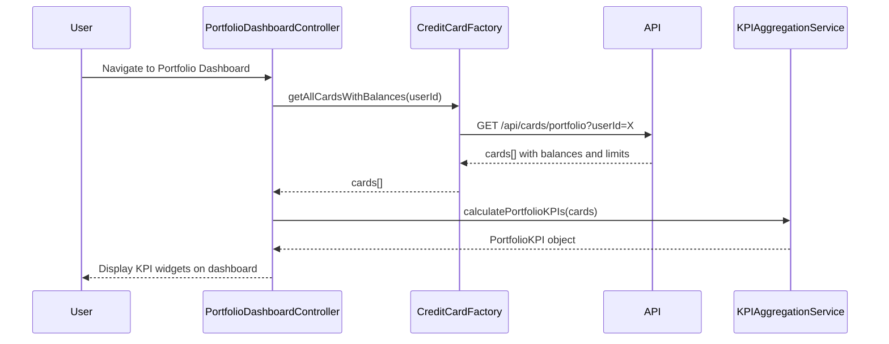

# Low-Level Design: QE-8261 - Credit Card Portfolio Dashboard and KPIs

## a. Architecture Mapping

**Component to Artifact Mapping:**
- Dashboard UI → AngularJS Module (`portfolioDashboardModule`) + Controller (`PortfolioDashboardController`)
- KPI Aggregation Service → AngularJS Service (`KPIAggregationService`) for calculating portfolio-level KPIs
- Credit Card Data Service → AngularJS Factory (`CreditCardFactory`) for fetching card details, balances, and limits
- User Authentication Service → Integrated via AngularJS $http interceptor for token management

**Recommended Folder Structure:**
```
app/
├── modules/
│   └── portfolio-dashboard/
│       ├── portfolio-dashboard.module.js
│       ├── controllers/
│       │   └── portfolio-dashboard.controller.js
│       ├── services/
│       │   └── kpi-aggregation.service.js
│       ├── factories/
│       │   └── credit-card.factory.js
│       └── views/
│           └── portfolio-dashboard.html
```

## b. Component Specifications

| Component Name | Artifact Type | Responsibility | Key Dependencies |
|----------------|---------------|----------------|------------------|
| portfolioDashboardModule | Module | Root module for portfolio dashboard feature | ngRoute, ngAnimate |
| PortfolioDashboardController | Controller | Manages dashboard UI, triggers KPI calculation and display | KPIAggregationService, CreditCardFactory |
| KPIAggregationService | Service | Aggregates data across all cards to calculate monthly spend, total credit limit, available credit, outstanding amounts | None |
| CreditCardFactory | Factory | Fetches all credit cards with balances and limits from REST API | $http, $q |

## c. Data Model

**PortfolioKPI Model:**
```javascript
{
  monthlySpend: Number,
  totalCreditLimit: Number,
  availableCredit: Number,
  outstandingAmount: Number,
  cardCount: Number,
  lastUpdated: Date
}
```

**CreditCard Model:**
```javascript
{
  cardId: String,
  cardNumber: String, // Masked
  cardType: String,
  creditLimit: Number,
  availableCredit: Number,
  outstandingBalance: Number,
  currentMonthSpend: Number
}
```

## d. Data Flow

User navigates to Portfolio Dashboard → PortfolioDashboardController calls CreditCardFactory.getAllCardsWithBalances() → Factory makes GET request to /api/cards/portfolio → API returns all cards with current balances, limits, and monthly spend → KPIAggregationService.calculatePortfolioKPIs(cards) aggregates data across all cards → Calculated KPIs (monthly spend, total credit limit, available credit, outstanding amount) bound to controller scope → Dashboard view displays KPI widgets in responsive layout → Real-time updates via periodic refresh.

## e. Primary Sequence Diagram



## f. Implementation Notes

- Use AngularJS Dependency Injection to inject KPIAggregationService and CreditCardFactory into PortfolioDashboardController.
- Optimize API call by fetching all card data (including balances and limits) in a single request to meet the 2-second load time requirement.
- Implement responsive layout using Bootstrap grid system with media queries for desktop, tablet, and mobile views.
- Use AngularJS $filter('currency') for formatting monetary values in KPI widgets.
- Apply AngularJS animations (ngAnimate) for smooth transitions when KPI values update.

## g. Error Handling

HTTP interceptor-based error handling; display user-friendly error messages using toastr; fallback to cached data if available; retry mechanism for transient API failures.

## h. Security Notes

Requires token-based auth via existing SSO; all API calls include Authorization header with JWT token; card data is user-specific and access-controlled.