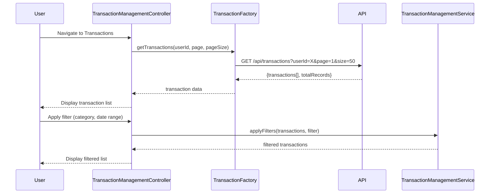

# Low-Level Design: QE-8262 - Transaction Management and Viewing

## a. Architecture Mapping

**Component to Artifact Mapping:**
- User Interface → AngularJS Module (`transactionManagementModule`) + Controller (`TransactionManagementController`)
- Transaction Management Service → AngularJS Service (`TransactionManagementService`) for business logic and state management
- Transaction Data Service → AngularJS Factory (`TransactionFactory`) for API calls to fetch transaction history
- Credit Card Service → AngularJS Factory (`CreditCardFactory`) for linking transactions to cards
- Category Classification Service → Backend API (consumed via `CategoryFactory`)

**Recommended Folder Structure:**
```
app/
├── modules/
│   └── transaction-management/
│       ├── transaction-management.module.js
│       ├── controllers/
│       │   └── transaction-management.controller.js
│       ├── services/
│       │   └── transaction-management.service.js
│       ├── factories/
│       │   ├── transaction.factory.js
│       │   ├── credit-card.factory.js
│       │   └── category.factory.js
│       └── views/
│           └── transaction-management.html
```

## b. Component Specifications

| Component Name | Artifact Type | Responsibility | Key Dependencies |
|----------------|---------------|----------------|------------------|
| transactionManagementModule | Module | Root module for transaction management feature | ngRoute, ngTable |
| TransactionManagementController | Controller | Manages transaction list UI, handles search, filter, and pagination | TransactionManagementService, TransactionFactory, CreditCardFactory |
| TransactionManagementService | Service | Maintains transaction state, applies search/filter logic, manages pagination | None |
| TransactionFactory | Factory | Fetches transaction history from REST API with pagination support | $http, $q |
| CreditCardFactory | Factory | Fetches card details for linking transactions to specific cards | $http |
| CategoryFactory | Factory | Retrieves category metadata for transaction categorization | $http |

## c. Data Model

**Transaction Model:**
```javascript
{
  id: String,
  cardId: String,
  cardName: String,
  merchantName: String,
  amount: Number,
  date: Date,
  category: String,
  status: String, // "pending", "completed", "failed"
  description: String
}
```

**TransactionFilter Model:**
```javascript
{
  cardId: String,
  category: String,
  dateFrom: Date,
  dateTo: Date,
  minAmount: Number,
  maxAmount: Number,
  searchText: String
}
```

**PaginationConfig Model:**
```javascript
{
  currentPage: Number,
  pageSize: Number,
  totalRecords: Number
}
```

## d. Data Flow

User navigates to Transaction Management view → TransactionManagementController initializes and calls TransactionFactory.getTransactions(userId, paginationConfig) → Factory makes paginated GET request to /api/transactions → API returns transaction data with pagination metadata → Controller stores transactions in scope and displays in table → User applies search/filter criteria → TransactionManagementService.applyFilters(transactions, filter) filters data client-side → Filtered transactions displayed → User clicks on transaction row → Controller navigates to transaction details view with transaction ID.

## e. Primary Sequence Diagram



## f. Implementation Notes

- Use AngularJS Dependency Injection to inject TransactionFactory, TransactionManagementService, and CreditCardFactory into TransactionManagementController.
- Implement server-side pagination with default page size of 50 transactions; use ngTable or custom pagination directive for UI.
- Apply AngularJS filters for client-side search and filtering (by merchant name, category, date range, amount range).
- Use ng-repeat with track by id for efficient DOM rendering of transaction list.
- Leverage Bootstrap table styling for responsive transaction table layout.

## g. Error Handling

HTTP interceptor captures API errors; display user-friendly error messages via toastr; retry mechanism for transient failures; fallback to empty state UI on data load failure.

## h. Security Notes

Requires token-based auth via existing SSO; all API calls include Authorization header with JWT token; transaction data is user-specific and access-controlled.