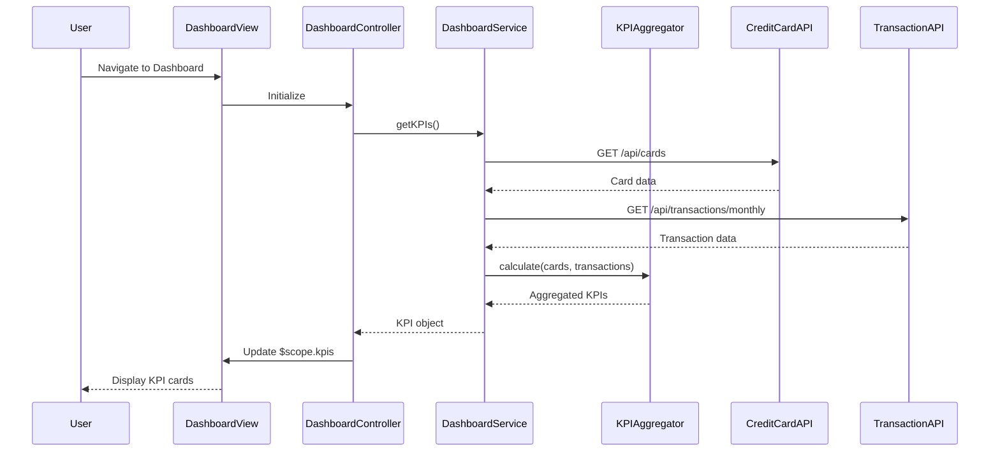

# Low-Level Design: Dashboard and KPI Management
**Epic ID:** QE-8287  
**Application Stack:** AngularJS 1.x, JavaScript ES6, HTML5, CSS3, Bootstrap, REST APIs, MVC Architecture

---

## a. Architecture Mapping

**HLD Component → AngularJS Artifact:**
- User Interface → Module: `dashboardModule`, Controller: `DashboardController`, View: `dashboard.html`
- Dashboard Service → Service: `DashboardService`
- KPI Aggregator → Factory: `KPIAggregatorFactory`
- Credit Card Data Service → Service: `CreditCardDataService` (external integration)
- Transaction Service → Service: `TransactionService` (external integration)

**Recommended Folder Structure:**
```
app/
├── modules/
│   └── dashboard/
│       ├── dashboard.module.js
│       ├── dashboard.controller.js
│       ├── dashboard.service.js
│       └── views/
│           └── dashboard.html
├── shared/
│   ├── factories/
│   │   └── kpi-aggregator.factory.js
│   └── services/
│       ├── credit-card-data.service.js
│       └── transaction.service.js
└── assets/
    ├── css/
    └── js/
```

---

## b. Component Specifications

| Component Name | Artifact Type | Responsibility | Key Dependencies |
|----------------|---------------|----------------|------------------|
| dashboardModule | Module | Declares dashboard feature module and routes | angular, ngRoute |
| DashboardController | Controller | Manages dashboard view state, triggers KPI load, handles user interactions | DashboardService, KPIAggregatorFactory, $scope |
| DashboardService | Service | Orchestrates data retrieval for dashboard KPIs | CreditCardDataService, TransactionService, $http, $q |
| KPIAggregatorFactory | Factory | Aggregates and calculates KPIs (monthly spend, total limit, available credit, outstanding) | None |
| CreditCardDataService | Service | Fetches card balances and credit limits from REST API | $http, $q |
| TransactionService | Service | Fetches monthly spend and outstanding amounts from REST API | $http, $q |
| dashboard.html | View | Renders KPI cards with responsive Bootstrap layout | Bootstrap CSS |

---

## c. Data Model

**CreditCard Object:**
```javascript
{
  cardId: String,
  cardNumber: String,
  cardType: String,
  creditLimit: Number,
  availableCredit: Number,
  outstandingAmount: Number
}
```

**Transaction Object:**
```javascript
{
  transactionId: String,
  cardId: String,
  amount: Number,
  date: Date,
  category: String
}
```

**KPI Model:**
```javascript
{
  monthlySpend: Number,
  totalCreditLimit: Number,
  availableCredit: Number,
  outstandingAmount: Number
}
```

---

## d. Data Flow

User navigates to dashboard → `DashboardController` initializes and calls `DashboardService.getKPIs()` → Service invokes `CreditCardDataService.getAllCards()` and `TransactionService.getMonthlyTransactions()` in parallel → Raw data is passed to `KPIAggregatorFactory.calculate()` which computes aggregated KPIs → Aggregated KPI object is returned to controller and bound to `$scope.kpis` → View (`dashboard.html`) renders KPI cards using Bootstrap grid with two-way data binding → On data refresh (polling or manual), the cycle repeats and view updates automatically.

---

## e. Primary Sequence Diagram



---

## f. Implementation Notes

- Use AngularJS dependency injection to inject services into controllers and factories into services for testability.
- Leverage ES6 classes for service definitions and arrow functions for promise chaining.
- Implement Bootstrap responsive grid (col-xs, col-sm, col-md) for KPI card layout to ensure mobile and desktop compatibility.
- Use `$http` service with promise-based API calls; aggregate parallel requests using `$q.all()`.
- Implement periodic polling using `$interval` service for real-time KPI refresh (configurable interval, e.g., 30 seconds).

---

## g. Error Handling

HTTP interceptor captures API errors; user-friendly notifications displayed via Bootstrap alerts with retry option.

---

## h. Security Notes

Requires token-based auth via existing SSO; API endpoints secured with JWT validation on backend.