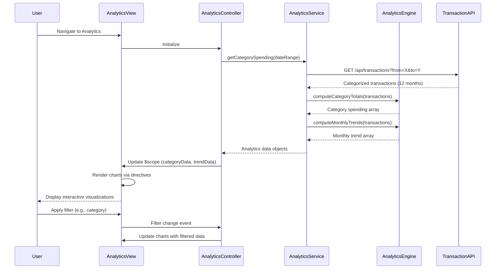

# Low-Level Design: Analytics and Spending Insights
**Epic ID:** QE-8288  
**Application Stack:** AngularJS 1.x, JavaScript ES6, HTML5, CSS3, Bootstrap, REST APIs, MVC Architecture

---

## a. Architecture Mapping

**HLD Component → AngularJS Artifact:**
- User Interface → Module: `analyticsModule`, Controller: `AnalyticsController`, View: `analytics.html`
- Analytics Service → Service: `AnalyticsService`
- Transaction Service → Service: `TransactionService` (external integration)
- Analytics Engine → Factory: `AnalyticsEngineFactory`
- Data Store → REST API endpoints

**Recommended Folder Structure:**
```
app/
├── modules/
│   └── analytics/
│       ├── analytics.module.js
│       ├── analytics.controller.js
│       ├── analytics.service.js
│       ├── directives/
│       │   ├── category-chart.directive.js
│       │   └── trend-chart.directive.js
│       └── views/
│           └── analytics.html
├── shared/
│   ├── factories/
│   │   └── analytics-engine.factory.js
│   └── services/
│       └── transaction.service.js
└── assets/
    ├── css/
    └── libs/
        └── chart.js
```

---

## b. Component Specifications

| Component Name | Artifact Type | Responsibility | Key Dependencies |
|----------------|---------------|----------------|------------------|
| analyticsModule | Module | Declares analytics feature module and routes | angular, ngRoute, chart.js |
| AnalyticsController | Controller | Manages analytics view state, handles filter interactions, triggers data load | AnalyticsService, AnalyticsEngineFactory, $scope, $filter |
| AnalyticsService | Service | Fetches categorized transaction data and coordinates analytics computation | TransactionService, $http, $q |
| AnalyticsEngineFactory | Factory | Computes category-wise spending totals, monthly trends, and pattern analysis | None |
| TransactionService | Service | Retrieves categorized transactions from REST API with date range filters | $http, $q |
| CategoryChartDirective | Directive | Renders interactive pie/donut chart for category-wise spending using Chart.js | chart.js |
| TrendChartDirective | Directive | Renders line chart for monthly spend trends with drill-down capability | chart.js |
| analytics.html | View | Displays charts, filters, and spending breakdown table with Bootstrap layout | Bootstrap CSS, directives |

---

## c. Data Model

**Transaction Object:**
```javascript
{
  transactionId: String,
  cardId: String,
  amount: Number,
  date: Date,
  category: String // One of: Food & Dining, Fuel, Shopping, Travel, Entertainment, Utilities, Healthcare, Education, Miscellaneous
}
```

**CategorySpending Object:**
```javascript
{
  category: String,
  totalAmount: Number,
  percentage: Number,
  transactionCount: Number
}
```

**MonthlyTrend Object:**
```javascript
{
  month: String, // YYYY-MM format
  totalSpend: Number,
  categoryBreakdown: Array<CategorySpending>
}
```

---

## d. Data Flow

User navigates to analytics page → `AnalyticsController` initializes and calls `AnalyticsService.getCategorySpending(dateRange)` → Service invokes `TransactionService.getTransactions(filters)` to fetch categorized transaction data → Raw transactions are passed to `AnalyticsEngineFactory.computeCategoryTotals()` and `computeMonthlyTrends()` → Computed analytics objects are returned to controller and bound to `$scope.categoryData` and `$scope.trendData` → View renders charts via `CategoryChartDirective` and `TrendChartDirective` using Chart.js → User applies filters (date range, category) → Controller updates scope and re-triggers analytics computation → Charts update reactively.

---

## e. Primary Sequence Diagram



---

## f. Implementation Notes

- Use AngularJS custom directives with isolated scope for reusable chart components; pass data via attribute bindings.
- Integrate Chart.js library for rendering interactive pie, donut, and line charts with hover tooltips and click events.
- Implement ES6 array methods (map, reduce, filter) in `AnalyticsEngineFactory` for efficient category aggregation and trend calculation.
- Use `$filter` service for date range filtering and currency formatting in views.
- Cache transaction data in service layer using simple object cache to avoid redundant API calls within session.

---

## g. Error Handling

HTTP interceptor handles API failures; fallback displays cached data or empty state with user notification.

---

## h. Security Notes

Standard input validation and secure API calls assumed; transaction data filtered by authenticated user context.