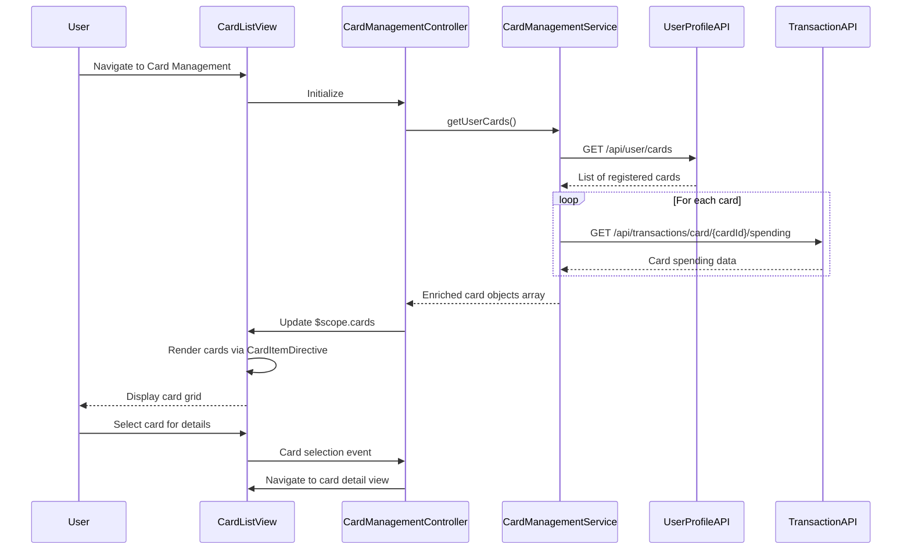

# Low-Level Design: Multiple Credit Card Management
**Epic ID:** QE-8289  
**Application Stack:** AngularJS 1.x, JavaScript ES6, HTML5, CSS3, Bootstrap, REST APIs, MVC Architecture

---

## a. Architecture Mapping

**HLD Component → AngularJS Artifact:**
- User Interface → Module: `cardManagementModule`, Controller: `CardManagementController`, View: `card-list.html`
- Card Management Service → Service: `CardManagementService`
- User Profile Service → Service: `UserProfileService` (external integration)
- Transaction Service → Service: `TransactionService` (external integration)
- Database → REST API endpoints

**Recommended Folder Structure:**
```
app/
├── modules/
│   └── card-management/
│       ├── card-management.module.js
│       ├── card-management.controller.js
│       ├── card-management.service.js
│       ├── directives/
│       │   └── card-item.directive.js
│       └── views/
│           ├── card-list.html
│           └── card-detail.html
├── shared/
│   └── services/
│       ├── user-profile.service.js
│       └── transaction.service.js
└── assets/
    ├── css/
    └── images/
```

---

## b. Component Specifications

| Component Name | Artifact Type | Responsibility | Key Dependencies |
|----------------|---------------|----------------|------------------|
| cardManagementModule | Module | Declares card management feature module and routes | angular, ngRoute |
| CardManagementController | Controller | Manages card list view, handles card selection, filters, and triggers card-wise analysis | CardManagementService, TransactionService, $scope, $filter |
| CardManagementService | Service | Orchestrates retrieval of user's registered cards and card-specific data | UserProfileService, $http, $q |
| UserProfileService | Service | Fetches user profile and registered credit card list from REST API | $http, $q |
| TransactionService | Service | Retrieves card-wise spending data and transaction history from REST API | $http, $q |
| CardItemDirective | Directive | Renders individual card tile with balance, limit, and utilization percentage | None |
| card-list.html | View | Displays grid of credit cards with filtering and sorting options using Bootstrap | Bootstrap CSS, CardItemDirective |

---

## c. Data Model

**CreditCard Object:**
```javascript
{
  cardId: String,
  userId: String,
  cardNumber: String, // Masked (e.g., **** **** **** 1234)
  cardType: String, // Visa, MasterCard, Amex, etc.
  cardHolderName: String,
  creditLimit: Number,
  availableCredit: Number,
  outstandingAmount: Number,
  utilizationRate: Number, // Calculated as (creditLimit - availableCredit) / creditLimit * 100
  expiryDate: String, // MM/YY
  isActive: Boolean
}
```

**CardSpending Object:**
```javascript
{
  cardId: String,
  monthlySpend: Number,
  transactionCount: Number,
  lastTransactionDate: Date
}
```

---

## d. Data Flow

User navigates to card management page → `CardManagementController` initializes and calls `CardManagementService.getUserCards()` → Service invokes `UserProfileService.getRegisteredCards()` to fetch user's card list → For each card, service calls `TransactionService.getCardSpending(cardId)` to retrieve card-wise spending data → Card objects enriched with spending data are returned to controller and bound to `$scope.cards` → View (`card-list.html`) renders card grid using `CardItemDirective` for each card with Bootstrap responsive layout → User applies filter (e.g., by card type) or sorts (e.g., by utilization) → Controller updates `$scope.filteredCards` using `$filter` → View updates to display filtered/sorted cards.

---

## e. Primary Sequence Diagram



---

## f. Implementation Notes

- Use AngularJS dependency injection to inject services into controller; use `$q.all()` to fetch card spending data in parallel for performance.
- Implement `CardItemDirective` with isolated scope accepting card object as attribute; directive template includes Bootstrap card component with utilization progress bar.
- Use ES6 template literals for dynamic card number masking and computed properties (e.g., utilization rate calculation).
- Implement client-side filtering and sorting using AngularJS `$filter` service (orderBy, filter) for responsive user experience without server round-trips.
- Ensure card list loads within 1 second by optimizing API payload (return only necessary fields) and implementing lazy loading for card details.

---

## g. Error Handling

HTTP interceptor captures API errors; display user-friendly message with retry option using Bootstrap modal.

---

## h. Security Notes

Requires token-based auth via existing SSO; card numbers masked on client; sensitive data transmitted over HTTPS only.