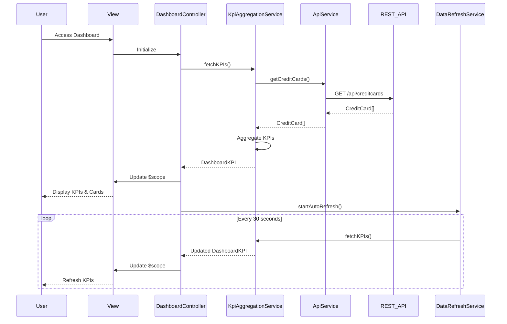

# Low-Level Design: QE-8290 - Dashboard KPIs and Credit Card Overview

## a. Architecture Mapping

- **Dashboard Module** → AngularJS Module (`creditCardDashboard`)
- **Responsive UI Layer** → HTML5 templates with Bootstrap grid + CSS3 media queries
- **Dashboard Controller** → AngularJS Controller (`DashboardController`)
- **KPI Aggregation Service** → AngularJS Service (`KpiAggregationService`)
- **Real-time Data Refresh Module** → AngularJS Service with `$interval` (`DataRefreshService`)
- **Credit Card Data Source** → REST API integration via AngularJS `$http` service

**Recommended Folder Structure:**
```
app/
├── modules/dashboard/
│   ├── controllers/DashboardController.js
│   ├── services/KpiAggregationService.js
│   ├── services/DataRefreshService.js
│   ├── views/dashboard.html
│   └── dashboard.module.js
├── shared/
│   ├── services/ApiService.js
│   └── interceptors/ErrorInterceptor.js
└── assets/css/dashboard.css
```

## b. Component Specifications

| Name | Artifact Type | Responsibility | Key Dependencies |
|------|---------------|----------------|------------------|
| creditCardDashboard | Module | Root module for dashboard feature | ngRoute, ngResource |
| DashboardController | Controller | Manages dashboard view state, KPI display, and user interactions | KpiAggregationService, DataRefreshService, $scope |
| KpiAggregationService | Service | Fetches and aggregates KPI data (Monthly Spend, Total Credit Limit, Available Credit, Outstanding Amount) from API | ApiService, $http, $q |
| DataRefreshService | Service | Polls API at intervals for real-time KPI updates | $interval, KpiAggregationService |
| ApiService | Service | Handles all REST API calls to credit card data source | $http, $q |
| ErrorInterceptor | Factory | Intercepts HTTP errors and provides user notifications | $q, $injector |
| dashboard.html | View | Responsive Bootstrap-based template displaying KPIs and card list | Bootstrap grid, ng-repeat, ng-class |

## c. Data Model

**CreditCard Object:**
```javascript
{
  cardId: String,
  cardNumber: String (masked),
  cardType: String,
  cardholderName: String,
  creditLimit: Number,
  availableCredit: Number,
  outstandingAmount: Number,
  monthlySpend: Number,
  expiryDate: String
}
```

**DashboardKPI Object:**
```javascript
{
  totalMonthlySpend: Number,
  totalCreditLimit: Number,
  totalAvailableCredit: Number,
  totalOutstandingAmount: Number,
  cardCount: Number,
  lastUpdated: Date
}
```

## d. Data Flow

User accesses dashboard → AngularJS route loads DashboardController and dashboard.html view → Controller invokes KpiAggregationService.fetchKPIs() → Service calls REST API via ApiService to retrieve all credit card data → API returns array of CreditCard objects → Service aggregates KPIs (sum of limits, available credit, outstanding amounts, monthly spend) → Aggregated DashboardKPI object is returned to Controller → Controller binds data to $scope → View renders KPIs in Bootstrap cards and displays credit card list using ng-repeat → DataRefreshService polls API every 30 seconds and updates $scope with fresh data → UI updates automatically via AngularJS two-way binding.

## e. Primary Sequence Diagram



## f. Implementation Notes

- Use AngularJS Dependency Injection to inject services into controllers; follow strict DI annotation (`$inject` or array syntax) for minification safety.
- Implement responsive design using Bootstrap grid (col-xs, col-sm, col-md, col-lg) and CSS3 media queries for mobile/tablet/desktop breakpoints.
- Use `$http` service with promise-based pattern for REST API calls; leverage `$q` for promise chaining and error handling.
- Implement `$interval` in DataRefreshService for polling; ensure proper cleanup on scope destroy (`$scope.$on('$destroy')`) to prevent memory leaks.
- Use AngularJS filters for formatting currency, dates, and masked card numbers in the view.

## g. Error Handling

HTTP errors are intercepted by ErrorInterceptor factory; user-facing notifications are displayed via a toast/alert service, and failed API calls are logged for debugging.

## h. Security Notes

Requires token-based authentication via existing SSO; API calls include Authorization header with bearer token, and sensitive card data is masked on client-side.