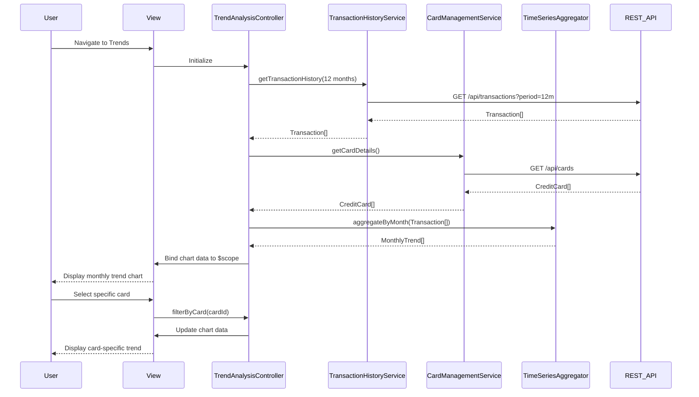

# Low-Level Design: QE-8291 - Monthly Spend Trends and Card-wise Analysis

## a. Architecture Mapping

- **Trend Analysis Module** → AngularJS Module (`spendTrendsModule`)
- **User Interface** → HTML5 view with Bootstrap layout and Chart.js directives
- **Trend Analysis Controller** → AngularJS Controller (`TrendAnalysisController`)
- **Transaction History Service** → AngularJS Service (`TransactionHistoryService`)
- **Card Management Service** → AngularJS Service (`CardManagementService`)
- **Time-Series Aggregator** → AngularJS Factory (`TimeSeriesAggregator`)
- **Card-wise Analyzer** → AngularJS Factory (`CardwiseAnalyzer`)

**Recommended Folder Structure:**
```
app/
├── modules/trends/
│   ├── controllers/TrendAnalysisController.js
│   ├── services/TransactionHistoryService.js
│   ├── services/CardManagementService.js
│   ├── factories/TimeSeriesAggregator.js
│   ├── factories/CardwiseAnalyzer.js
│   ├── directives/trendChartDirective.js
│   ├── views/trends.html
│   └── trends.module.js
└── shared/services/ApiService.js
```

## b. Component Specifications

| Name | Artifact Type | Responsibility | Key Dependencies |
|------|---------------|----------------|------------------|
| spendTrendsModule | Module | Root module for spending trends feature | ngRoute, chart.js |
| TrendAnalysisController | Controller | Manages trend view, user selections (time period, cards), and chart data binding | TransactionHistoryService, CardManagementService, TimeSeriesAggregator, CardwiseAnalyzer, $scope |
| TransactionHistoryService | Service | Fetches historical transaction data (12 months) from REST API | ApiService, $http, $q |
| CardManagementService | Service | Retrieves card details and card-specific transaction aggregations | ApiService, $http, $q |
| TimeSeriesAggregator | Factory | Computes monthly spending totals and trends from transaction data | None (pure computation) |
| CardwiseAnalyzer | Factory | Breaks down spending by individual cards and calculates card usage metrics | None (pure computation) |
| trendChartDirective | Directive | Renders interactive line/bar charts using Chart.js for monthly trends | Chart.js library |
| trends.html | View | Bootstrap-based template with dropdowns for card/time selection and chart containers | Bootstrap, ng-repeat, ng-options |

## c. Data Model

**Transaction Object:**
```javascript
{
  transactionId: String,
  cardId: String,
  amount: Number,
  category: String,
  merchant: String,
  transactionDate: Date,
  description: String
}
```

**MonthlyTrend Object:**
```javascript
{
  month: String (YYYY-MM),
  totalSpend: Number,
  transactionCount: Number,
  cardBreakdown: Array<{cardId: String, spend: Number}>
}
```

**CardSpendSummary Object:**
```javascript
{
  cardId: String,
  cardName: String,
  totalSpend: Number,
  monthlyData: Array<{month: String, spend: Number}>
}
```

## d. Data Flow

User navigates to trends view → TrendAnalysisController initializes and fetches 12 months of transaction data via TransactionHistoryService and card details via CardManagementService → Services call REST APIs and return Transaction[] and CreditCard[] → TimeSeriesAggregator processes transactions to compute MonthlyTrend[] (grouped by month) → CardwiseAnalyzer processes transactions to compute CardSpendSummary[] (grouped by card) → Controller binds aggregated data to $scope → View renders dropdowns for card/time selection and displays charts via trendChartDirective → User selects specific card or time range → Controller filters data and updates chart → Directive re-renders chart with updated dataset.

## e. Primary Sequence Diagram



## f. Implementation Notes

- Use AngularJS Factory pattern for stateless computation logic (TimeSeriesAggregator, CardwiseAnalyzer) and Service pattern for stateful API interactions.
- Integrate Chart.js via custom AngularJS directive; use directive's link function to render charts and watch scope variables for data changes to trigger re-rendering.
- Leverage ES6 Array methods (map, filter, reduce) in aggregator factories for efficient data transformation and grouping.
- Cache transaction history in service for 5 minutes to minimize API calls; use `$cacheFactory` or simple in-memory object.
- Implement dropdown filters using ng-options and ng-change to trigger controller methods for dynamic chart updates.

## g. Error Handling

API errors are caught in service promises using `.catch()` and propagated to controller; controller displays user-friendly error messages via toast notifications.

## h. Security Notes

Standard input validation and secure API calls assumed; transaction data is fetched with authenticated API requests including bearer token.