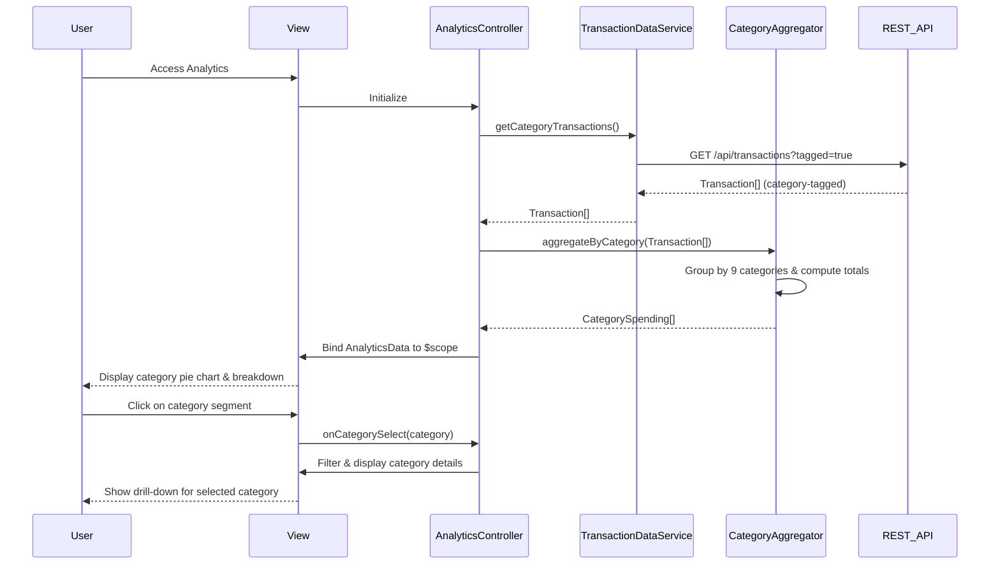

# Low-Level Design: QE-8292 - Spending Analytics and Category-wise Insights

## a. Architecture Mapping

- **Analytics Module** → AngularJS Module (`spendingAnalyticsModule`)
- **User Interface** → HTML5 view with Bootstrap grid and interactive chart components
- **Analytics Controller** → AngularJS Controller (`AnalyticsController`)
- **Transaction Data Service** → AngularJS Service (`TransactionDataService`)
- **Category Aggregation Module** → AngularJS Factory (`CategoryAggregator`)
- **Visualization Engine** → AngularJS Directive (`categoryChartDirective`) with Chart.js integration

**Recommended Folder Structure:**
```
app/
├── modules/analytics/
│   ├── controllers/AnalyticsController.js
│   ├── services/TransactionDataService.js
│   ├── factories/CategoryAggregator.js
│   ├── directives/categoryChartDirective.js
│   ├── views/analytics.html
│   └── analytics.module.js
└── shared/constants/CategoryConstants.js
```

## b. Component Specifications

| Name | Artifact Type | Responsibility | Key Dependencies |
|------|---------------|----------------|------------------|
| spendingAnalyticsModule | Module | Root module for spending analytics feature | ngRoute, chart.js |
| AnalyticsController | Controller | Manages analytics view state, category selection, and chart interactions | TransactionDataService, CategoryAggregator, $scope |
| TransactionDataService | Service | Fetches category-tagged transaction data from REST API | ApiService, $http, $q |
| CategoryAggregator | Factory | Groups transactions by 9 predefined categories and computes spending totals per category | CategoryConstants |
| categoryChartDirective | Directive | Renders interactive pie/bar charts for category-wise spending using Chart.js | Chart.js library |
| CategoryConstants | Constant | Defines the 9 predefined spending categories (Food & Dining, Fuel, Shopping, Travel, Entertainment, Utilities, Healthcare, Education, Miscellaneous) | None |
| analytics.html | View | Bootstrap-based template with category filter and chart display area | Bootstrap, ng-repeat |

## c. Data Model

**Transaction Object:**
```javascript
{
  transactionId: String,
  cardId: String,
  amount: Number,
  category: String (one of 9 predefined categories),
  merchant: String,
  transactionDate: Date,
  description: String
}
```

**CategorySpending Object:**
```javascript
{
  category: String,
  totalSpend: Number,
  transactionCount: Number,
  percentage: Number (of total spend)
}
```

**AnalyticsData Object:**
```javascript
{
  categoryBreakdown: Array<CategorySpending>,
  totalSpend: Number,
  period: String
}
```

## d. Data Flow

User accesses analytics view → AnalyticsController initializes and invokes TransactionDataService.getCategoryTransactions() → Service calls REST API to fetch category-tagged transactions → API returns Transaction[] → CategoryAggregator processes transactions and groups by 9 predefined categories, computing CategorySpending[] with totals and percentages → Aggregated AnalyticsData is returned to Controller → Controller binds data to $scope → View renders category breakdown using categoryChartDirective (pie chart) and a table/list for detailed breakdown → User clicks on chart segment or category → Controller filters transactions for selected category and displays drill-down details → Interactive elements respond within 300ms via AngularJS digest cycle.

## e. Primary Sequence Diagram



## f. Implementation Notes

- Define 9 category constants in CategoryConstants.js as an AngularJS constant for reuse across services and views.
- Use AngularJS Factory pattern for CategoryAggregator to encapsulate category grouping logic using ES6 reduce() for efficient aggregation.
- Implement categoryChartDirective using Chart.js; configure chart options for interactivity (onClick handlers) and ensure chart renders within 1 second by optimizing data transformation.
- Handle up to 1000 transactions per category by implementing efficient filtering and aggregation; avoid nested loops in aggregator logic.
- Use ng-click on chart segments (via directive scope) to trigger category drill-down in controller, ensuring 300ms response via lightweight scope updates.

## g. Error Handling

TransactionDataService catches API errors in promise chain and displays user-friendly error notifications; failed requests are logged and retried once with exponential backoff.

## h. Security Notes

Standard input validation and secure API calls assumed; category-tagged transaction data is fetched via authenticated API requests with bearer token.