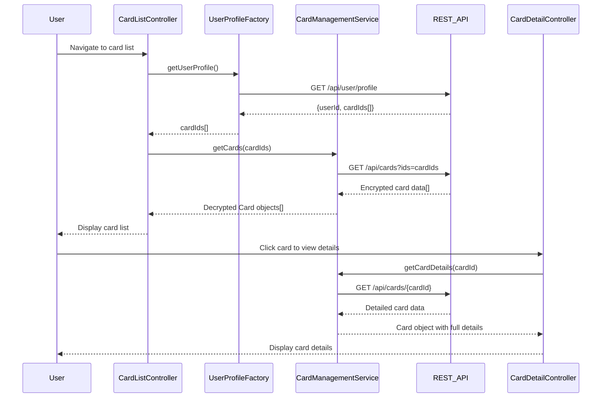

# Low-Level Design: Multiple Credit Card Management
**Epic ID:** QE-8299

## a. Architecture Mapping

- **User Interface** → AngularJS Module: `cardManagement`, Controller: `CardListController`, Directive: `cardSelector`
- **Card Management Service** → AngularJS Service: `CardManagementService` (handles card CRUD operations)
- **Card Selection Controller** → AngularJS Controller: `CardDetailController` (manages card selection and detail view)
- **Secure Data Storage** → REST API integration via `$http` service to backend storage endpoints
- **User Profile Service** → AngularJS Factory: `UserProfileFactory` (retrieves user-card associations)
- **Card Issuer Data Feed** → AngularJS Service: `CardIssuerService` (optional real-time card data sync)

**Recommended Folder Structure:**
```
/app
  /modules
    /card-management
      /controllers (CardListController, CardDetailController)
      /services (CardManagementService, CardIssuerService)
      /factories (UserProfileFactory)
      /directives (cardSelector)
      /views (card-list.html, card-detail.html)
  /shared
    /services (AuthInterceptor, ErrorHandler)
```

## b. Component Specifications

| Name | Artifact Type | Responsibility | Key Dependencies |
|------|---------------|----------------|------------------|
| cardManagement | Module | Root module for card management features | ngRoute, ngResource |
| CardListController | Controller | Displays list of all user cards with summary info | CardManagementService, UserProfileFactory |
| CardDetailController | Controller | Shows detailed view of selected card including limits and balances | CardManagementService, $routeParams |
| CardManagementService | Service | Handles API calls for card CRUD, retrieves card details | $http, $q, API_ENDPOINTS |
| UserProfileFactory | Factory | Fetches user profile and associated card IDs | $resource, AUTH_TOKEN |
| CardIssuerService | Service | Syncs card data from external issuer feeds (optional) | $http, $interval |
| cardSelector | Directive | Provides UI component for card selection dropdown | CardManagementService |

## c. Data Model

**Card Object:**
```javascript
{
  cardId: String,
  userId: String,
  cardNumber: String, // last 4 digits only
  cardHolderName: String,
  cardType: String, // 'Visa', 'MasterCard', 'Amex'
  creditLimit: Number,
  outstandingBalance: Number,
  availableCredit: Number, // calculated: creditLimit - outstandingBalance
  expiryDate: String, // 'MM/YY'
  isActive: Boolean,
  lastUpdated: Date
}
```

**UserProfile Object:**
```javascript
{
  userId: String,
  cardIds: Array<String>
}
```

## d. Data Flow

User navigates to card management view → CardListController initializes and calls UserProfileFactory to retrieve user profile → UserProfileFactory returns list of cardIds → CardListController calls CardManagementService.getCards(cardIds) → Service makes REST API call to backend → Backend returns encrypted card data → Service decrypts and maps to Card objects → Controller binds card list to view → User clicks on a card → cardSelector directive emits selection event → CardDetailController receives selected cardId via $routeParams → Controller calls CardManagementService.getCardDetails(cardId) → Service fetches detailed card info → Controller updates view with card details including credit limit, outstanding balance, and available credit.

## e. Primary Sequence Diagram



## f. Implementation Notes

- Use AngularJS Dependency Injection for all services, factories, and controllers to ensure testability and modularity.
- Implement ES6 classes for services and controllers, transpile with Babel if needed for browser compatibility.
- Use $http interceptor for attaching authentication tokens to all API requests and handling 401 responses.
- Leverage Bootstrap grid system (col-xs, col-sm, col-md) for responsive card list and detail views.
- Implement card switching with instant UI update using ng-click and $scope.$apply() for digest cycle triggering.

## g. Error Handling

HTTP interceptor captures API errors; user-friendly notifications displayed via toastr or custom modal; retry logic for network failures.

## h. Security Notes

Requires token-based auth via existing SSO; card data encrypted in transit (HTTPS) and at rest; only last 4 digits of card number displayed.