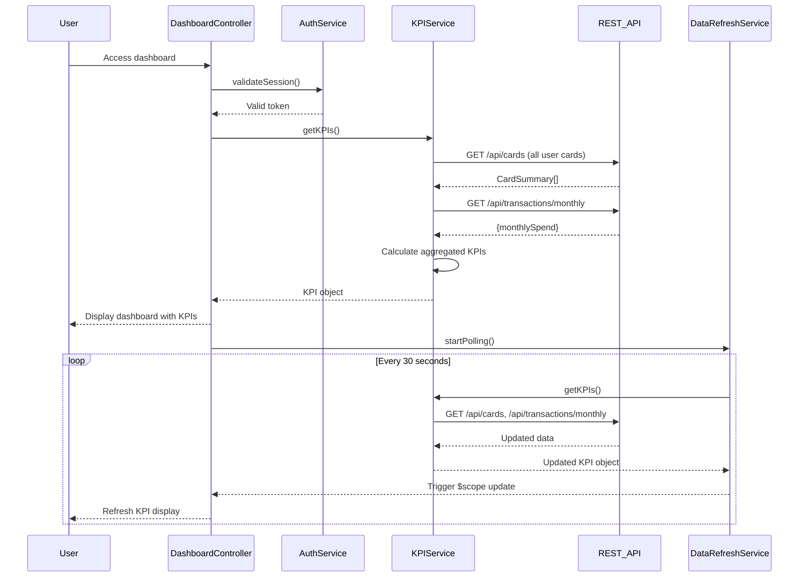

# Low-Level Design: Credit Card Dashboard and KPI Monitoring
**Epic ID:** QE-8300

## a. Architecture Mapping

- **Dashboard UI** → AngularJS Module: `dashboard`, Controller: `DashboardController`, View: `dashboard.html`
- **KPI Service** → AngularJS Service: `KPIService` (aggregates and calculates KPIs)
- **Credit Card Data Source** → REST API integration via `$http` to `/api/cards` and `/api/transactions` endpoints
- **Authentication Service** → AngularJS Service: `AuthService` (manages user session and tokens)
- **Real-time Data Refresh** → AngularJS Service: `DataRefreshService` (polling mechanism using $interval)

**Recommended Folder Structure:**
```
/app
  /modules
    /dashboard
      /controllers (DashboardController)
      /services (KPIService, DataRefreshService)
      /views (dashboard.html)
  /shared
    /services (AuthService, AuthInterceptor)
    /directives (kpiCard, chartWidget)
```

## b. Component Specifications

| Name | Artifact Type | Responsibility | Key Dependencies |
|------|---------------|----------------|------------------|
| dashboard | Module | Root module for dashboard functionality | ngRoute, ngAnimate |
| DashboardController | Controller | Orchestrates dashboard view, binds KPI data to UI | KPIService, DataRefreshService, AuthService |
| KPIService | Service | Fetches card data, calculates aggregated KPIs (total limit, available credit, monthly spend, outstanding) | $http, $q |
| DataRefreshService | Service | Polls backend every 30 seconds for updated card/transaction data | $interval, KPIService |
| AuthService | Service | Validates user session, provides auth token for API calls | $http, $window (localStorage) |
| kpiCard | Directive | Reusable UI component for displaying individual KPI with icon and value | None |
| chartWidget | Directive | Displays mini chart for monthly spend trend | Chart.js or similar library |

## c. Data Model

**KPI Object:**
```javascript
{
  totalCreditLimit: Number,
  totalAvailableCredit: Number,
  totalOutstanding: Number,
  monthlySpend: Number,
  utilizationPercentage: Number, // calculated: (totalOutstanding / totalCreditLimit) * 100
  lastUpdated: Date
}
```

**CardSummary Object:**
```javascript
{
  cardId: String,
  creditLimit: Number,
  outstandingBalance: Number,
  availableCredit: Number
}
```

## d. Data Flow

User logs in via AuthService → DashboardController initializes and calls KPIService.getKPIs() → KPIService makes parallel REST API calls to /api/cards and /api/transactions/monthly → Backend returns card summaries and monthly transaction totals → KPIService aggregates data (sums credit limits, outstanding balances, calculates available credit and utilization percentage) → Service returns KPI object to controller → Controller binds KPI data to $scope → View renders KPI cards using kpiCard directive → DataRefreshService starts $interval polling (every 30 seconds) → On each interval, service calls KPIService.getKPIs() → Updated KPIs trigger view refresh via two-way data binding.

## e. Primary Sequence Diagram



## f. Implementation Notes

- Use Bootstrap responsive utilities (hidden-xs, visible-md) to optimize KPI card layout for mobile, tablet, and desktop.
- Implement KPIService methods using $q.all() for parallel API calls to minimize load time.
- Use ng-animate for smooth transitions when KPI values update during refresh cycles.
- Leverage $interval in DataRefreshService with proper cleanup on $scope.$on('$destroy') to prevent memory leaks.
- Cache KPI data in service for 30 seconds to avoid redundant API calls if user navigates away and returns quickly.

## g. Error Handling

HTTP interceptor handles API failures; fallback to cached KPI data if refresh fails; user notified via toast message.

## h. Security Notes

Requires token-based auth via existing SSO; all API calls include Authorization header with JWT token.