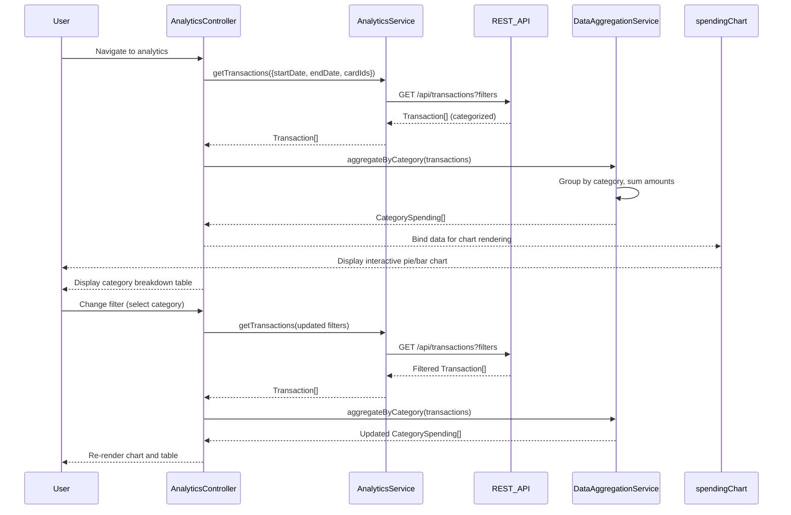

# Low-Level Design: Spending Analytics and Category Insights
**Epic ID:** QE-8301

## a. Architecture Mapping

- **User Interface** → AngularJS Module: `analytics`, Controller: `AnalyticsController`, View: `analytics.html`
- **Analytics Service** → AngularJS Service: `AnalyticsService` (fetches and processes transaction data)
- **Transaction Data Source** → REST API integration via `$http` to `/api/transactions` endpoint
- **Categorization Engine** → Backend service (transactions pre-categorized); AngularJS Filter: `categoryFilter` for client-side filtering
- **Visualization Library** → Chart.js integrated via AngularJS Directive: `spendingChart`
- **Data Aggregation Layer** → AngularJS Service: `DataAggregationService` (groups transactions by category and month)

**Recommended Folder Structure:**
```
/app
  /modules
    /analytics
      /controllers (AnalyticsController)
      /services (AnalyticsService, DataAggregationService)
      /directives (spendingChart, categoryBreakdown)
      /filters (categoryFilter)
      /views (analytics.html)
  /shared
    /constants (SPENDING_CATEGORIES)
```

## b. Component Specifications

| Name | Artifact Type | Responsibility | Key Dependencies |
|------|---------------|----------------|------------------|
| analytics | Module | Root module for spending analytics features | ngRoute, chart.js |
| AnalyticsController | Controller | Manages analytics view, handles user filters (card, category, date range) | AnalyticsService, DataAggregationService |
| AnalyticsService | Service | Fetches transaction data from REST API for specified time period | $http, $q |
| DataAggregationService | Service | Aggregates transactions by category and month, calculates totals and percentages | None (pure logic) |
| spendingChart | Directive | Renders interactive pie/bar chart for category-wise spending using Chart.js | Chart.js library |
| categoryBreakdown | Directive | Displays tabular breakdown of spending by category with amounts and percentages | None |
| categoryFilter | Filter | Filters transaction list by selected category | None |

## c. Data Model

**Transaction Object:**
```javascript
{
  transactionId: String,
  cardId: String,
  amount: Number, // precise to 2 decimals
  category: String, // 'Food & Dining', 'Fuel', 'Shopping', 'Travel', 'Entertainment', 'Utilities', 'Healthcare', 'Education', 'Miscellaneous'
  merchant: String,
  transactionDate: Date,
  description: String
}
```

**CategorySpending Object:**
```javascript
{
  category: String,
  totalAmount: Number, // precise to 2 decimals
  transactionCount: Number,
  percentage: Number // of total spending
}
```

**MonthlyTrend Object:**
```javascript
{
  month: String, // 'YYYY-MM'
  totalSpend: Number,
  categoryBreakdown: Array<CategorySpending>
}
```

## d. Data Flow

User navigates to analytics view → AnalyticsController initializes with default filters (all cards, last 3 months) → Controller calls AnalyticsService.getTransactions(filters) → Service makes REST API call to /api/transactions?startDate=X&endDate=Y&cardIds=Z → Backend returns array of categorized Transaction objects → Controller passes transactions to DataAggregationService.aggregateByCategory() → Service groups transactions by category, sums amounts (accurate to 2 decimals), calculates percentages → Service returns array of CategorySpending objects → Controller binds data to $scope → spendingChart directive renders pie chart, categoryBreakdown directive displays table → User changes filter (e.g., selects specific card or category) → Controller re-calls AnalyticsService with updated filters → New aggregated data triggers chart and table re-render.

## e. Primary Sequence Diagram



## f. Implementation Notes

- Use Chart.js responsive mode to ensure charts adapt to mobile, tablet, and desktop viewports.
- Implement DataAggregationService as a stateless service with pure functions for easy unit testing.
- Use AngularJS $filter service in controller to apply categoryFilter dynamically based on user selection.
- Leverage ES6 Array methods (reduce, map, filter) in DataAggregationService for efficient aggregation.
- Ensure all amount calculations use Number.toFixed(2) to maintain 2-decimal precision as per NFR.

## g. Error Handling

HTTP interceptor-based error handling; try/catch in aggregation logic; user notified via toast on API failure or data processing error.

## h. Security Notes

Standard input validation and secure API calls assumed; transactions fetched only for authenticated user's cards.