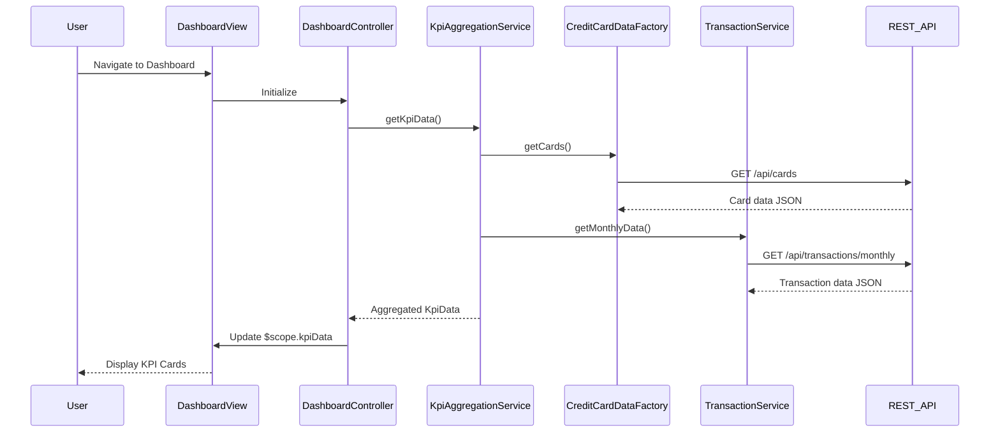

# Low-Level Design: Credit Card Dashboard and KPI Monitoring
**Epic ID:** QE-8302  
**Application Stack:** AngularJS 1.x, JavaScript ES6, HTML5, CSS3, Bootstrap, REST APIs, MVC Architecture

---

## a. Architecture Mapping

- **User Interface - Dashboard** → AngularJS Module (`creditCardDashboard`) + Controller (`DashboardController`) + HTML View (`dashboard.html`)
- **KPI Aggregation Service** → AngularJS Service (`KpiAggregationService`) with REST API integration
- **Credit Card Data Service** → AngularJS Factory (`CreditCardDataFactory`) for card balance/limit retrieval
- **Transaction Processing Service** → AngularJS Service (`TransactionService`) for monthly spend and outstanding amounts
- **Data Store** → Backend REST API endpoints (consumed via `$http`)

**Recommended Folder Structure:**
```
app/
├── modules/
│   └── dashboard/
│       ├── dashboard.module.js
│       ├── controllers/
│       │   └── dashboard.controller.js
│       ├── services/
│       │   ├── kpi-aggregation.service.js
│       │   ├── credit-card-data.factory.js
│       │   └── transaction.service.js
│       └── views/
│           └── dashboard.html
├── shared/
│   ├── constants/
│   └── interceptors/
└── assets/
    ├── css/
    └── js/
```

---

## b. Component Specifications

| Component Name | Artifact Type | Responsibility | Key Dependencies |
|---|---|---|---|
| `creditCardDashboard` | Module | Root module for dashboard feature | `ngRoute`, `ui.bootstrap` |
| `DashboardController` | Controller | Orchestrates KPI display, handles user interactions | `KpiAggregationService`, `$scope` |
| `KpiAggregationService` | Service | Aggregates KPI data from multiple sources | `CreditCardDataFactory`, `TransactionService`, `$q` |
| `CreditCardDataFactory` | Factory | Fetches card balances and credit limits via REST | `$http`, `API_ENDPOINTS` |
| `TransactionService` | Service | Retrieves monthly spend and outstanding amounts | `$http`, `API_ENDPOINTS` |
| `dashboardView` | HTML Template | Renders KPI cards with Bootstrap grid layout | Bootstrap CSS, AngularJS directives |

---

## c. Data Model

**KpiData (JavaScript Object):**
```javascript
{
  monthlySpend: Number,        // Current month total spend
  totalCreditLimit: Number,    // Sum of all card limits
  availableCredit: Number,     // Total available credit
  outstandingAmount: Number,   // Total outstanding balance
  lastUpdated: Date            // Timestamp of last refresh
}
```

**CreditCard (JavaScript Object):**
```javascript
{
  cardId: String,
  cardNumber: String,          // Masked (e.g., "****1234")
  creditLimit: Number,
  availableBalance: Number,
  outstandingBalance: Number
}
```

---

## d. Data Flow

User navigates to dashboard → `DashboardController` initializes and calls `KpiAggregationService.getKpiData()` → Service concurrently fetches data via `CreditCardDataFactory.getCards()` and `TransactionService.getMonthlyData()` using `$q.all()` → REST API calls return JSON responses → Service aggregates data into `KpiData` model → Controller updates `$scope.kpiData` → View renders KPI cards using Bootstrap grid with two-way data binding → Auto-refresh triggered every 5 minutes via `$interval` to update KPIs.

---

## e. Primary Sequence Diagram



---

## f. Implementation Notes

- Use AngularJS Dependency Injection for all services/factories to ensure testability and modularity
- Implement Promise-based async handling with `$q.all()` for parallel API calls to meet 2-second load requirement
- Apply Bootstrap responsive grid (`col-xs-*`, `col-md-*`) for mobile-first KPI card layout
- Use `$interval` service for periodic KPI refresh (5-minute interval) with cleanup on `$scope.$on('$destroy')`
- Implement HTTP interceptor for global error handling and loading state management

---

## g. Error Handling

HTTP interceptor captures API failures; user notified via Bootstrap alert component with retry option.

---

## h. Security Notes

Requires token-based authentication via existing SSO; card numbers masked in all responses.

---

**End of LLD**