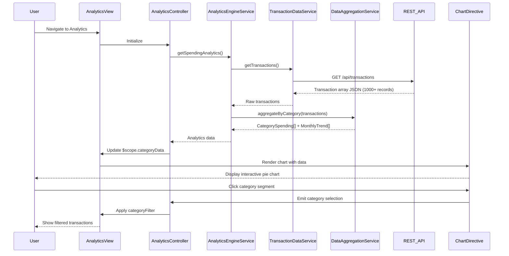

# Low-Level Design: Spending Analytics and Category Insights
**Epic ID:** QE-8303  
**Application Stack:** AngularJS 1.x, JavaScript ES6, HTML5, CSS3, Bootstrap, REST APIs, MVC Architecture

---

## a. Architecture Mapping

- **User Interface - Analytics Dashboard** → AngularJS Module (`spendingAnalytics`) + Controller (`AnalyticsController`) + HTML View (`analytics.html`)
- **Analytics Engine** → AngularJS Service (`AnalyticsEngineService`) for data processing and aggregation
- **Transaction Data Service** → AngularJS Service (`TransactionDataService`) for raw transaction retrieval
- **Category Classification Engine** → AngularJS Filter (`categoryFilter`) + Service (`CategoryService`) for transaction categorization
- **Data Aggregation Service** → AngularJS Service (`DataAggregationService`) for trend calculations
- **Transaction Data Store** → Backend REST API endpoints (consumed via `$http`)
- **Interactive Charts** → AngularJS Directive (`chartDirective`) wrapping Chart.js or D3.js

**Recommended Folder Structure:**
```
app/
├── modules/
│   └── analytics/
│       ├── analytics.module.js
│       ├── controllers/
│       │   └── analytics.controller.js
│       ├── services/
│       │   ├── analytics-engine.service.js
│       │   ├── transaction-data.service.js
│       │   ├── category.service.js
│       │   └── data-aggregation.service.js
│       ├── directives/
│       │   └── chart.directive.js
│       ├── filters/
│       │   └── category.filter.js
│       └── views/
│           └── analytics.html
├── shared/
│   └── constants/
│       └── categories.constant.js
└── assets/
    └── libs/
        └── chart.js
```

---

## b. Component Specifications

| Component Name | Artifact Type | Responsibility | Key Dependencies |
|---|---|---|---|
| `spendingAnalytics` | Module | Root module for analytics feature | `ngRoute`, `chart.js`, `ui.bootstrap` |
| `AnalyticsController` | Controller | Manages analytics view state and user interactions | `AnalyticsEngineService`, `$scope`, `$filter` |
| `AnalyticsEngineService` | Service | Orchestrates data retrieval and processing pipeline | `TransactionDataService`, `DataAggregationService`, `$q` |
| `TransactionDataService` | Service | Fetches raw transaction data via REST API | `$http`, `API_ENDPOINTS` |
| `CategoryService` | Service | Provides category definitions and mapping logic | `CATEGORY_CONSTANTS` |
| `DataAggregationService` | Service | Aggregates transactions by category and month with 2-decimal precision | `CategoryService`, ES6 Array methods |
| `chartDirective` | Directive | Renders interactive pie/bar charts using Chart.js | `Chart.js`, `$window` |
| `categoryFilter` | Filter | Filters transactions by selected category | None |

---

## c. Data Model

**Transaction (JavaScript Object):**
```javascript
{
  transactionId: String,
  amount: Number,
  date: Date,
  merchant: String,
  category: String,           // One of 9 predefined categories
  cardId: String
}
```

**CategorySpending (JavaScript Object):**
```javascript
{
  category: String,           // e.g., "Food & Dining"
  totalAmount: Number,        // Aggregated to 2 decimals
  transactionCount: Number,
  percentage: Number          // Of total monthly spend
}
```

**MonthlyTrend (JavaScript Object):**
```javascript
{
  month: String,              // Format: "YYYY-MM"
  totalSpend: Number,
  categoryBreakdown: Array    // Array of CategorySpending objects
}
```

**CATEGORY_CONSTANTS:**
```javascript
['Food & Dining', 'Fuel', 'Shopping', 'Travel', 'Entertainment', 'Utilities', 'Healthcare', 'Education', 'Miscellaneous']
```

---

## d. Data Flow

User navigates to analytics page → `AnalyticsController` calls `AnalyticsEngineService.getSpendingAnalytics()` → Service invokes `TransactionDataService.getTransactions()` to fetch raw transaction array via REST API → `DataAggregationService.aggregateByCategory()` processes transactions using ES6 `reduce()` and `map()`, grouping by category and calculating totals with 2-decimal precision → Aggregated data returned as `CategorySpending[]` → Controller updates `$scope.categoryData` and `$scope.monthlyTrends` → View renders interactive pie chart via `chartDirective` and category breakdown table → User clicks chart segment to filter transactions by category using `categoryFilter`.

---

## e. Primary Sequence Diagram



---

## f. Implementation Notes

- Use ES6 `Array.reduce()` and `Array.map()` in `DataAggregationService` for efficient category aggregation with `toFixed(2)` for decimal precision
- Implement Chart.js via custom AngularJS directive with isolated scope and two-way binding for interactive chart updates
- Cache aggregated analytics data in service layer using `$cacheFactory` to meet 2-second rendering requirement on repeat views
- Use `$filter` service for dynamic transaction filtering by category without re-fetching from API
- Apply responsive chart sizing using Chart.js `maintainAspectRatio` and Bootstrap container classes

---

## g. Error Handling

HTTP interceptor-based error handling with try/catch in aggregation logic; user notified via toast notifications for API failures.

---

## h. Security Notes

Standard input validation and secure API calls assumed; transaction data access controlled via user authentication token.

---

**End of LLD**