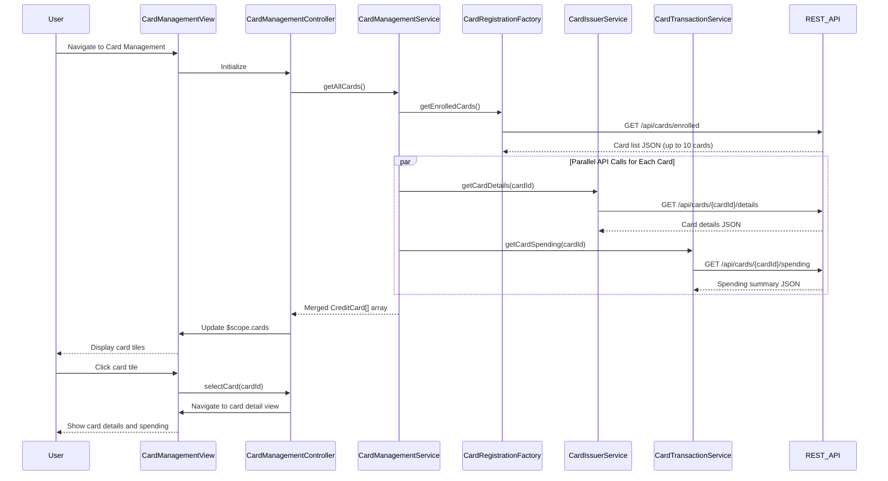

# Low-Level Design: Multiple Credit Card Management
**Epic ID:** QE-8304  
**Application Stack:** AngularJS 1.x, JavaScript ES6, HTML5, CSS3, Bootstrap, REST APIs, MVC Architecture

---

## a. Architecture Mapping

- **User Interface - Card Management** → AngularJS Module (`cardManagement`) + Controller (`CardManagementController`) + HTML View (`card-management.html`)
- **Card Management Service** → AngularJS Service (`CardManagementService`) for orchestrating card operations
- **Credit Card Registration Service** → AngularJS Factory (`CardRegistrationFactory`) for enrolled card data retrieval
- **Card Issuer Data Services** → AngularJS Service (`CardIssuerService`) for card details and status
- **Transaction Service** → AngularJS Service (`CardTransactionService`) for card-specific spending data

**Recommended Folder Structure:**
```
app/
├── modules/
│   └── card-management/
│       ├── card-management.module.js
│       ├── controllers/
│       │   └── card-management.controller.js
│       ├── services/
│       │   ├── card-management.service.js
│       │   ├── card-registration.factory.js
│       │   ├── card-issuer.service.js
│       │   └── card-transaction.service.js
│       ├── directives/
│       │   └── card-tile.directive.js
│       └── views/
│           ├── card-management.html
│           └── card-detail.html
├── shared/
│   └── components/
│       └── card-comparison/
└── assets/
    └── images/
        └── card-logos/
```

---

## b. Component Specifications

| Component Name | Artifact Type | Responsibility | Key Dependencies |
|---|---|---|---|
| `cardManagement` | Module | Root module for multi-card management feature | `ngRoute`, `ui.bootstrap` |
| `CardManagementController` | Controller | Manages card list, selection, and comparison state | `CardManagementService`, `$scope`, `$state` |
| `CardManagementService` | Service | Orchestrates card data retrieval from multiple sources | `CardRegistrationFactory`, `CardIssuerService`, `CardTransactionService`, `$q` |
| `CardRegistrationFactory` | Factory | Fetches enrolled card list via REST API | `$http`, `API_ENDPOINTS`, `$cacheFactory` |
| `CardIssuerService` | Service | Retrieves card details and real-time status | `$http`, `API_ENDPOINTS` |
| `CardTransactionService` | Service | Fetches card-specific spending and transaction data | `$http`, `API_ENDPOINTS` |
| `cardTileDirective` | Directive | Reusable card display component with click handler | None |

---

## c. Data Model

**CreditCard (JavaScript Object):**
```javascript
{
  cardId: String,
  cardNumber: String,          // Masked format
  cardType: String,            // e.g., "Visa", "Mastercard"
  cardHolderName: String,
  creditLimit: Number,
  availableCredit: Number,
  outstandingBalance: Number,
  status: String,              // "Active", "Blocked", "Expired"
  expiryDate: String,          // Format: "MM/YY"
  issuerName: String
}
```

**CardSpendingSummary (JavaScript Object):**
```javascript
{
  cardId: String,
  monthlySpend: Number,
  transactionCount: Number,
  lastTransactionDate: Date,
  topCategory: String          // Highest spending category
}
```

**CardComparison (JavaScript Object):**
```javascript
{
  cards: Array,                // Array of CreditCard objects
  comparisonMetrics: {
    totalCreditLimit: Number,
    totalAvailableCredit: Number,
    totalOutstanding: Number,
    utilizationRate: Number    // Percentage
  }
}
```

---

## d. Data Flow

User navigates to card management page → `CardManagementController` initializes and calls `CardManagementService.getAllCards()` → Service uses `$q.all()` to concurrently fetch data: `CardRegistrationFactory.getEnrolledCards()` retrieves card list (cached), `CardIssuerService.getCardDetails(cardId)` fetches status for each card, and `CardTransactionService.getCardSpending(cardId)` retrieves spending summaries → All promises resolve within 3 seconds → Service merges data into `CreditCard[]` array (max 10 cards) → Controller updates `$scope.cards` → View renders card tiles using `cardTileDirective` in Bootstrap grid → User clicks card tile → Controller navigates to card detail view with selected card data → User activates comparison mode → Controller builds `CardComparison` object and displays side-by-side metrics.

---

## e. Primary Sequence Diagram



---

## f. Implementation Notes

- Use `$q.all()` with array of promises for parallel card data fetching to meet 3-second retrieval NFR
- Implement `$cacheFactory` in `CardRegistrationFactory` to cache enrolled card list and reduce redundant API calls
- Create reusable `cardTileDirective` with isolated scope accepting card object and click callback for modularity
- Apply ES6 `Promise.all()` pattern wrapped in AngularJS `$q` for consistent async handling
- Use Bootstrap responsive grid (`col-sm-6 col-md-4`) for card tile layout supporting up to 10 cards

---

## g. Error Handling

Interceptor-based error handling with graceful degradation; partial card data displayed if some API calls fail, with retry option.

---

## h. Security Notes

Requires token-based auth via existing SSO; card numbers masked in all API responses and UI display.

---

**End of LLD**