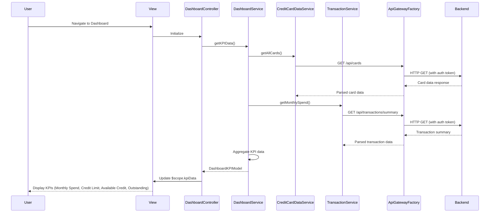

# Low-Level Design: QE-8311 - Credit Card Dashboard and KPI Management

## a. Architecture Mapping

- **User Interface - Dashboard**: AngularJS Module (`ccDashboardModule`) + Main Controller (`DashboardController`) + HTML5 view template
- **API Gateway**: REST API integration via AngularJS `$http` service wrapped in custom Factory (`ApiGatewayFactory`)
- **Dashboard Service**: AngularJS Service (`DashboardService`) for business logic and KPI calculations
- **Credit Card Data Service**: AngularJS Service (`CreditCardDataService`) for card data retrieval
- **Transaction Processing Service**: AngularJS Service (`TransactionService`) for spend and outstanding calculations
- **User Authentication Service**: AngularJS Service (`AuthService`) with HTTP interceptor for token management

**Recommended Folder Structure:**
```
app/
├── modules/
│   └── dashboard/
│       ├── controllers/
│       ├── services/
│       ├── factories/
│       └── views/
├── shared/
│   ├── services/
│   └── interceptors/
└── assets/
    ├── css/
    └── js/
```

## b. Component Specifications

| Name | Artifact Type | Responsibility | Key Dependencies |
|------|---------------|----------------|------------------|
| ccDashboardModule | Module | Root module for dashboard feature | angular, ngRoute, ui.bootstrap |
| DashboardController | Controller | Manages dashboard view state and user interactions | DashboardService, $scope, $interval |
| DashboardService | Service | Orchestrates KPI data retrieval and aggregation | CreditCardDataService, TransactionService, $q |
| CreditCardDataService | Service | Fetches credit card data from backend APIs | ApiGatewayFactory, $http, $q |
| TransactionService | Service | Retrieves and processes transaction data | ApiGatewayFactory, $http, $q |
| AuthService | Service | Manages user authentication and session | $http, $window, $cookies |
| ApiGatewayFactory | Factory | Centralized REST API communication wrapper | $http, API_CONFIG |
| AuthInterceptor | Factory | Intercepts HTTP requests to inject auth tokens | $q, $window, AuthService |
| kpiCard | Directive | Reusable KPI display card component | None |

## c. Data Model

**CreditCardModel:**
```javascript
{
  cardId: String,
  cardNumber: String,
  cardHolderName: String,
  creditLimit: Number,
  availableCredit: Number,
  outstandingAmount: Number,
  lastUpdated: Date
}
```

**DashboardKPIModel:**
```javascript
{
  monthlySpend: Number,
  totalCreditLimit: Number,
  totalAvailableCredit: Number,
  totalOutstanding: Number,
  lastRefreshed: Date
}
```

**TransactionSummaryModel:**
```javascript
{
  currentMonthSpend: Number,
  transactionCount: Number,
  period: String
}
```

## d. Data Flow

User navigates to the dashboard view, triggering `DashboardController` initialization. The controller invokes `DashboardService.getKPIData()`, which concurrently calls `CreditCardDataService.getAllCards()` and `TransactionService.getMonthlySpend()` using `$q.all()`. These services use `ApiGatewayFactory` to make REST API calls to backend endpoints (`/api/cards`, `/api/transactions/summary`). The `AuthInterceptor` injects the authentication token into each request header. Upon receiving responses, `DashboardService` aggregates the data into `DashboardKPIModel` and returns it to the controller. The controller updates `$scope.kpiData`, triggering Angular's digest cycle to refresh the view. A `$interval` service polls `DashboardService.refreshKPIData()` every 45 seconds for real-time updates.

## e. Primary Sequence Diagram



## f. Implementation Notes

- Use AngularJS 1.x with ES6 modules; transpile with Babel for browser compatibility
- Implement dependency injection via `$inject` annotation to ensure minification safety
- Use `$q.all()` for parallel API calls to optimize load time and meet 2-second page load NFR
- Apply Bootstrap 4 grid system with responsive breakpoints for cross-device compatibility
- Implement caching in services using `$cacheFactory` with TTL of 30 seconds to reduce redundant API calls

## g. Error Handling

HTTP interceptor captures API errors; user-facing notifications displayed via Bootstrap toast component with retry option.

## h. Security Notes

Requires token-based authentication via existing SSO; AuthInterceptor injects JWT in Authorization header for all API requests.