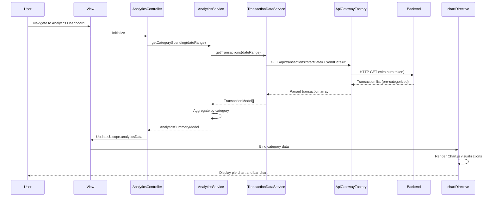

# Low-Level Design: QE-8312 - Transaction Analytics and Category-wise Spending Insights

## a. Architecture Mapping

- **User Interface - Analytics Dashboard**: AngularJS Module (`ccAnalyticsModule`) + Controller (`AnalyticsController`) + HTML5 view with chart containers
- **API Gateway**: REST API integration via AngularJS `$http` service wrapped in custom Factory (`ApiGatewayFactory`)
- **Analytics Service**: AngularJS Service (`AnalyticsService`) for data aggregation and analytics logic
- **Transaction Data Service**: AngularJS Service (`TransactionDataService`) for transaction retrieval
- **Category Classification Engine**: Backend service; client consumes categorized data via `TransactionDataService`
- **Data Visualization Engine**: AngularJS Directive (`chartDirective`) wrapping Chart.js library for rendering
- **Transaction History Database**: Backend persistence; accessed via REST APIs

**Recommended Folder Structure:**
```
app/
├── modules/
│   └── analytics/
│       ├── controllers/
│       ├── services/
│       ├── directives/
│       └── views/
├── shared/
│   ├── factories/
│   └── filters/
└── assets/
    ├── css/
    └── libs/
```

## b. Component Specifications

| Name | Artifact Type | Responsibility | Key Dependencies |
|------|---------------|----------------|------------------|
| ccAnalyticsModule | Module | Root module for analytics feature | angular, ngRoute, chart.js |
| AnalyticsController | Controller | Manages analytics view state and user interactions with charts | AnalyticsService, $scope, $filter |
| AnalyticsService | Service | Orchestrates transaction data retrieval and category aggregation | TransactionDataService, $q |
| TransactionDataService | Service | Fetches transaction data from backend APIs | ApiGatewayFactory, $http, $q |
| ApiGatewayFactory | Factory | Centralized REST API communication wrapper | $http, API_CONFIG |
| chartDirective | Directive | Renders interactive charts using Chart.js | Chart.js library |
| categoryFilter | Filter | Filters transactions by selected category | None |
| dateRangeFilter | Filter | Filters transactions by date range | None |

## c. Data Model

**TransactionModel:**
```javascript
{
  transactionId: String,
  cardId: String,
  amount: Number,
  category: String,
  merchantName: String,
  transactionDate: Date,
  description: String
}
```

**CategorySpendingModel:**
```javascript
{
  category: String,
  totalAmount: Number,
  transactionCount: Number,
  percentage: Number
}
```

**AnalyticsSummaryModel:**
```javascript
{
  categoryBreakdown: Array<CategorySpendingModel>,
  totalSpend: Number,
  period: String,
  lastUpdated: Date
}
```

## d. Data Flow

User navigates to the analytics view, triggering `AnalyticsController` initialization. The controller calls `AnalyticsService.getCategorySpending(dateRange)`, which invokes `TransactionDataService.getTransactions(dateRange)` to fetch transaction data via `ApiGatewayFactory` from the backend endpoint `/api/transactions?startDate=X&endDate=Y`. The backend returns pre-categorized transactions. `AnalyticsService` aggregates transactions by category into `CategorySpendingModel` objects, calculating totals and percentages. The aggregated `AnalyticsSummaryModel` is returned to the controller, which updates `$scope.analyticsData`. The view binds this data to the `chartDirective`, which uses Chart.js to render a pie chart and bar chart showing category-wise spending. User interactions (e.g., date range selection) trigger re-aggregation and chart updates via Angular's two-way data binding.

## e. Primary Sequence Diagram



## f. Implementation Notes

- Use AngularJS 1.x with Chart.js 2.x for visualization; wrap Chart.js in custom directive for Angular integration
- Implement lazy loading for transaction data using pagination to handle 12+ months of history efficiently
- Use `$q` promises for asynchronous data retrieval; cache aggregated category data for 5 minutes using `$cacheFactory`
- Apply Bootstrap responsive grid for chart containers to ensure mobile compatibility
- Use AngularJS `$filter` service for client-side date range and category filtering to reduce server calls

## g. Error Handling

HTTP interceptor captures API errors; display user-friendly error messages via Bootstrap alert component with retry button.

## h. Security Notes

Standard input validation and secure API calls assumed; JWT token authentication enforced via HTTP interceptor.