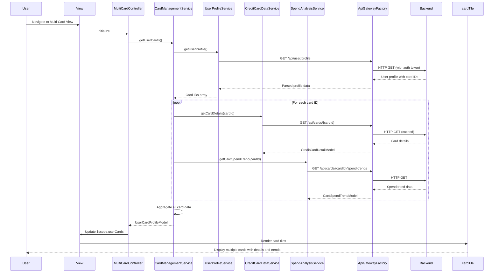

# Low-Level Design: QE-8313 - Multi-Card Management and Visualization

## a. Architecture Mapping

- **User Interface - Multi-Card View**: AngularJS Module (`ccMultiCardModule`) + Controller (`MultiCardController`) + HTML5 view template
- **API Gateway**: REST API integration via AngularJS `$http` service wrapped in custom Factory (`ApiGatewayFactory`)
- **Card Management Service**: AngularJS Service (`CardManagementService`) for card orchestration and business logic
- **Credit Card Data Repository**: Backend data store; accessed via `CreditCardDataService`
- **Card Issuer Information Service**: Backend service; consumed via `CardIssuerService`
- **User Profile Service**: AngularJS Service (`UserProfileService`) for user-card associations
- **Spend Analysis Engine**: AngularJS Service (`SpendAnalysisService`) for card-wise spend calculations

**Recommended Folder Structure:**
```
app/
├── modules/
│   └── multicard/
│       ├── controllers/
│       ├── services/
│       ├── directives/
│       └── views/
├── shared/
│   ├── services/
│   └── factories/
└── assets/
    ├── css/
    └── images/
```

## b. Component Specifications

| Name | Artifact Type | Responsibility | Key Dependencies |
|------|---------------|----------------|------------------|
| ccMultiCardModule | Module | Root module for multi-card management feature | angular, ngRoute, ui.bootstrap |
| MultiCardController | Controller | Manages multi-card view state and user interactions | CardManagementService, $scope, $filter |
| CardManagementService | Service | Orchestrates card data retrieval and card operations | CreditCardDataService, UserProfileService, SpendAnalysisService, $q |
| CreditCardDataService | Service | Fetches credit card data from backend APIs | ApiGatewayFactory, $http, $q, $cacheFactory |
| UserProfileService | Service | Retrieves user profile and card associations | ApiGatewayFactory, $http |
| CardIssuerService | Service | Fetches card issuer metadata | ApiGatewayFactory, $http |
| SpendAnalysisService | Service | Computes card-wise spending trends | ApiGatewayFactory, $http, $q |
| ApiGatewayFactory | Factory | Centralized REST API communication wrapper | $http, API_CONFIG |
| cardTile | Directive | Reusable card display tile component | None |
| cardComparison | Directive | Card comparison view component | None |

## c. Data Model

**CreditCardDetailModel:**
```javascript
{
  cardId: String,
  cardNumber: String,
  cardHolderName: String,
  issuerName: String,
  issuerLogo: String,
  creditLimit: Number,
  availableCredit: Number,
  currentBalance: Number,
  outstandingAmount: Number,
  dueDate: Date,
  lastUpdated: Date
}
```

**CardSpendTrendModel:**
```javascript
{
  cardId: String,
  monthlySpend: Array<{month: String, amount: Number}>,
  currentMonthSpend: Number,
  averageMonthlySpend: Number
}
```

**UserCardProfileModel:**
```javascript
{
  userId: String,
  cards: Array<CreditCardDetailModel>,
  totalCards: Number
}
```

## d. Data Flow

User navigates to the multi-card view, triggering `MultiCardController` initialization. The controller invokes `CardManagementService.getUserCards()`, which first calls `UserProfileService.getUserProfile()` to retrieve the user's associated card IDs via `/api/user/profile`. Using these IDs, `CardManagementService` makes parallel calls using `$q.all()` to `CreditCardDataService.getCardDetails(cardId)` for each card, fetching detailed card information from `/api/cards/{cardId}`. Simultaneously, it calls `SpendAnalysisService.getCardSpendTrend(cardId)` to retrieve monthly spend data from `/api/cards/{cardId}/spend-trends`. `CardIssuerService.getIssuerInfo(issuerId)` is invoked to fetch issuer logos and metadata. All services use `ApiGatewayFactory` for REST communication with caching enabled (500ms target). The aggregated `UserCardProfileModel` with embedded `CardSpendTrendModel` is returned to the controller, which updates `$scope.userCards`. The view renders card tiles using the `cardTile` directive, displaying card details and spend trends. User can select cards for comparison, triggering the `cardComparison` directive.

## e. Primary Sequence Diagram



## f. Implementation Notes

- Use AngularJS 1.x with ES6 arrow functions and template literals for cleaner code; transpile with Babel
- Implement `$cacheFactory` with 5-minute TTL in `CreditCardDataService` to meet 500ms retrieval NFR
- Use `$q.all()` for parallel card data fetching to optimize performance when loading 10+ cards
- Apply Bootstrap card components with CSS Grid for responsive multi-card layout
- Implement virtual scrolling or pagination for users with more than 10 cards to maintain UI performance

## g. Error Handling

HTTP interceptor-based error handling with try/catch blocks in services; display error notifications via Bootstrap toast with retry option.

## h. Security Notes

Requires token-based auth via existing SSO; sensitive card data (full card numbers) masked in UI, only last 4 digits displayed.