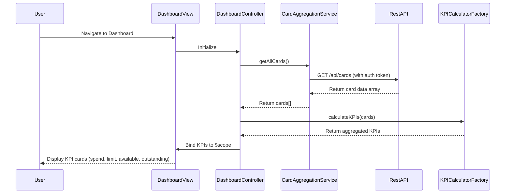

# Low-Level Design: QE-8314 - Dashboard KPIs and Financial Overview

## a. Architecture Mapping

**Component to Artifact Mapping:**
- User Interface - Dashboard → AngularJS Module (`dashboardModule`) + Controller (`DashboardController`) + HTML View (`dashboard.html`)
- Data Aggregation Service → AngularJS Service (`CardAggregationService`)
- KPI Calculation Engine → AngularJS Factory (`KPICalculatorFactory`)
- User Authentication Service → AngularJS Service (`AuthService`)
- Credit Card Data Sources → REST API Integration via `$http` service

**Recommended Folder Structure:**
```
app/
├── modules/dashboard/
│   ├── controllers/DashboardController.js
│   ├── services/CardAggregationService.js
│   ├── factories/KPICalculatorFactory.js
│   ├── views/dashboard.html
│   └── dashboard.module.js
├── shared/services/AuthService.js
├── assets/css/dashboard.css
└── app.js
```

## b. Component Specifications

| Component Name | Artifact Type | Responsibility | Key Dependencies |
|----------------|---------------|----------------|------------------|
| DashboardController | Controller | Orchestrates dashboard view, loads KPI data, handles user interactions | CardAggregationService, KPICalculatorFactory, $scope |
| CardAggregationService | Service | Fetches and consolidates credit card data from REST APIs | $http, $q, AuthService |
| KPICalculatorFactory | Factory | Calculates monthly spend, total limit, available credit, outstanding amount | None (pure calculation logic) |
| AuthService | Service | Manages user authentication tokens and session | $http, $window |
| dashboard.html | View | Displays KPI cards with Bootstrap responsive grid layout | DashboardController |
| dashboardModule | Module | Defines dashboard feature module and routing | ngRoute, shared services |

## c. Data Model

**CreditCard Model:**
```javascript
{
  cardId: String,
  cardNumber: String (masked),
  cardName: String,
  creditLimit: Number,
  currentBalance: Number,
  availableCredit: Number,
  outstandingAmount: Number,
  lastUpdated: Date
}
```

**DashboardKPI Model:**
```javascript
{
  monthlySpend: Number,
  totalCreditLimit: Number,
  totalAvailableCredit: Number,
  totalOutstanding: Number,
  cardCount: Number,
  lastRefreshed: Date
}
```

## d. Data Flow

User navigates to dashboard → `DashboardController` initializes and calls `CardAggregationService.getAllCards()` → Service fetches card data from REST API (`/api/cards`) with auth token → Raw card array returned to controller → Controller passes data to `KPICalculatorFactory.calculateKPIs(cards)` → Factory computes aggregated metrics (sum limits, balances, calculate available credit) → Calculated KPI object bound to `$scope.kpis` → View renders KPI cards using Bootstrap grid with data-binding → User sees real-time financial overview.

## e. Primary Sequence Diagram



## f. Implementation Notes

- Use AngularJS 1.x module pattern with dependency injection for all services and controllers
- Implement `$http` interceptor in AuthService to attach bearer token to all API requests
- Use `$q.all()` for parallel card data fetching to meet 2-second load requirement
- Apply Bootstrap responsive grid (col-xs-12 col-md-6 col-lg-3) for KPI card layout across devices
- Leverage AngularJS filters (currency, number) for formatting financial values in view

## g. Error Handling

HTTP interceptor-based error handling with `$http` response interceptor; display user-friendly error notifications using Bootstrap alerts for API failures.

## h. Security Notes

Requires token-based authentication via existing SSO; AuthService manages secure token storage and automatic injection into API headers.