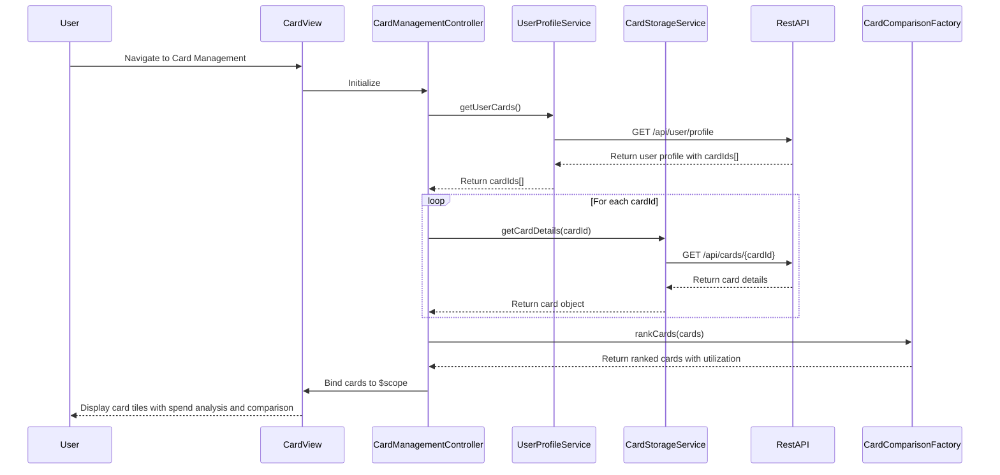

# Low-Level Design: QE-8315 - Multi-Card Management and Monitoring

## a. Architecture Mapping

**Component to Artifact Mapping:**
- User Interface - Card Management → AngularJS Module (`cardManagementModule`) + Controller (`CardManagementController`) + HTML View (`card-management.html`)
- User Profile Service → AngularJS Service (`UserProfileService`)
- Credit Card Data Provider APIs → REST API Integration via `$http` service
- Secure Data Storage → AngularJS Service (`CardStorageService`) with localStorage wrapper
- Card Comparison Engine → AngularJS Factory (`CardComparisonFactory`)

**Recommended Folder Structure:**
```
app/
├── modules/cards/
│   ├── controllers/CardManagementController.js
│   ├── services/UserProfileService.js
│   ├── services/CardStorageService.js
│   ├── factories/CardComparisonFactory.js
│   ├── views/card-management.html
│   ├── directives/cardTile.directive.js
│   └── cards.module.js
├── shared/services/AuthService.js
└── app.js
```

## b. Component Specifications

| Component Name | Artifact Type | Responsibility | Key Dependencies |
|----------------|---------------|----------------|------------------|
| CardManagementController | Controller | Manages multi-card view, loads card list, handles card selection and comparison | UserProfileService, CardStorageService, CardComparisonFactory, $scope |
| UserProfileService | Service | Fetches user profile and associated card IDs from REST API | $http, AuthService |
| CardStorageService | Service | Securely stores and retrieves card data using localStorage with encryption wrapper | $window |
| CardComparisonFactory | Factory | Compares card metrics (utilization %, spend, limits) and ranks cards | None (pure logic) |
| cardTile.directive | Directive | Reusable card tile component displaying card details with Bootstrap card styling | None |
| card-management.html | View | Displays card grid with individual card tiles and comparison view toggle | CardManagementController |

## c. Data Model

**CreditCard Model (Extended):**
```javascript
{
  cardId: String,
  cardNumber: String (masked),
  cardName: String,
  cardType: String,
  bankName: String,
  creditLimit: Number,
  currentBalance: Number,
  availableCredit: Number,
  outstandingAmount: Number,
  utilizationPercent: Number,
  monthlySpend: Number,
  lastSyncTime: Date,
  isActive: Boolean
}
```

**CardComparison Model:**
```javascript
{
  cardId: String,
  cardName: String,
  utilizationPercent: Number,
  monthlySpend: Number,
  availableCredit: Number,
  rank: Number
}
```

## d. Data Flow

User navigates to card management page → `CardManagementController` initializes and calls `UserProfileService.getUserCards()` → Service fetches user's card IDs from `/api/user/profile` → For each card ID, controller calls `CardStorageService.getCardDetails(cardId)` which fetches from `/api/cards/{cardId}` → Card data array stored in `$scope.cards` → Controller invokes `CardComparisonFactory.rankCards(cards)` to calculate utilization and ranking → View renders card tiles using `cardTile` directive in Bootstrap grid → User sees all cards with spend analysis, can toggle comparison view to see ranked cards side-by-side.

## e. Primary Sequence Diagram



## f. Implementation Notes

- Use AngularJS custom directive (`cardTile`) with isolated scope for reusable card display component
- Implement batch API call optimization using `$q.all()` to fetch multiple card details in parallel within 5-second sync window
- Apply ES6 arrow functions and template literals for cleaner service code
- Use AngularJS `ng-repeat` with `track by cardId` for efficient card list rendering
- Store sensitive card data in localStorage with Base64 encoding (not true encryption, but obfuscation for demo purposes)

## g. Error Handling

Try/catch blocks in service methods with promise rejection; display Bootstrap toast notifications for card sync failures or API errors.

## h. Security Notes

Standard input validation and secure API calls assumed; card numbers displayed in masked format (last 4 digits only).