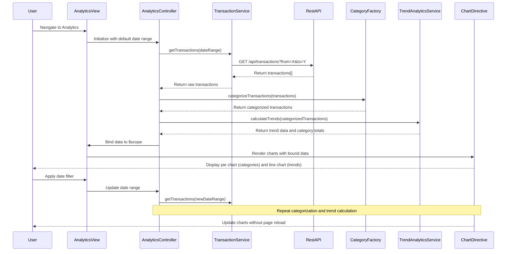

# Low-Level Design: QE-8316 - Spending Analytics and Category Insights

## a. Architecture Mapping

**Component to Artifact Mapping:**
- User Interface - Analytics Dashboard → AngularJS Module (`analyticsModule`) + Controller (`AnalyticsController`) + HTML View (`analytics.html`)
- Transaction Data Service → AngularJS Service (`TransactionService`)
- Categorization Engine → AngularJS Factory (`CategoryFactory`)
- Data Analytics Service → AngularJS Service (`TrendAnalyticsService`)
- Charting Library → AngularJS Directive wrapping Chart.js (`chartDirective`)

**Recommended Folder Structure:**
```
app/
├── modules/analytics/
│   ├── controllers/AnalyticsController.js
│   ├── services/TransactionService.js
│   ├── services/TrendAnalyticsService.js
│   ├── factories/CategoryFactory.js
│   ├── directives/chartDirective.js
│   ├── views/analytics.html
│   └── analytics.module.js
├── shared/constants/categories.constant.js
└── app.js
```

## b. Component Specifications

| Component Name | Artifact Type | Responsibility | Key Dependencies |
|----------------|---------------|----------------|------------------|
| AnalyticsController | Controller | Manages analytics view, loads transactions, triggers categorization and trend analysis | TransactionService, TrendAnalyticsService, CategoryFactory, $scope, $filter |
| TransactionService | Service | Fetches raw transaction data from REST API for specified date range | $http, AuthService |
| CategoryFactory | Factory | Categorizes transactions into 9 predefined categories using merchant/description matching | CATEGORIES constant |
| TrendAnalyticsService | Service | Calculates monthly spend trends, category totals, and percentage breakdowns | $filter (for date filtering) |
| chartDirective | Directive | Wraps Chart.js library to render pie/bar charts with AngularJS data-binding | Chart.js library |
| analytics.html | View | Displays category breakdown charts, trend graphs, and interactive filters | AnalyticsController |

## c. Data Model

**Transaction Model:**
```javascript
{
  transactionId: String,
  cardId: String,
  amount: Number,
  merchantName: String,
  description: String,
  transactionDate: Date,
  category: String,
  categoryId: Number
}
```

**CategorySpend Model:**
```javascript
{
  categoryName: String,
  categoryId: Number,
  totalSpend: Number,
  transactionCount: Number,
  percentageOfTotal: Number
}
```

**MonthlyTrend Model:**
```javascript
{
  month: String,
  totalSpend: Number,
  categoryBreakdown: Array<CategorySpend>
}
```

**Categories Constant:**
```javascript
[
  { id: 1, name: 'Food & Dining', keywords: ['restaurant', 'cafe', 'food'] },
  { id: 2, name: 'Fuel', keywords: ['gas', 'petrol', 'fuel'] },
  { id: 3, name: 'Shopping', keywords: ['mall', 'store', 'retail'] },
  { id: 4, name: 'Travel', keywords: ['airline', 'hotel', 'uber'] },
  { id: 5, name: 'Entertainment', keywords: ['movie', 'theater', 'netflix'] },
  { id: 6, name: 'Utilities', keywords: ['electric', 'water', 'internet'] },
  { id: 7, name: 'Healthcare', keywords: ['hospital', 'pharmacy', 'doctor'] },
  { id: 8, name: 'Education', keywords: ['school', 'university', 'course'] },
  { id: 9, name: 'Miscellaneous', keywords: [] }
]
```

## d. Data Flow

User navigates to analytics page → `AnalyticsController` initializes and calls `TransactionService.getTransactions(dateRange)` → Service fetches transactions from `/api/transactions?from=X&to=Y` → Raw transaction array returned to controller → Controller passes transactions to `CategoryFactory.categorizeTransactions(transactions)` → Factory matches merchant names against category keywords and assigns categoryId (defaults to Miscellaneous if no match) → Categorized transactions passed to `TrendAnalyticsService.calculateTrends(transactions)` → Service groups by month and category, calculates totals and percentages → Trend data bound to `$scope.trendData` and `$scope.categoryData` → View renders interactive charts via `chartDirective` with Chart.js → User sees pie chart for category breakdown and line chart for monthly trends, can filter by date range without page reload.

## e. Primary Sequence Diagram



## f. Implementation Notes

- Use AngularJS custom directive to wrap Chart.js with two-way data-binding via `$watch` on chart data scope property
- Implement keyword-based categorization in CategoryFactory using ES6 `Array.find()` and `String.includes()` for merchant matching
- Apply AngularJS `$filter('date')` and `$filter('currency')` for formatting in view and service calculations
- Use `ng-change` on date range picker to trigger controller method that re-fetches and re-renders charts without full page reload
- Optimize for 1000 transactions by implementing client-side caching in TransactionService with 5-minute TTL

## g. Error Handling

Try/catch in service methods with promise rejection; interceptor displays Bootstrap alert for API failures during transaction fetch.

## h. Security Notes

Standard input validation and secure API calls assumed; transaction data filtered by authenticated user's card IDs on backend.