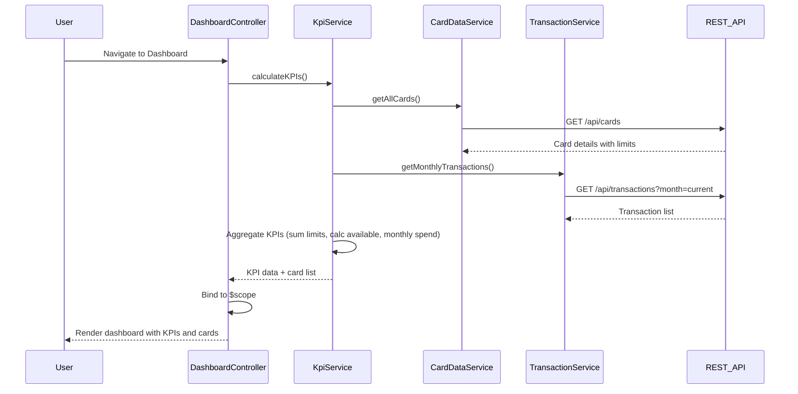

# Low-Level Design: Credit Card Portfolio and KPI Dashboard (QE-8317)

## a. Architecture Mapping

- **Dashboard Module** (`app.dashboard`) → Main AngularJS module containing dashboard components
- **DashboardController** → Manages dashboard state, KPI display, and card portfolio view
- **KpiService** → Factory service for KPI calculations and data aggregation
- **CardDataService** → Service for fetching credit card details and limits from REST API
- **TransactionService** → Service for retrieving transaction data for monthly spend calculation
- **kpiWidget** → Directive for rendering individual KPI cards (spend, limit, available, outstanding)
- **cardList** → Directive for displaying multiple credit cards with summary info

**Folder Structure:**
```
/app
  /dashboard
    dashboard.module.js
    dashboard.controller.js
    dashboard.html
    /services
      kpi.service.js
      card-data.service.js
      transaction.service.js
    /directives
      kpi-widget.directive.js
      card-list.directive.js
  /models
    card.model.js
    kpi.model.js
```

## b. Component Specifications

| Component Name | Artifact Type | Responsibility | Key Dependencies |
|----------------|---------------|----------------|------------------|
| DashboardController | Controller | Orchestrates dashboard view, fetches data, manages KPI state | KpiService, CardDataService, TransactionService, $scope |
| KpiService | Factory | Calculates aggregated KPIs (total limit, available credit, outstanding, monthly spend) | CardDataService, TransactionService, $q |
| CardDataService | Service | Fetches credit card details, limits, balances via REST API | $http, $q, API_ENDPOINTS |
| TransactionService | Service | Retrieves transaction data for monthly spend calculation | $http, $q, API_ENDPOINTS |
| kpiWidget | Directive | Renders individual KPI display card with value, label, and icon | None (isolated scope) |
| cardList | Directive | Displays list of credit cards with individual card metrics | CardDataService |

## c. Data Model

**Card Model** (`card.model.js`):
```javascript
{
  cardId: String,
  cardNumber: String,
  cardType: String,
  creditLimit: Number,
  outstandingAmount: Number,
  availableCredit: Number,
  lastUpdated: Date
}
```

**KPI Model** (`kpi.model.js`):
```javascript
{
  totalCreditLimit: Number,
  totalAvailableCredit: Number,
  totalOutstanding: Number,
  monthlySpend: Number,
  utilizationRate: Number
}
```

## d. Data Flow

User navigates to dashboard → DashboardController initializes and calls KpiService.calculateKPIs() → KpiService concurrently fetches card data via CardDataService.getAllCards() and transaction data via TransactionService.getMonthlyTransactions() → REST APIs return card details and transactions → KpiService aggregates data (sums limits, calculates available credit, computes monthly spend) → Aggregated KPIs and card list are bound to $scope → View renders KPI widgets using kpiWidget directive and card portfolio using cardList directive → UI updates within 2 seconds with responsive layout.

## e. Primary Sequence Diagram



## f. Implementation Notes

- Use AngularJS dependency injection for all services; register services as singletons in dashboard module
- Leverage $q.all() for parallel API calls to CardDataService and TransactionService to meet 2-second load requirement
- Implement Bootstrap grid system (col-md-3, col-sm-6, col-xs-12) for responsive KPI widget layout
- Use ES6 arrow functions and const/let in services; transpile with Babel if needed for browser compatibility
- Cache card data in CardDataService using simple in-memory object with TTL to reduce API calls on dashboard refresh

## g. Error Handling

HTTP interceptor captures API errors; user-friendly notifications displayed via toastr or Bootstrap alerts; retry logic for transient failures.

## h. Security Notes

Requires token-based auth via existing SSO; API endpoints secured with JWT validation on backend.