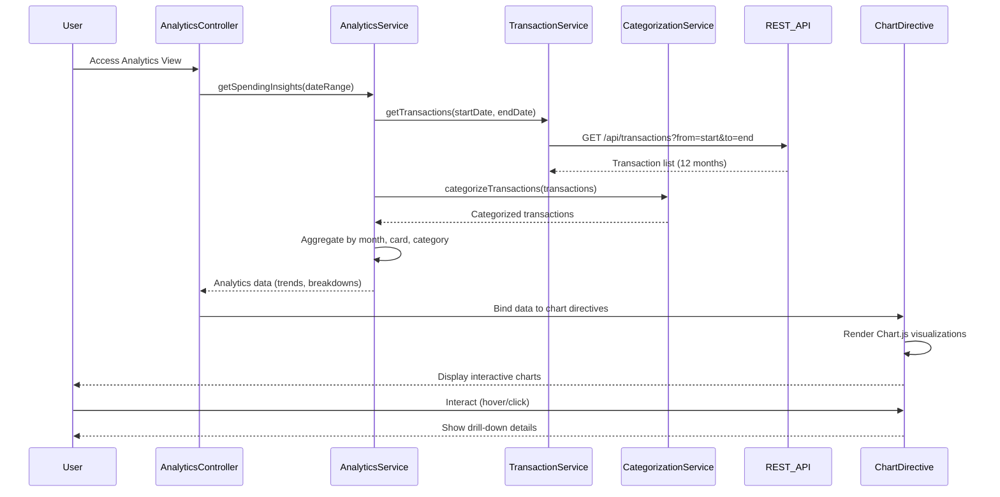

# Low-Level Design: Spending Analytics and Insights (QE-8318)

## a. Architecture Mapping

- **Analytics Module** (`app.analytics`) → Main AngularJS module for analytics features
- **AnalyticsController** → Manages analytics view state, chart interactions, and data filtering
- **AnalyticsService** → Factory for aggregating and processing spending data
- **TransactionService** → Service for fetching historical transaction data from REST API
- **CategorizationService** → Service for category assignment and validation
- **spendTrendChart** → Directive for rendering monthly spend trend line chart using Chart.js
- **cardWiseChart** → Directive for card-wise spending bar/pie chart
- **categoryChart** → Directive for category-wise spending breakdown chart

**Folder Structure:**
```
/app
  /analytics
    analytics.module.js
    analytics.controller.js
    analytics.html
    /services
      analytics.service.js
      transaction.service.js
      categorization.service.js
    /directives
      spend-trend-chart.directive.js
      card-wise-chart.directive.js
      category-chart.directive.js
  /models
    analytics.model.js
```

## b. Component Specifications

| Component Name | Artifact Type | Responsibility | Key Dependencies |
|----------------|---------------|----------------|------------------|
| AnalyticsController | Controller | Manages analytics view, handles date range selection, triggers chart rendering | AnalyticsService, $scope, $filter |
| AnalyticsService | Factory | Aggregates transaction data by month, card, and category; computes trends | TransactionService, CategorizationService, $q |
| TransactionService | Service | Fetches historical transaction data (up to 12 months) via REST API | $http, $q, API_ENDPOINTS |
| CategorizationService | Service | Maps transactions to 9 predefined categories; validates category assignments | None (business logic) |
| spendTrendChart | Directive | Renders interactive line chart for monthly spend trends using Chart.js | Chart.js library |
| cardWiseChart | Directive | Renders bar/pie chart for card-wise spending comparison | Chart.js library |
| categoryChart | Directive | Renders breakdown chart for 9 spending categories | Chart.js library |

## c. Data Model

**Analytics Model** (`analytics.model.js`):
```javascript
{
  monthlyTrends: [
    { month: String, totalSpend: Number, transactionCount: Number }
  ],
  cardWiseSpend: [
    { cardId: String, cardName: String, totalSpend: Number, percentage: Number }
  ],
  categorySpend: [
    { category: String, amount: Number, percentage: Number, transactionCount: Number }
  ],
  dateRange: { startDate: Date, endDate: Date }
}
```

**Categories**: Food & Dining, Fuel, Shopping, Travel, Entertainment, Utilities, Healthcare, Education, Miscellaneous

## d. Data Flow

User accesses analytics view → AnalyticsController calls AnalyticsService.getSpendingInsights(dateRange) → AnalyticsService fetches historical transactions via TransactionService.getTransactions(startDate, endDate) → REST API returns transaction list → CategorizationService assigns/validates categories for each transaction → AnalyticsService aggregates data into monthly trends, card-wise totals, and category breakdowns → Processed analytics data bound to $scope → Chart directives (spendTrendChart, cardWiseChart, categoryChart) render interactive visualizations using Chart.js → User interacts with charts (hover, click) to drill down into specific periods/cards/categories.

## e. Primary Sequence Diagram



## f. Implementation Notes

- Use Chart.js library for all visualizations; register as Angular constant or load via CDN
- Implement AngularJS $filter for date formatting and currency display in chart tooltips
- Use ES6 array methods (map, reduce, filter) in AnalyticsService for data aggregation
- Lazy-load transaction data in chunks if dataset exceeds 1000 records to maintain 3-second render target
- Store category mapping as constant object in CategorizationService for O(1) lookup

## g. Error Handling

HTTP interceptor with try/catch blocks in services; display user-friendly error messages via modal or inline alerts on chart failure.

## h. Security Notes

Standard input validation and secure API calls assumed; date range inputs sanitized to prevent injection attacks.