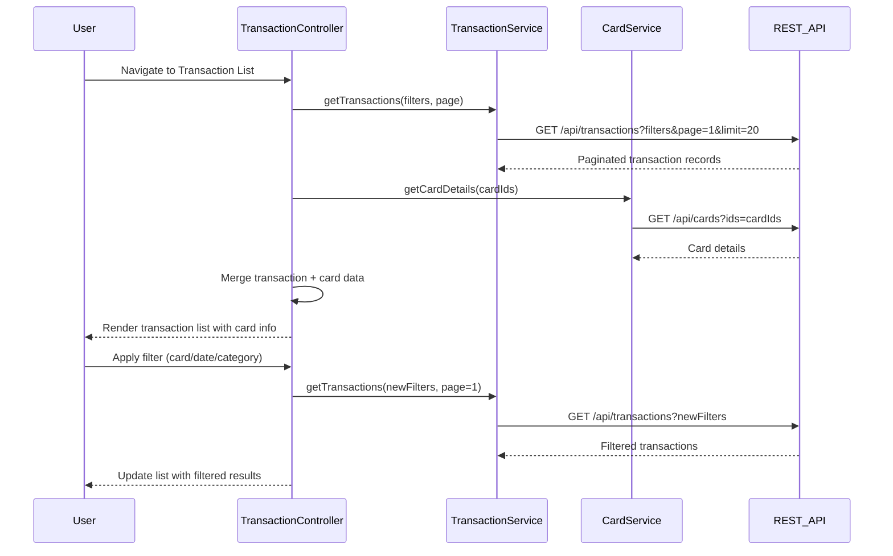

# Low-Level Design: Transaction Management and Monitoring (QE-8319)

## a. Architecture Mapping

- **Transaction Module** (`app.transactions`) → Main AngularJS module for transaction features
- **TransactionController** → Manages transaction list view, filtering, and pagination
- **TransactionDetailController** → Manages individual transaction detail view
- **TransactionService** → Service for fetching transaction data from REST API
- **CardService** → Service for retrieving card associations and details
- **transactionList** → Directive for rendering paginated transaction table
- **transactionFilter** → Directive for filtering transactions by card, date, category

**Folder Structure:**
```
/app
  /transactions
    transaction.module.js
    transaction.controller.js
    transaction-detail.controller.js
    transaction-list.html
    transaction-detail.html
    /services
      transaction.service.js
      card.service.js
    /directives
      transaction-list.directive.js
      transaction-filter.directive.js
  /models
    transaction.model.js
```

## b. Component Specifications

| Component Name | Artifact Type | Responsibility | Key Dependencies |
|----------------|---------------|----------------|------------------|
| TransactionController | Controller | Manages transaction list, applies filters, handles pagination | TransactionService, CardService, $scope |
| TransactionDetailController | Controller | Displays detailed view of single transaction with all attributes | TransactionService, $routeParams, $scope |
| TransactionService | Service | Fetches transaction records via REST API with filtering and pagination support | $http, $q, API_ENDPOINTS |
| CardService | Service | Retrieves card details for associating transactions with specific cards | $http, $q, API_ENDPOINTS |
| transactionList | Directive | Renders responsive transaction table with sorting and pagination | None (isolated scope) |
| transactionFilter | Directive | Provides UI controls for filtering by card, date range, category | CardService |

## c. Data Model

**Transaction Model** (`transaction.model.js`):
```javascript
{
  transactionId: String,
  cardId: String,
  cardName: String,
  amount: Number,
  currency: String,
  transactionDate: Date,
  merchantName: String,
  category: String,
  description: String,
  status: String
}
```

## d. Data Flow

User navigates to transaction list → TransactionController initializes and calls TransactionService.getTransactions(filters, page) → TransactionService queries REST API with filter params (cardId, dateRange, category) and pagination → REST API returns paginated transaction records → CardService enriches transactions with card details via parallel calls → Aggregated transaction data with card associations bound to $scope → transactionList directive renders responsive table with transaction rows → User applies filters via transactionFilter directive → Controller re-fetches filtered data → UI updates with filtered results; user clicks transaction row → Navigate to detail view with TransactionDetailController displaying full transaction attributes.

## e. Primary Sequence Diagram



## f. Implementation Notes

- Implement server-side pagination with page size of 20 transactions; use AngularJS ng-repeat with limitTo filter for client-side rendering
- Use AngularJS $routeProvider for navigation between list and detail views
- Apply Bootstrap table-responsive class for mobile-friendly transaction table layout
- Use ES6 template literals for building API query strings with filter parameters
- Implement infinite scroll or "Load More" button for large transaction datasets to improve performance

## g. Error Handling

Interceptor-based error handling with try/catch; display error toasts for API failures and provide retry option.

## h. Security Notes

Requires token-based auth via existing SSO; transaction data filtered by authenticated user's card portfolio on backend.