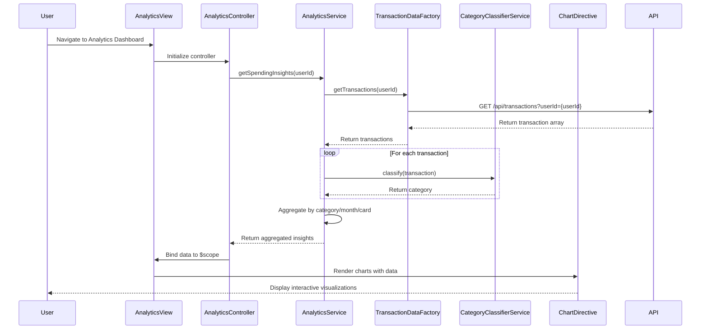

# Low-Level Design: QE-8344 - Analytics and Spending Insights

## a. Architecture Mapping

**HLD Component → AngularJS Artifact Mapping:**

- User Interface - Analytics Dashboard → AngularJS Module (`analyticsModule`) + Controller (`AnalyticsController`) + HTML Template
- Analytics Service → AngularJS Service (`AnalyticsService`) for business logic and data aggregation
- Transaction Data Service → AngularJS Factory (`TransactionDataFactory`) for REST API calls
- Category Classification Engine → AngularJS Service (`CategoryClassifierService`) for transaction categorization logic
- Charting Library Integration → AngularJS Directive (`chartDirective`) wrapping Chart.js or D3.js
- Dashboard KPI Service → AngularJS Service (`DashboardKPIService`) for shared KPI data

**Recommended Folder Structure:**
```
app/
├── modules/
│   └── analytics/
│       ├── analytics.module.js
│       ├── controllers/
│       │   └── analytics.controller.js
│       ├── services/
│       │   ├── analytics.service.js
│       │   ├── category-classifier.service.js
│       │   └── dashboard-kpi.service.js
│       ├── factories/
│       │   └── transaction-data.factory.js
│       ├── directives/
│       │   └── chart.directive.js
│       └── views/
│           └── analytics.html
```

---

## b. Component Specifications

| Component Name | Artifact Type | Responsibility | Key Dependencies |
|---|---|---|---|
| `analyticsModule` | Module | Root module for analytics feature; registers all controllers, services, directives | `ngRoute`, `ui.bootstrap` |
| `AnalyticsController` | Controller | Manages analytics view state, user interactions, and coordinates data flow between services and view | `AnalyticsService`, `$scope`, `$q` |
| `AnalyticsService` | Service | Aggregates transaction data, computes category-wise/card-wise/monthly trends, prepares chart data | `TransactionDataFactory`, `CategoryClassifierService`, `DashboardKPIService` |
| `TransactionDataFactory` | Factory | Fetches raw transaction data from REST API endpoints | `$http`, `$q` |
| `CategoryClassifierService` | Service | Classifies transactions into 9 categories based on MCC or merchant name | None |
| `DashboardKPIService` | Service | Provides shared KPI data for consistency with dashboard module | `$http` |
| `chartDirective` | Directive | Wraps Chart.js/D3.js library for rendering interactive charts (category pie, monthly line, card bar) | Chart.js or D3.js library |

---

## c. Data Model

**Transaction Model:**
```javascript
class Transaction {
  id: String
  cardId: String
  amount: Number
  merchantName: String
  merchantCategoryCode: String
  category: String // Food & Dining, Fuel, Shopping, Travel, Entertainment, Utilities, Healthcare, Education, Miscellaneous
  transactionDate: Date
  description: String
}
```

**CategorySpend Model:**
```javascript
class CategorySpend {
  category: String
  totalAmount: Number
  transactionCount: Number
  percentage: Number
}
```

**MonthlyTrend Model:**
```javascript
class MonthlyTrend {
  month: String // YYYY-MM
  totalSpend: Number
  transactionCount: Number
}
```

**CardSpend Model:**
```javascript
class CardSpend {
  cardId: String
  cardLabel: String
  totalSpend: Number
  categoryBreakdown: Array<CategorySpend>
}
```

---

## d. Data Flow

User navigates to the Analytics Dashboard → `AnalyticsController` initializes and calls `AnalyticsService.getSpendingInsights()` → `AnalyticsService` fetches raw transactions via `TransactionDataFactory.getTransactions()` (REST API call) → Transactions are classified using `CategoryClassifierService.classify()` → `AnalyticsService` aggregates data into category-wise, monthly, and card-wise models → Aggregated data is bound to `$scope` → `chartDirective` watches scope changes and renders interactive charts (category pie chart, monthly line chart, card bar chart) → User interacts with charts (hover, click) triggering directive event handlers that update tooltip/detail views.

---

## e. Primary Sequence Diagram



---

## f. Implementation Notes

- Use AngularJS 1.x module pattern with ES6 classes for controllers/services; leverage `$inject` annotation for dependency injection to ensure minification safety.
- Implement `TransactionDataFactory` using `$http` with promise-based API calls; cache transaction data in service layer to avoid redundant API calls within session.
- Use `$q.all()` for parallel data fetching if multiple API endpoints are required (transactions, KPIs); implement debouncing for chart re-rendering on filter changes.
- Wrap Chart.js in a custom directive with isolated scope; watch data changes using `$scope.$watch` and trigger chart update/destroy/recreate lifecycle.
- Apply AngularJS filters for currency formatting (`| currency`) and date formatting (`| date:'MMM yyyy'`) in templates; use `ng-repeat` with `track by` for performance.

---

## g. Error Handling

HTTP interceptor captures API errors (4xx/5xx) and displays user-friendly notifications via Bootstrap modal or toast; client-side try/catch in services logs errors to console.

---

## h. Security Notes

Requires token-based authentication via existing SSO; API calls include Authorization header with JWT token; standard input validation applied to filter parameters.