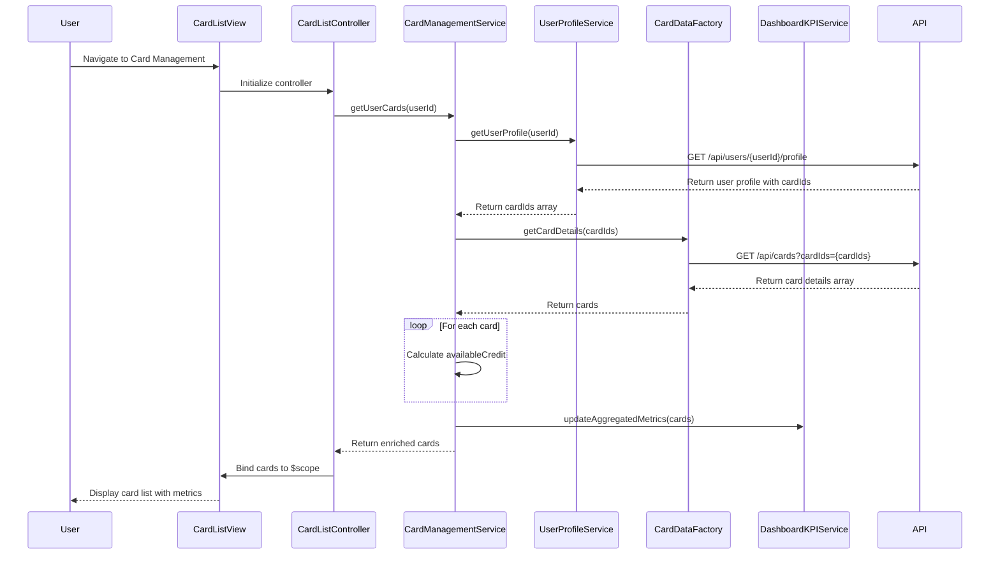

# Low-Level Design: QE-8345 - Multiple Credit Card Management

## a. Architecture Mapping

**HLD Component → AngularJS Artifact Mapping:**

- User Interface - Card List View → AngularJS Module (`cardManagementModule`) + Controller (`CardListController`) + HTML Template
- Card Management Service → AngularJS Service (`CardManagementService`) for card business logic and data orchestration
- Credit Card Data Repository → AngularJS Factory (`CardDataFactory`) for REST API calls to card repository
- User Profile Service → AngularJS Service (`UserProfileService`) for user-card association
- Dashboard KPI Service → AngularJS Service (`DashboardKPIService`) for feeding aggregated card metrics

**Recommended Folder Structure:**
```
app/
├── modules/
│   └── card-management/
│       ├── card-management.module.js
│       ├── controllers/
│       │   └── card-list.controller.js
│       ├── services/
│       │   ├── card-management.service.js
│       │   ├── user-profile.service.js
│       │   └── dashboard-kpi.service.js
│       ├── factories/
│       │   └── card-data.factory.js
│       └── views/
│           └── card-list.html
```

---

## b. Component Specifications

| Component Name | Artifact Type | Responsibility | Key Dependencies |
|---|---|---|---|
| `cardManagementModule` | Module | Root module for card management feature; registers controllers, services, factories | `ngRoute`, `ui.bootstrap` |
| `CardListController` | Controller | Manages card list view state, handles user interactions, coordinates data retrieval and display | `CardManagementService`, `$scope`, `$interval` |
| `CardManagementService` | Service | Orchestrates card data retrieval, calculates card-specific metrics, manages data sync logic | `CardDataFactory`, `UserProfileService`, `DashboardKPIService` |
| `CardDataFactory` | Factory | Fetches credit card data from REST API endpoints, handles 5-minute sync polling | `$http`, `$q`, `$interval` |
| `UserProfileService` | Service | Retrieves user profile and associated card IDs for the logged-in user | `$http` |
| `DashboardKPIService` | Service | Aggregates card-level metrics (total limit, available credit, outstanding) for dashboard consumption | None |

---

## c. Data Model

**CreditCard Model:**
```javascript
class CreditCard {
  cardId: String
  userId: String
  cardLabel: String // User-defined or bank-provided label
  maskedCardNumber: String // e.g., "**** **** **** 1234"
  cardType: String // Visa, MasterCard, Amex, etc.
  creditLimit: Number
  outstandingBalance: Number
  availableCredit: Number // Calculated: creditLimit - outstandingBalance
  lastSyncDate: Date
  isActive: Boolean
}
```

**UserCardAssociation Model:**
```javascript
class UserCardAssociation {
  userId: String
  cardIds: Array<String>
}
```

---

## d. Data Flow

User navigates to Card Management view → `CardListController` initializes and calls `CardManagementService.getUserCards()` → `CardManagementService` fetches user profile via `UserProfileService.getUserProfile()` to get associated card IDs → `CardManagementService` calls `CardDataFactory.getCardDetails(cardIds)` (REST API call) → API returns array of card objects → `CardManagementService` calculates `availableCredit` for each card and updates `DashboardKPIService` with aggregated metrics → Card data is bound to `$scope.cards` → View renders card list using `ng-repeat` → `$interval` triggers `CardDataFactory.syncCardData()` every 5 minutes to refresh card balances → Updated data re-binds to view automatically via Angular's two-way binding.

---

## e. Primary Sequence Diagram



---

## f. Implementation Notes

- Use AngularJS 1.x module pattern with ES6 classes; apply `$inject` annotation for minification-safe dependency injection.
- Implement `CardDataFactory` with `$http` service for REST API calls; use `$interval` to poll API every 5 minutes for data sync (store interval promise for cleanup on scope destroy).
- Calculate `availableCredit` in service layer (creditLimit - outstandingBalance); ensure calculation happens before binding to view to avoid template-level computation.
- Use `ng-repeat="card in cards track by card.cardId"` for optimal rendering performance with large card lists; apply Bootstrap grid classes for responsive card layout.
- Mask card numbers on client side if API returns full numbers; use AngularJS filter or service method to format as "**** **** **** XXXX".

---

## g. Error Handling

HTTP interceptor-based error handling for API failures; display user-friendly error messages via Bootstrap alert component; retry logic with exponential backoff for sync failures.

---

## h. Security Notes

Requires token-based auth via existing SSO; card numbers are masked (last 4 digits only); API calls include Authorization header with JWT token.