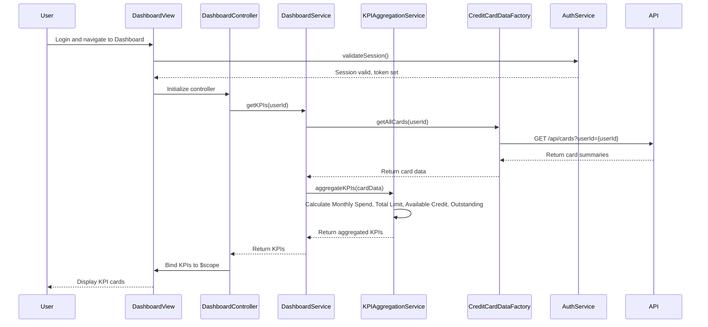

# Low-Level Design: QE-8346 - Dashboard and KPI Management

## a. Architecture Mapping

**HLD Component → AngularJS Artifact Mapping:**

- User Interface - Dashboard → AngularJS Module (`dashboardModule`) + Controller (`DashboardController`) + HTML Template
- Dashboard Service → AngularJS Service (`DashboardService`) for dashboard business logic
- KPI Aggregation Engine → AngularJS Service (`KPIAggregationService`) for calculating consolidated KPIs
- Credit Card Data Source → AngularJS Factory (`CreditCardDataFactory`) for REST API calls
- User Authentication Service → AngularJS Service (`AuthService`) for session and authentication management

**Recommended Folder Structure:**
```
app/
├── modules/
│   └── dashboard/
│       ├── dashboard.module.js
│       ├── controllers/
│       │   └── dashboard.controller.js
│       ├── services/
│       │   ├── dashboard.service.js
│       │   ├── kpi-aggregation.service.js
│       │   └── auth.service.js
│       ├── factories/
│       │   └── credit-card-data.factory.js
│       └── views/
│           └── dashboard.html
```

---

## b. Component Specifications

| Component Name | Artifact Type | Responsibility | Key Dependencies |
|---|---|---|---|
| `dashboardModule` | Module | Root module for dashboard feature; registers controllers, services, factories | `ngRoute`, `ui.bootstrap` |
| `DashboardController` | Controller | Manages dashboard view state, handles user interactions, coordinates KPI data retrieval and display | `DashboardService`, `$scope`, `$timeout` |
| `DashboardService` | Service | Orchestrates dashboard data flow, calls KPI aggregation, manages real-time data refresh | `KPIAggregationService`, `CreditCardDataFactory` |
| `KPIAggregationService` | Service | Calculates Monthly Spend, Total Credit Limit, Available Credit, Outstanding Amount across all cards | None |
| `CreditCardDataFactory` | Factory | Fetches credit card data (balances, transactions, limits) from REST API endpoints | `$http`, `$q` |
| `AuthService` | Service | Manages user authentication state, session tokens, and secure API call headers | `$http`, `$window` |

---

## c. Data Model

**DashboardKPI Model:**
```javascript
class DashboardKPI {
  monthlySpend: Number
  totalCreditLimit: Number
  availableCredit: Number
  outstandingAmount: Number
  lastUpdated: Date
}
```

**CreditCardSummary Model:**
```javascript
class CreditCardSummary {
  cardId: String
  creditLimit: Number
  outstandingBalance: Number
  currentMonthSpend: Number
}
```

---

## d. Data Flow

User logs in and navigates to Dashboard → `AuthService` validates session and sets authentication token → `DashboardController` initializes and calls `DashboardService.getKPIs()` → `DashboardService` fetches all user credit cards via `CreditCardDataFactory.getAllCards()` (REST API call) → API returns array of `CreditCardSummary` objects → `DashboardService` passes data to `KPIAggregationService.aggregateKPIs()` which sums Monthly Spend, Total Credit Limit, calculates Available Credit (sum of limits - sum of outstanding), and Outstanding Amount → Aggregated KPIs are returned to `DashboardController` and bound to `$scope.kpis` → View renders KPI cards using Bootstrap grid → Real-time refresh is handled via polling or WebSocket push, triggering `$scope.$apply()` to update UI.

---

## e. Primary Sequence Diagram



---

## f. Implementation Notes

- Use AngularJS 1.x module pattern with ES6 classes; apply `$inject` annotation for dependency injection to ensure minification compatibility.
- Implement `CreditCardDataFactory` using `$http` with promise-based API calls; use `$q.all()` if multiple endpoints need to be called in parallel for card data and transactions.
- For real-time data refresh, use `$interval` to poll API every 30 seconds or integrate WebSocket service with `$scope.$apply()` to trigger digest cycle on data push.
- Apply responsive Bootstrap grid (col-xs-12, col-sm-6, col-md-3) for KPI cards to ensure mobile/tablet/desktop compatibility; use AngularJS `ng-if` for conditional rendering.
- Store authentication token in `AuthService` using `$window.sessionStorage`; attach token to all API requests via HTTP interceptor.

---

## g. Error Handling

HTTP interceptor captures API errors and displays user-friendly notifications via Bootstrap modal; client-side try/catch in services logs errors to console for debugging.

---

## h. Security Notes

Requires token-based auth via existing SSO; all API calls include Authorization header with JWT token; standard input validation and secure API calls assumed.