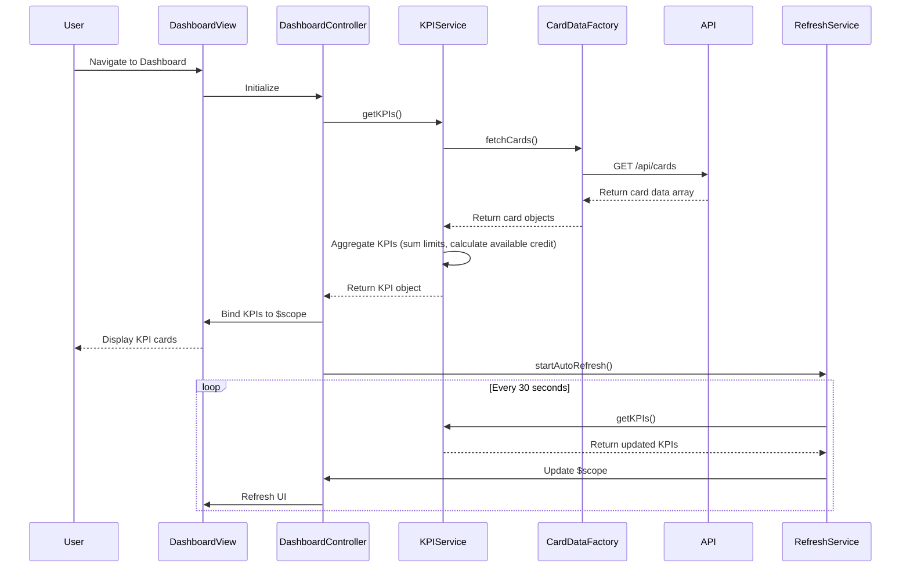

# Low-Level Design: QE-8347 - Dashboard KPIs and Credit Card Overview

## a. Architecture Mapping

- **Dashboard Module** → AngularJS Module (`app.dashboard`)
- **Dashboard Controller** → AngularJS Controller (`DashboardController`) - Manages KPI display and card overview
- **KPI Service** → AngularJS Service (`KPIService`) - Calculates and retrieves KPI data
- **Card Data Service** → AngularJS Factory (`CardDataFactory`) - Fetches credit card data from REST API
- **Refresh Service** → AngularJS Service (`RefreshService`) - Handles real-time data refresh
- **KPI Display Directive** → AngularJS Directive (`kpiCard`) - Reusable KPI card component

**Recommended Folder Structure:**
```
app/
├── modules/dashboard/
│   ├── dashboard.module.js
│   ├── dashboard.controller.js
│   ├── dashboard.html
├── services/
│   ├── kpi.service.js
│   ├── refresh.service.js
├── factories/
│   ├── card-data.factory.js
├── directives/
│   ├── kpi-card.directive.js
├── models/
│   ├── card.model.js
```

## b. Component Specifications

| Component Name | Artifact Type | Responsibility | Key Dependencies |
|----------------|---------------|----------------|------------------|
| DashboardController | Controller | Orchestrates dashboard view, binds KPI data to scope, handles user interactions | KPIService, RefreshService, $scope |
| KPIService | Service | Aggregates and calculates monthly spend, credit limit, available credit, outstanding amount | CardDataFactory, $q |
| CardDataFactory | Factory | Fetches credit card data from REST API endpoint `/api/cards` | $http, $q |
| RefreshService | Service | Implements polling mechanism (every 30s) to refresh KPI data | $interval, KPIService |
| kpiCard | Directive | Renders individual KPI card with value, label, and trend indicator | None |
| app.dashboard | Module | Encapsulates all dashboard-related components | ui.router, ngAnimate |

## c. Data Model

**CreditCard Model:**
```javascript
{
  cardId: String,
  cardNumber: String (masked),
  cardType: String,
  creditLimit: Number,
  availableCredit: Number,
  outstandingAmount: Number,
  lastUpdated: Date
}
```

**KPI Model:**
```javascript
{
  monthlySpend: Number,
  totalCreditLimit: Number,
  totalAvailableCredit: Number,
  totalOutstanding: Number,
  cardCount: Number,
  lastRefreshed: Date
}
```

## d. Data Flow

User navigates to dashboard → DashboardController initializes and calls KPIService.getKPIs() → KPIService requests card data via CardDataFactory.fetchCards() → Factory makes REST API call to `/api/cards` → API returns array of credit card objects → KPIService aggregates data (sum credit limits, calculate available credit, sum outstanding amounts, calculate monthly spend from recent transactions) → Aggregated KPI object is returned to controller → Controller binds KPIs to $scope → View renders KPI cards using kpiCard directive → RefreshService polls every 30 seconds to update KPIs → UI updates automatically via two-way data binding.

## e. Primary Sequence Diagram



## f. Implementation Notes

- Use AngularJS Dependency Injection to inject KPIService, CardDataFactory, and RefreshService into DashboardController
- Implement ES6 classes for services and factories with constructor-based DI pattern
- Use $http service with promise-based API calls; implement caching with `cache: true` option to meet 2-second load time
- Leverage Bootstrap grid system (col-md-3, col-sm-6, col-xs-12) for responsive KPI card layout
- Use $interval service in RefreshService for polling; ensure proper cleanup with $scope.$on('$destroy') to prevent memory leaks

## g. Error Handling

HTTP interceptor captures API errors; display user-friendly notifications using Bootstrap alerts; fallback to cached data if refresh fails.

## h. Security Notes

Requires token-based auth via existing SSO; card numbers are masked on API response; secure HTTPS-only API calls.