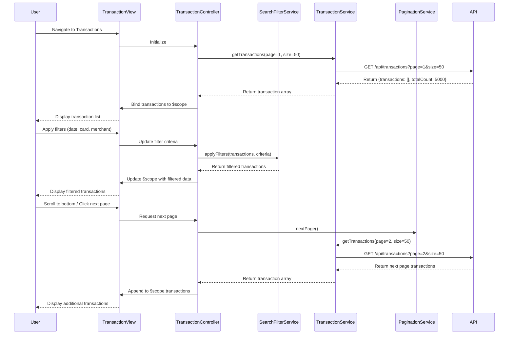

# Low-Level Design: QE-8348 - Transaction Management and Monitoring

## a. Architecture Mapping

- **Transaction Module** → AngularJS Module (`app.transactions`)
- **Transaction Controller** → AngularJS Controller (`TransactionController`) - Manages transaction list and filtering
- **Transaction Service** → AngularJS Service (`TransactionService`) - Retrieves and manages transaction data
- **Search Filter Service** → AngularJS Service (`SearchFilterService`) - Implements search and filter logic
- **Pagination Service** → AngularJS Service (`PaginationService`) - Handles pagination and infinite scroll
- **Transaction List Directive** → AngularJS Directive (`transactionList`) - Renders transaction table

**Recommended Folder Structure:**
```
app/
├── modules/transactions/
│   ├── transactions.module.js
│   ├── transactions.controller.js
│   ├── transactions.html
├── services/
│   ├── transaction.service.js
│   ├── search-filter.service.js
│   ├── pagination.service.js
├── directives/
│   ├── transaction-list.directive.js
├── models/
│   ├── transaction.model.js
```

## b. Component Specifications

| Component Name | Artifact Type | Responsibility | Key Dependencies |
|----------------|---------------|----------------|------------------|
| TransactionController | Controller | Manages transaction view, handles filter/search inputs, coordinates pagination | TransactionService, SearchFilterService, PaginationService, $scope |
| TransactionService | Service | Fetches transaction data from REST API `/api/transactions`, manages transaction cache | $http, $q |
| SearchFilterService | Service | Applies client-side filtering by date, card, amount, merchant; returns filtered results | None |
| PaginationService | Service | Implements pagination logic with page size 50, tracks current page and total pages | None |
| transactionList | Directive | Renders responsive transaction table with Bootstrap table classes | None |
| app.transactions | Module | Encapsulates all transaction-related components | ui.router, ngAnimate |

## c. Data Model

**Transaction Model:**
```javascript
{
  transactionId: String,
  cardId: String,
  cardNumber: String (masked),
  merchantName: String,
  category: String,
  amount: Number,
  currency: String,
  transactionDate: Date,
  status: String,
  description: String
}
```

**Filter Criteria Model:**
```javascript
{
  cardId: String,
  startDate: Date,
  endDate: Date,
  minAmount: Number,
  maxAmount: Number,
  merchantName: String,
  category: String
}
```

## d. Data Flow

User navigates to transaction view → TransactionController initializes and calls TransactionService.getTransactions(page=1, pageSize=50) → Service makes REST API call to `/api/transactions?page=1&size=50` → API returns paginated transaction array with total count → Controller stores transactions in $scope → User applies filters (date range, card, merchant) → SearchFilterService.applyFilters() filters the cached transaction array client-side → Filtered results are displayed in transactionList directive → User scrolls or clicks next page → PaginationService.nextPage() triggers TransactionService to fetch next page → New transactions are appended to view → UI updates via two-way binding.

## e. Primary Sequence Diagram



## f. Implementation Notes

- Use AngularJS DI to inject TransactionService, SearchFilterService, and PaginationService into TransactionController
- Implement ES6 arrow functions for filter predicates in SearchFilterService for cleaner syntax
- Use $http with response caching for initial load; implement indexedDB or localStorage caching for offline capability
- Leverage Bootstrap responsive table classes (table-responsive) and ng-repeat with track by transactionId for performance
- Implement infinite scroll using ng-infinite-scroll directive or custom scroll event listener with debouncing

## g. Error Handling

HTTP interceptor-based error handling with try/catch blocks in service methods; display Bootstrap toast notifications for API failures; retry logic for transient errors.

## h. Security Notes

Standard input validation and secure API calls assumed; card numbers masked in transaction display; requires authentication token in API headers.