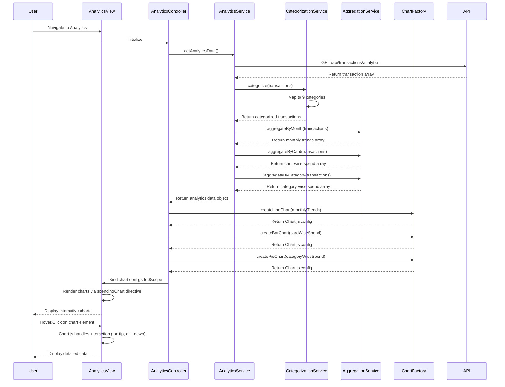

# Low-Level Design: QE-8349 - Spending Analytics and Insights

## a. Architecture Mapping

- **Analytics Module** → AngularJS Module (`app.analytics`)
- **Analytics Controller** → AngularJS Controller (`AnalyticsController`) - Manages analytics view and chart interactions
- **Analytics Service** → AngularJS Service (`AnalyticsService`) - Aggregates and prepares chart data
- **Categorization Service** → AngularJS Service (`CategorizationService`) - Categorizes transactions into 9 predefined categories
- **Chart Factory** → AngularJS Factory (`ChartFactory`) - Integrates with Chart.js or D3.js for rendering
- **Aggregation Service** → AngularJS Service (`AggregationService`) - Aggregates transaction data by month, card, and category

**Recommended Folder Structure:**
```
app/
├── modules/analytics/
│   ├── analytics.module.js
│   ├── analytics.controller.js
│   ├── analytics.html
├── services/
│   ├── analytics.service.js
│   ├── categorization.service.js
│   ├── aggregation.service.js
├── factories/
│   ├── chart.factory.js
├── directives/
│   ├── spending-chart.directive.js
├── models/
│   ├── analytics.model.js
```

## b. Component Specifications

| Component Name | Artifact Type | Responsibility | Key Dependencies |
|----------------|---------------|----------------|------------------|
| AnalyticsController | Controller | Manages analytics view, handles chart type selection, coordinates data aggregation | AnalyticsService, $scope |
| AnalyticsService | Service | Orchestrates data flow from transaction repository through categorization and aggregation | CategorizationService, AggregationService, $http, $q |
| CategorizationService | Service | Maps transactions to 9 predefined categories (Food & Dining, Fuel, Shopping, Travel, Entertainment, Utilities, Healthcare, Education, Miscellaneous) | None |
| AggregationService | Service | Aggregates transaction data by month, card, and category; returns chart-ready datasets | None |
| ChartFactory | Factory | Wraps Chart.js library; provides methods to create line, bar, and pie charts with responsive config | Chart.js library |
| spendingChart | Directive | Renders interactive charts with drill-down capability; handles chart interactions | ChartFactory |

## c. Data Model

**Analytics Data Model:**
```javascript
{
  monthlyTrends: Array<{month: String, totalSpend: Number}>,
  cardWiseSpend: Array<{cardId: String, cardName: String, totalSpend: Number}>,
  categoryWiseSpend: Array<{category: String, amount: Number, percentage: Number}>,
  period: {startDate: Date, endDate: Date}
}
```

**Category Model:**
```javascript
{
  categoryId: String,
  categoryName: String (one of 9 predefined categories),
  totalAmount: Number,
  transactionCount: Number,
  percentage: Number
}
```

## d. Data Flow

User navigates to analytics view → AnalyticsController calls AnalyticsService.getAnalyticsData() → AnalyticsService fetches transaction data from `/api/transactions/analytics` endpoint → CategorizationService.categorize() maps each transaction to one of 9 predefined categories → AggregationService.aggregateByMonth() groups transactions by month and sums amounts → AggregationService.aggregateByCard() groups by cardId and sums amounts → AggregationService.aggregateByCategory() groups by category and calculates percentages → Aggregated data is returned to controller → Controller passes data to ChartFactory → ChartFactory generates Chart.js configuration objects → spendingChart directive renders interactive charts (line for monthly trends, bar for card-wise, pie for category-wise) → User interacts with chart (hover, click) → Chart updates with sub-200ms response via Chart.js animation config.

## e. Primary Sequence Diagram



## f. Implementation Notes

- Use AngularJS DI to inject AnalyticsService and ChartFactory into AnalyticsController
- Integrate Chart.js library via CDN or npm; configure responsive: true and animation duration: 200ms for sub-200ms interactions
- Implement ES6 Map/Reduce functions in AggregationService for efficient data aggregation
- Use AngularJS $q.all() to parallelize multiple aggregation operations if needed
- Leverage Bootstrap grid (col-md-4) for responsive chart layout; ensure charts resize with window using Chart.js responsive config

## g. Error Handling

HTTP interceptor captures API errors; display user-friendly error messages using Bootstrap alerts; fallback to empty state with "No data available" message.

## h. Security Notes

Standard input validation and secure API calls assumed; analytics data aggregated server-side to prevent exposure of individual transaction details.